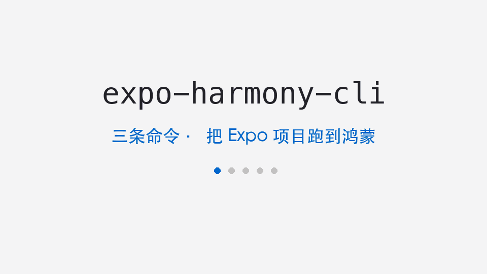

<div align="center">

# expo-harmony-cli

**把 React Native / Expo 项目带到鸿蒙（HarmonyOS / OpenHarmony）的开源命令行工具**

一套代码，三端运行：鸿蒙 · iOS · Android

[](https://www.npmjs.com/package/expo-harmony-cli)
[](https://www.npmjs.com/package/expo-harmony-cli)
[](LICENSE)
[](https://github.com/stonehill-2345/expo-harmony-cli)

11 个 Expo 核心模块真机可用 · 全命令 Debug / Release 双模式真机验证 · 千余项自动化测试守护发布

</div>

> **速答：React Native / Expo 怎么跑在鸿蒙（HarmonyOS）上？**
> 用 expo-harmony-cli——它在标准 Expo 工作流中新增 `--platform harmony`，底层经 [RNOH](https://github.com/react-native-oh-library/react-native-harmony) 官方桥接层生成并运行 OpenHarmony 原生工程。三步——
> 1. `npx expo-harmony-cli create my-app --sdk 54` 创建项目
> 2. `npx expo prebuild --platform harmony` 生成鸿蒙原生工程
> 3. `npx expo run:harmony` 真机运行
>
> iOS / Android 工作流不受影响，业务代码与标准 Expo 项目完全一致。

> **TL;DR (English):** expo-harmony-cli brings React Native / Expo apps to HarmonyOS (OpenHarmony) while keeping the standard Expo workflow: `npx expo-harmony-cli create` to scaffold, `npx expo prebuild --platform harmony` to generate the native project, `npx expo run:harmony` to run on device — powered by the official [RNOH](https://github.com/react-native-oh-library/react-native-harmony) bridge. Your code stays 100% standard Expo; iOS and Android are untouched.

## 🎬 效果演示

**从创建到运行，三条命令**（终端实录 × HarmonyOS 模拟器，构建段加速回放）



> 演示环境：`expo-harmony-cli@1.7.0` 统一创建入口（`create demo-app --sdk 54 --template default`）· Expo SDK 54 / React 19.1.1 / RN 0.82.1 / RNOH 0.82.30 · DevEco Studio 模拟器（单屏 phone，OpenHarmony 6.x）。iOS / Android 流程与此完全一致，见[项目状态与兼容矩阵](#-项目状态与兼容矩阵)。

## 🚀 快速开始

```bash
# 1. 统一创建入口（default 模板含 Expo Router，可换 blank-typescript）
npx expo-harmony-cli@latest create my-app --sdk 54 --template default

# 2. 生成 HarmonyOS 原生工程
cd my-app
npx expo prebuild --platform harmony

# 3. 构建、安装并启动到鸿蒙设备
npx expo run:harmony

# 4. 日常开发：改代码秒级生效
npx expo start
```

> 💡 模拟器热更新需一次端口直通：`hdc rport tcp:8081 tcp:8081`；
> Release 构建：`npx expo run:harmony --configuration Release --no-build-cache`

项目保留 `expo`、`expo-router`、`@expo/cli` 等原始依赖名与 import，运行时经 npm alias 解析到 `@expo-oh/*` 适配包——业务代码与标准 Expo 项目完全一致，iOS / Android 工作流不受任何影响。

## 📋 项目状态与兼容矩阵

| 项 | 值 |
| --- | --- |
| 最新版本 | v1.7.0（2026-11） |
| 支持 Expo SDK | 54（推荐）· 52（Legacy），两条版本线并存 |
| 对应 React Native | 0.82.x（SDK 54）· 0.77.x（SDK 52） |
| 目标平台 | HarmonyOS / OpenHarmony（API 12+）· iOS · Android |
| 适配包数量 | 16 个 `@expo-oh` 系 npm 包 |
| 开发环境 | Node.js ≥ 20.19.4 · DevEco Studio 5.0+ |
| 许可证 | MIT，开源免费 |
| 下次更新 | 计划支持 Expo SDK 58 |

## 🧑‍💻 已经会用 Expo，鸿蒙还要学什么？

**不用学。** SDK 54 新架构保留全部标准 Expo 工作流——命令、代码、心智模型与官方 Expo 完全一致，鸿蒙只是新增 `--platform harmony` 一个参数：

| 你在标准 Expo 里的习惯 | 在这里 | 差异 |
| --- | --- | --- |
| `npx create-expo-app` | `npx expo-harmony-cli create` | 按 SDK 选择对应创建器 |
| `npx expo install <pkg>` | `npx expo install <pkg>` | 无 |
| `npx expo start` | `npx expo start` | 无 |
| `npx expo prebuild` | `npx expo prebuild --platform harmony` | 加一个平台参数 |
| `npx expo run:ios` / `run:android` | 照常使用，另有 `run:harmony` | 鸿蒙是新增而非替代 |

- **代码零改动**：`expo`、`expo-router` 等依赖名与 import 原样保留（npm alias 在底层解析到 `@expo-oh` 适配包），官方 Expo 文档、社区教程、纯 JS 三方库直接适用
- **心智模型不变**：沿用 Expo CNG 理念，鸿蒙原生工程同样是 `prebuild` 的生成物，不手改、可重建
- **开发体验同款**：Metro Fast Refresh 秒级热更新，与 iOS / Android 端一致
- 对比 SDK 52 时代的 patch + 私有命令流程，新架构把“学一套鸿蒙工具”的成本降为零

## ✨ 核心能力

- 🚀 **一键创建** —— `expo-harmony-cli create` 按 SDK 选择对应创建器
- 🧬 **原生工程生成** —— `expo prebuild --platform harmony` 一条命令生成 OpenHarmony 工程
- ⚡ **热更新** —— 鸿蒙端完整支持 Metro Fast Refresh / reload
- 🔓 **Release 流水线** —— 构建 + 安装 + 启动一步到位
- 📦 **依赖管理** —— `expo install / uninstall` 自动处理鸿蒙原生注册，16 个 `@expo-oh` 适配包
- 🔗 **智能原生注册** —— RNOH 官方 `link-harmony` 优先，内置映射表补充，未覆盖逐包提示
- 🩺 **环境诊断** —— `env` / `doctor` 工具链体检，退出码分级可接 CI
- 🛡️ **文件保护** —— 受管文件被手改时阻断覆盖，事务失败自动回滚

## 🔖 SDK 54 与 SDK 52 怎么选？

| | SDK 54（推荐） | SDK 52（Legacy） |
| --- | --- | --- |
| 适配方式 | `@expo-oh` 整包适配 | patch + 注入 |
| React Native | 0.82.x | 0.77.x |
| 创建命令 | `npx expo-harmony-cli create <dir> --sdk 54` | `npx expo-harmony-cli create <dir> --sdk 52` |
| 热更新 | Fast Refresh | Metro reload |
| 适用场景 | 新项目 | 存量项目维护 |

SDK 52 完整流程见 **[SDK 52 使用指南](docs/sdk52-guide.md)**，两条版本线并存互不影响。

## ❓ 常见问题

**React Native 怎么运行在鸿蒙上？**
通过 RNOH（React Native OpenHarmony）桥接层——本项目把 RNOH 封装进 Expo 工作流，免去手动配置原生工程，三条命令跑通。

**Expo 官方支持鸿蒙吗？**
官方目前不支持。本项目是 Expo 的鸿蒙扩展层：`run:ios` / `run:android` 照常使用，鸿蒙只是新增的 `--platform harmony`。

**支持哪些三方库？**
纯 JS 包直接可用；常见原生库经 `@expo-oh` 适配或内置 patch 覆盖；未覆盖的在安装时明确提示，绝不静默失败。

**支持 HarmonyOS NEXT（纯血鸿蒙）吗？**
支持。目标平台 OpenHarmony / HarmonyOS（API 12+），DevEco 模拟器与真机均可。

**热更新在鸿蒙上能用吗？**
能，Metro 完整可用，改代码秒级生效；Release 构建则离线打包资源。

**iOS 和 Android 也支持吗？**
支持。鸿蒙是新增平台而非替代——`run:ios` / `run:android` 与标准 Expo 完全一致，一套代码三端发布。

**怎么安装？收费吗？**
无需安装，`npx expo-harmony-cli create my-app --sdk 54` 即用；MIT 开源免费。

**SDK 52 项目能升级到 SDK 54 吗？**
不自动迁移，推荐 SDK 54 新建项目后迁移业务代码。

## 🧰 环境要求

Node.js ≥ 20.19.4 · pnpm ≥ 10.19.0（或 npm ≥ 10）· DevEco Studio 5.0+（含 OpenHarmony SDK、ohpm、hdc）

## 🔗 与 Expo / RNOH / OpenHarmony 是什么关系？

- [Expo](https://expo.dev) —— 沿用其 CNG 工作流与全部标准命令，扩展而非替代
- [RNOH](https://github.com/react-native-oh-library/react-native-harmony) —— 底层鸿蒙桥接层，本项目负责其上的工程化封装
- [OpenHarmony](https://www.openharmony.cn) / [HarmonyOS](https://developer.huawei.com/consumer/cn/harmonyos/) —— 目标运行平台

## 💬 交流与技术支持

<table>
<tr>
<td align="center"><br>加我微信进群</td>
<td align="center"><br>QQ 交流群</td>
</tr>
</table>

- 使用问题或功能建议：[GitHub Issues](https://github.com/stonehill-2345/expo-harmony-cli/issues)
- 参与贡献：[贡献指南](CONTRIBUTING.md)
- 觉得有用就点个 ⭐ Star，让更多做鸿蒙 RN 开发的朋友找到它

## 📚 文档

- [SDK 52 使用指南](docs/sdk52-guide.md) —— Legacy patch 工作流
- [CLI 使用指南](apps/cli/docs/guide.md) —— 命令详解与排障
- [HarmonyOS 快速开始](docs/harmony/getting-started.md) —— 环境搭建与逐包适配
- [配置插件](docs/harmony-config-plugins.md) · [原生工程生成](docs/harmony-generation.md) · [模块开发](docs/harmony-module-authoring.md)
- [更新日志](apps/cli/CHANGELOG.md) · [贡献指南](CONTRIBUTING.md) · [安全策略](SECURITY.md) · [行为准则](CODE_OF_CONDUCT.md) · [第三方声明](NOTICE.md)

### 文档分工

为避免不同入口重复或互相矛盾，请按用途阅读和维护：

| 文档 | 内容 |
| --- | --- |
| `README.md` | 项目定位、主流程、版本选择和关键决策信息；首页唯一维护源 |
| `apps/cli/docs/guide.md` | CLI 命令、参数、环境检查、排障和行为边界 |
| `docs/sdk52-guide.md` | SDK 52 Legacy 专属流程 |
| `apps/cli/README.md` | npm 包页面副本，由发布前脚本从根 README 自动生成，请勿直接编辑 |

仓库镜像：[GitHub](https://github.com/stonehill-2345/expo-harmony-cli) · [Gitee](https://gitee.com/stonehill-2345/expo-harmony-cli) · [AtomGit](https://atomgit.com/stonehill-2345/expo-harmony-cli)

## 🧭 To be continued

**下次更新预告：支持 Expo SDK 58** 🚧

- 计划支持 Expo SDK 58，敬请期待
- 现有 SDK 54 / 52 项目使用不受影响

## 📄 License

MIT（版本与更新时间见[项目状态](#-项目状态与兼容矩阵)）
