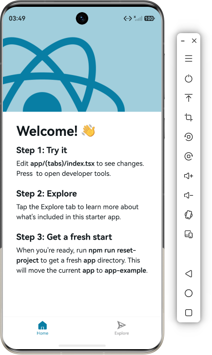

# expo-harmony-cli

使用 Expo 工作流，一套 React Native 代码同时运行在 **HarmonyOS（鸿蒙）、iOS、Android** 三端。

**English TL;DR** — `expo-harmony-cli` adds **HarmonyOS / OpenHarmony as a first-class target platform to Expo and React Native**: create a project with one command, generate the OpenHarmony native project (`expo prebuild --platform harmony`), then build and run on HarmonyOS devices (`expo run:harmony`) with full Expo CNG workflow, autolinking, Metro HMR (Fast Refresh), and a Release pipeline. Supports **Expo SDK 54** (RN 0.82 / RNOH 0.82, whole-package adaptation) and **Expo SDK 52** (RN 0.77 / RNOH 0.77, patch-based, see [SDK 52 guide](docs/sdk52-guide.md)). If you are looking for how to run React Native on HarmonyOS with Expo tooling — this is it.

<p align="center">
  <a href="https://www.npmjs.com/package/expo-harmony-cli"></a>
  <a href="https://www.npmjs.com/package/expo-harmony-cli"></a>
  <a href="https://github.com/stonehill-2345/expo-harmony-cli/blob/main/LICENSE"></a>
  <a href="https://github.com/stonehill-2345/expo-harmony-cli"></a>
</p>

## 效果演示

**从创建到真机运行（加速演示）**

[](docs/assets/video-overview.mp4)

**Fast Refresh：改代码，秒级生效**

[](docs/assets/video-fast-refresh.mp4)

**Tabs / Modal / 导航（Expo 默认模板原样运行）**

[](docs/assets/video-ui-tour.mp4)

<p align="center"></p>

## 快速开始（SDK 54，推荐）

```bash
# 1. 创建项目（default 模板含 Expo Router；也可 --template blank-typescript）
npx @expo-oh/create-expo@latest my-app --template default

# 2. 生成 HarmonyOS 原生工程
cd my-app
npx expo prebuild --platform harmony

# 3. 构建、安装并启动到鸿蒙设备/模拟器
npx expo run:harmony

# 4. 日常开发：启动 Metro，JS 改动即时生效
npx expo start
```

> 模拟器上使用 Metro 热更新需做一次端口直通：
> `hdc rport tcp:8081 tcp:8081`
>
> 干净的 Release 构建：`npx expo run:harmony --configuration Release --no-build-cache`

项目保留 `expo`、`expo-router`、`@expo/cli` 等原始依赖名与 import，运行时通过 npm alias 解析到 `@expo-oh/*` 鸿蒙适配包——业务代码与标准 Expo 项目保持一致，iOS/Android 工作流完全不受影响。

**SDK 52 用户**：legacy patch 流程见 [SDK 52 使用指南](docs/sdk52-guide.md)。

## 核心能力

| 能力 | 说明 |
| --- | --- |
| 🚀 **一键创建** | `@expo-oh/create-expo` 创建即含鸿蒙支持；SDK52 用 `npx expo-harmony-cli <dir> --sdk 52` |
| 🧬 **原生工程生成** | `expo prebuild --platform harmony` 生成 OpenHarmony 工程、Metro 配置与 RNOH 依赖 |
| 📦 **依赖管理** | SDK54 声明式整包适配（`@expo-oh/*`）；`expo install/uninstall` 自动处理鸿蒙原生注册 |
| 🔗 **智能原生注册** | 官方优先：优先调用 RNOH 官方 `link-harmony`，内置映射表补充，未覆盖逐包提示 |
| ⚡ **热更新** | 鸿蒙端完整支持 Metro Fast Refresh / reload |
| 🔓 **Release 流水线** | `expo run:harmony --configuration Release` 一条命令完成构建、安装、启动 |
| 🩺 **环境诊断** | `env` / `doctor` 命令：工具链检查 + 项目健康诊断，退出码分级可接入 CI |
| 🛡️ **文件保护** | 受管文件被手动修改时阻断覆盖，事务写入失败自动回滚 |
| 🔄 **Expo 兼容** | `expo run:android` / `run:ios` 照常使用，鸿蒙只是多出来的 `--platform harmony` |

## 环境与支持范围

| 项 | 要求 / 基线 |
| --- | --- |
| Node.js | ≥ 20.19.4 |
| pnpm / npm | pnpm ≥ 10.19.0 / npm ≥ 10 |
| DevEco Studio | 5.0+（含 OpenHarmony SDK、ohpm、hdc） |
| Expo | **SDK 54**（Expo 54.x，推荐）或 SDK 52（Expo 52.x） |
| React Native | 0.82.x（SDK 54）或 0.77.x（SDK 52） |
| RNOH | 0.82.x（SDK 54）或 0.77.x（SDK 52） |
| iOS 构建 | 遵循对应 Expo SDK 官方要求 |

## 与 Expo 标准工作流的关系

`expo-harmony-cli` **不是 Expo 的替代品**，而是 Expo 的 HarmonyOS 扩展层：

- ✅ 沿用 Expo CNG（配置驱动、随时重建原生工程）
- ✅ 鸿蒙与 Android/iOS 统一使用 8081 端口 Metro
- ✅ 鸿蒙构建可通过 CLI 直达，也可在 DevEco Studio 中打开 `harmony/` 调试

## 常见问题

**Q：怎么让 React Native / Expo 跑在鸿蒙上？**
用本项目：`npx @expo-oh/create-expo` 创建项目 → `expo prebuild --platform harmony` 生成鸿蒙工程 → `expo run:harmony` 运行。底层基于 RNOH（React Native OpenHarmony）桥接。

**Q：和直接用 RNOH 有什么区别？**
RNOH 是鸿蒙桥接层；本项目在其上封装了 Expo 工作流：一条命令完成工程生成、依赖适配、原生注册、构建安装，免去手动配置原生工程。

**Q：支持哪些三方库？**
纯 JS 包直接可用；常见原生库经 `@expo-oh` 适配或内置 patch 覆盖；未覆盖的会在安装时明确提示。SDK52 依赖分类见 `expo-harmony-cli list`。

**Q：SDK52 项目可以升级到 SDK54 吗？**
不自动迁移。推荐 SDK54 模板新建项目后迁移业务代码（详见 [SDK 52 指南](docs/sdk52-guide.md)）。

**Q：支持 HarmonyOS NEXT / 纯血鸿蒙吗？**
支持。目标平台为 OpenHarmony/HarmonyOS（API 12+），DevEco 模拟器与真机均可。

更多排障问题见 [CLI 使用指南](apps/cli/docs/guide.md)。

## 交流与技术支持

<p align="center">
  <table>
    <tr>
      <td align="center"><br><sub>加我微信进群</sub></td>
      <td align="center"><br><sub>QQ 交流群</sub></td>
    </tr>
  </table>
</p>

- 使用问题或功能建议：[GitHub Issues](https://github.com/stonehill-2345/expo-harmony-cli/issues)
- 想参与贡献：见 [贡献指南](CONTRIBUTING.md)
- 如果这个项目帮到了你，随手点个 ⭐ Star，让更多做鸿蒙 React Native 开发的朋友找到它

## 文档

- [SDK 52 使用指南（Legacy）](docs/sdk52-guide.md)
- [CLI 使用指南](apps/cli/docs/guide.md)
- [HarmonyOS 快速开始与逐包说明](docs/harmony/getting-started.md)
- [配置插件](docs/harmony-config-plugins.md) · [原生工程生成](docs/harmony-generation.md) · [模块开发](docs/harmony-module-authoring.md)
- [CLI 更新日志](apps/cli/CHANGELOG.md) · [贡献指南](CONTRIBUTING.md) · [安全策略](SECURITY.md) · [行为准则](CODE_OF_CONDUCT.md) · [第三方声明](NOTICE.md)

## 仓库与链接

- npm：[expo-harmony-cli](https://www.npmjs.com/package/expo-harmony-cli)
- GitHub：[stonehill-2345/expo-harmony-cli](https://github.com/stonehill-2345/expo-harmony-cli)
- Gitee：[stonehill-2345/expo-harmony-cli](https://gitee.com/stonehill-2345/expo-harmony-cli)
- AtomGit：[stonehill-2345/expo-harmony-cli](https://atomgit.com/stonehill-2345/expo-harmony-cli)

## License

MIT
