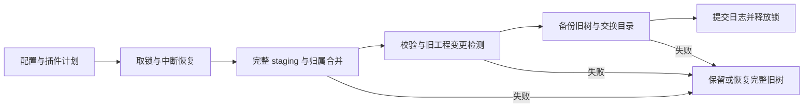

# Harmony 工程生成、归属与恢复

SDK54 的 `expo prebuild --platform harmony` 在同一文件系统的 staging 中生成完整工程，校验后交换 `harmony` 目录。版本、资源、JSON5、HAR、注册文件、调试地址和归属状态一起提交。



## 归属与普通生成

`harmony/.expo-harmony-state.json` 的 schemaVersion 为 1。`files` 以工程相对路径为键，记录上次期望内容的 SHA256、owner；JSON/JSON5 另记录上次期望的 JSON 值。该文件由生成器维护，不应手工修改。

JSON5 使用 parser 读取，输出为稳定排序的 JSON，保留字段语义，不保留注释和原排版。对象按字段三方合并；数组对象优先用 `name` 作为资源键，其余用规范化内容作为键。重复键明确报错。上次生成值、当前人工值和本次期望值不能同时兼容时，报告具体冲突位置并保留原工程。

普通生成保留用户文件和非受管 JSON 字段；失去最后有效引用的受管文件和条目才删除。传递依赖仍在有效模块图中时继续保留，共享权限同理。用户修改过的受管二进制或文本不会被静默覆盖。生成内容完全相同时不替换工程目录。

无状态的旧工程无法证明归属，首次迁移保守保留重叠用户值，并保存完整旧工程备份。确需全部按声明式配置重建时使用 clean，并检查备份。

## Clean 与恢复示例

```sh
npx expo prebuild --platform harmony --clean
```

命令提示重建范围，成功后输出 `.expo/harmony-backups/<事务 token>/harmony` 的备份路径。clean 从 app config 和插件重建，未声明的手工扩展只保存在备份中；工程目录外源码不参与删除。

恢复自定义文件时，将备份内需要的非受管文件复制回生成工程。恢复受管字段前，优先将修改迁到 app config 或 Harmony 插件；同一字段同时由配置和人工维护会触发冲突。需要恢复整个旧工程时，先停止生成和构建进程，将当前 `harmony` 改名留存，再将日志所示备份目录移回 `harmony`，然后核对配置和状态。

## 并发、中断与冲突

项目 `.expo-harmony-generation` 保存事务锁和日志。活进程持锁时第二个生成进程明确失败；不以超时抢锁。持锁 PID 被复用时也保守拒绝，确认进程状态后再处理，避免抢占仍存活的生成任务。

死进程留下的事务由下一次生成先恢复。提交前失败保留原工程；交换期间失败按日志恢复完整旧树。恢复发现当前工程已被人工修改时，保留事务与备份并报冲突，避免清除修改。不要在生成进程运行时删除锁或事务目录。

生成期间检测旧工程被编辑会拒绝提交。保存编辑、停止并行写入后重试。受管路径和模板内的软链被拒绝；非受管缓存软链按链接原样保留，不读取其目标。模块映射到相同生成目录也会在提交前拒绝。

## 兼容产物发行

RNOH、Screens、Worklets 的兼容转换在发行 staging 执行。Core 携带 `harmony/released-compatibility/manifest.json`，记录转换种类、输入/输出 SHA256 与来源。消费只核验并复制匹配产物，不运行 Python、不修改 `node_modules`。未知输入或校验失败必须重新生成合规发行候选，不能在消费工程内补丁修复。

发行维护者使用 `prepare-npm-release.mjs --screens-archive <已核验上游tgz> --rnoh-har <输入HAR> --worklets-har <输入HAR> --output <新目录>`。输入必须匹配固定策略 SHA256；Screens 输入从完整性校验后的 tgz 取得。Python 只用于此发行 staging 步骤。随后运行 `verify-npm-release.mjs <候选目录>`，Core 缺兼容 bundle 时验证失败。

本说明不代表所有内置模块、真机运行或签名 Release 已完成验收；各阶段结论以冻结验收记录为准。
