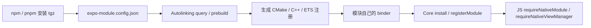

# Harmony 模块作者契约

基线：Expo SDK54、expo-modules-core 3.0.30、RNOH 0.82.30。本文描述现有公共 C++ API，不提供 Swift/Kotlin DSL 自动转换。

## 独立包接入

完整可打包示例：`packages/expo-modules-core/harmony/m3-fixture`。包名 `@expo-harmony/m3-author-fixture`，不属于发行中央名单。它提供自己的 RNOH Package、GlobalJSIBinder、TurboModuleFactory、真实 Fabric/ArkUI TextNode、ETS marker 和插件，不修改 CLI 或 EntryAbility。



配置声明 `platforms: ["harmony"]`，`harmony.kind` 为 `view` 或 `turbo-module`，`cpp` 包含 `packageClass/header/cmakeTarget/cmakePath`，`ets` 包含 `packageClass/importPath/entrypoint`。路径相对包根，ETS 入口显式 re-export Package。元数据只生成注册，不能替代真实原生实现。插件使用 `expo/harmony-config` 的 `defineHarmonyPlugin/withHarmonyModule` 修改模块 metadata。

如果 C++ 模块继承 `rnoh::ArkTSTurboModule`，ArkTS 包也必须通过 `getUITurboModuleFactoryByNameMap()` 注册同名 `UITurboModule` 工厂；即使业务方法由 C++ 实现，RNOH 创建模块时仍需要对应的 ArkTS 实例。

RNOH 的全局 JSI 绑定可能晚于 JS 首次求值。需要立即读取模块或视图配置时，应像示例一样提供同步安装方法，在读取之前调用；全局绑定后续执行时必须允许重复安装。

## 元数据优先级与命名

| 输入 | 处理规则 |
| --- | --- |
| Expo 配置显式声明 Harmony | 优先使用；缺失或非法 Harmony 元数据报错，不回退覆盖错误。 |
| Expo 仅声明其他平台 | 继续读取该包 `package.json` 的 `harmony.autolinking`。 |
| RNOH `true` / 对象 | 按 RNOH 约定解析 HAR、C++ 与 ETS；显式声明缺 HAR 即报错。 |
| RNOH `false` / `null` | 显式停用，不进入兼容表。固定 RNOH 0.82.30 宿主自身使用 `null`。 |
| 无声明的已知导航包 | 仅接受固定兼容版本；未知版本报出实际与期望版本。合法显式元数据优先于兼容表。 |
| 无声明的普通 JS 包 | 不生成原生注册。 |

`packageName` 保留应用安装时的逻辑名，`npmPackageName/npmPackageVersion` 保留实际 npm 身份，`har.packageName` 是独立的 OHPM 身份，`cpp/ets.packageClass` 是原生导出符号。这四者可以不同，不能靠字符串替换推导出彼此。多个逻辑别名指向不同根/版本的同一原生身份会被拒绝；允许 pnpm 包根链接，但拒绝文件路径逃出真实包根。

screens 的两个固定 npm 身份分别匹配：`@react-native-ohos/react-native-screens@4.9.0` 与 `@expo-oh/react-native-screens@4.9.1`。后者是当前冻结发行别名；两者使用相同原生映射，但不能互换版本或自动接受相邻版本。

多 HAR 以声明映射顺序优先，未映射项按稳定路径顺序补默认名；RNOH 推导结果首项为 primary，显式 Expo 多 HAR 必须准确声明唯一 primary。重复 basename、悬空或重复映射、重复 OHPM 身份均报错，不默默丢项。`rnoh-package` 的 C++ 与 ETS 路径相对 primary HAR 内部，源码包路径相对 npm 包根。

ETS 入口的实现放在入口目录下 `src/main/ets`，例如 `harmony/index.ets` re-export `./src/main/ets/AuthorFixturePackage`；这些文件会与入口一起进入生成的 OHPM 包。普通同级文件不自动打包成原生模块。CMake target、包类、生命周期变量/存储键、overlay/import 名冲突会在写入前报出双方来源；生成方法、关键字及会遮蔽导入/参数的局部名不可使用。

## 线程与生命周期

| API / 场景 | 作者必须遵守的契约 |
| --- | --- |
| `install/registerModule/registerViewConfig` | 在当前 runtime 的 JS 线程调用；每个 runtime 独立注册，同名模块或视图配置报错。不要用进程全局变量保存 JSI 值。 |
| 同步 HostFunction | 检查参数和 receiver，错误抛 `jsi::JSError`；JSI 值只在其所属线程访问。 |
| `startAsync` | 在 JS 线程启动，worker 仅捕获复制的数字、字符串、原生资源或弱引用。worker 返回的转换器才可在 JS 线程创建 JSI 值。 |
| 错误 | `NativeAsyncError(code,message)` 保留错误码；普通 native 异常按 Core 默认错误传播。 |
| `cancelAsync/CancellationSignal` | 取消是协作式；耗时循环主动检查 signal。取消/销毁会抑制迟到完成，不能期待取消后的 Promise 必然 resolve/reject。 |
| runtime 销毁/reload | 不捕获 runtime 指针、JS 函数或 JSI 对象进 worker；不得给新 runtime 投递旧回调。Core RuntimeState 管理待完成调用和资源。 |
| `mountNativeView/getNativeViewBinding` | 挂载绑定真实 native tag；异步只捕获弱 binding。UI 操作通过 taskExecutor 调度 MAIN，再 `resolveNativeView`。 |
| view 卸载 | wrapper 调用 `unmountNativeView`，旧 binding 永久失效；待完成读取拒绝 `ERR_VIEW_UNMOUNTED`，即使旧 tag 被复用也不得访问新实例。 |
| 事件 | 在 JS 线程调用 Core EventEmitter；JS 保留 subscription 并在 effect 清理或卸载时 `remove()`；重复 remove 必须安全。原生事件需注册 `onEvent` 配置与实际 binder。 |
| `SharedObject/SharedRef` | `attachSharedObject/getSharedObjectResource` 使用当前活 binding；release 后校验 receiver 并拒绝访问。SharedRef 允许原生外部所有者继续持有资源，不能因此恢复已释放的 JS binding。 |

线程调度、异步、资源和视图实现分别见 Core `ExpoModulesCoreRuntime.h`、`ExpoModulesCoreAsync.h`、`ExpoModulesCoreViewBinding.h` 及 fixture 的 C++ 文件。示例复用 `harmony/example/native` 已有的原生视图和 API 模式，源码自包含，不依赖 example 目录。

## 安装、调用、移除与重装

先按项目锁定的 SDK54 候选准备宿主；以下命令从仓库和应用各自根目录执行，包管理器不要混用。

```bash
# 仓库：真实产物，不发布 registry
npm pack ./packages/expo-modules-core/harmony/m3-fixture --pack-destination /tmp
# 应用 npm 项目
npm install /tmp/expo-harmony-m3-author-fixture-0.0.1.tgz
# 或在独立 pnpm 项目
pnpm add /tmp/expo-harmony-m3-author-fixture-0.0.1.tgz
```

```js
// app.config.js：保留既有配置并添加插件
module.exports = { expo: {
  plugins: ['@expo-harmony/m3-author-fixture'],
  // 此处沿用项目已有 harmony 配置
} };
// 应用入口：实际原生探针，无参数；成功后自动执行一次 RN reload
const { FixtureProbe } = require('@expo-harmony/m3-author-fixture');
export default FixtureProbe;
```

```bash
npx expo-modules-autolinking resolve --platform harmony
npx expo prebuild --platform harmony
npx expo run:harmony
hdc hilog > /tmp/m3-device.log
node node_modules/@expo-harmony/m3-author-fixture/check-device.cjs /tmp/m3-device.log
```

卸载时先从配置删除插件，并移除应用入口 import，再 `npm uninstall @expo-harmony/m3-author-fixture`（pnpm 用 `pnpm remove`），重新 prebuild。检查生成 CMake/C++/ETS 不再含 `rnoh_m3_author_fixture/AuthorFixturePackage`，模块 metadata 不再含 `expo.m3.author-fixture`。若其他依赖仍传递引用原生包，注册应保留到最终引用消失。只卸载包但保留插件会触发真实 config-plugins 解析错误，这是预期诊断。重装同一 tgz、恢复插件和入口后重新 prebuild，核对完整生成树恢复，不应编辑 node_modules。

## 验证边界

宿主命令 `node --test scripts/sdk54/__tests__/harmony-author-fixture.test.mjs` 验证真实 pack 内容、真实元数据解析及 checker 正反例，只证明工具链契约。

设备探针必须真实通过：同步值/异常、异步 resolve/带码 reject、重复退订、SharedObject release、真实 ArkUI props/事件/命令/读取、卸载时迟到读取拒绝、旧 ref 不访问重建视图；随后异步未完成时 reload，第二 runtime 重跑断言，日志包含取消的 worker 完成、失效视图读取和等待 2300ms 后的安静窗口。任何失败、缺项、旧 runtime callback 均不能通过 checker。

Pura 90 模拟器已通过 npm、pnpm 消费工程的探针及 reload 日志检查；阶段独立核查仍在进行。宿主正例日志是 checker 测试输入，不是设备证据。阶段状态见 `docs/releases/2026-10-28-sdk54-m3-author-contract-acceptance.md`。

边缘情况：重复注册需报错；非有限数值应由业务 API 拒绝；取消不等于 worker 立刻停止；无设备不算通过；异步线程不得持有 JSI；卸载后即使 tag 重用也要校验旧 binding；进程被杀或 marker 遗留时须使用新应用数据和完整双 runtime 日志重新执行探针。
