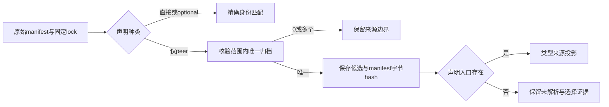

# SDK54 M0 声明消费与继承配置来源验收

日期：2026-10-23；run ID：`20261023-m0-source-provenance`；任务：M0-02/M0-03。

**M0仍未关闭，完成66%（4/6）。** 本批接通3份继承配置的固定来源，并增加声明消费的显式来源投影模式；653条原missing-exact-archive引用找到声明入口，3个原缺来源的导出候选补上声明位置。原13942导出、9312推断、202插件候选ID零丢失。来源投影没有证明安装身份、项目完整类型检查或Harmony运行，未据此接受M0-02/03。

## 每步实现与验收

| 步骤 | 实现与实际结果 | 结论 |
| --- | --- | --- |
| SP-01 | 新增`sourceProvenance`显式模式；发布者自身devDependencies不覆盖已声明的运行/peer消费条件。peer-only请求只接受唯一的已核验兼容归档，歧义/非法范围/精确依赖归档缺失均拒绝替代；传递配置只接受唯一可达身份 | PASS，契约先红后绿；原manifest字节hash、缺声明入口及type directive分别有独立失败测试 |
| SP-02 | 全图中create-expo-module两份、autolinking一份配置经各自expo-module-scripts依赖追到Node18 18.2.2固定归档；3份配置解析错误清零，依赖链、输入hash及未安装验收标记齐全。原275消费引用逐ID/源码保留，原来源队列阻塞49→48 | PASS，仅配置来源解析；完整项目类型与安装仍NOT_VERIFIED |
| SP-03 | 4390图输入重建103605类型；原导出/推断/插件无增减。47个推断候选解除图内边界，2个新暴露边界，净减少45；插件状态140/62保持。653条引用从缺精确归档变为有声明来源，3个导出补齐原缺失声明位置 | PASS，变化逐ID落表，不以类型数代替公共面完成 |
| SP-04 | 新语义图源重建正例及13类变异拒绝，项目来源正例及5类变异拒绝；默认exact重建前批88375类型结构图、86024类型legacy图及旧项目审计均一致。type directive修复后又以最新代码重建核对规范图一致 | PASS，混合集预期exit1；普通正例exit0 |
| SP-05 | 全工具467/467，catalog、repository、stage及diff检查通过；固定源码、归档、编译库、工具与证据独立hash复核 | PASS，详见evidence-verification.json |
| SP-06 | 完整公开API/属性/插件选项、来源身份、泛型实例、动态入口与消费关系退出条件 | BLOCKED，M0-02/03未接受，原分母保持 |

用例定义：`sdk54-m0-source-provenance-cases.json`；逐项实际结果：`outputs/sdk54/ai-e2e/20261023-m0-source-provenance/acceptance-results.json`；结构化摘要：`sdk54-m0-source-provenance-summary.json`。规范产物为证据目录内`semantic-final.json.gz`与`project-final.json`；`semantic-initial.json.gz`和首次失败日志保留，不作为最终结果。

## 来源选择与实际变化



736条请求选中了唯一peer归档，其中668条找到声明入口，68条仍缺入口。668条中653条原本为missing-exact-archive，另15条此前已有来源，本批改变的是其选择依据。因此不把736、668或新增类型数当作新增公开能力数量。

原1303条missing-exact-archive分解后为481条仍缺精确归档、94条无兼容peer、14条非法/非semver peer范围，653条取得来源，61条暴露归档内缺声明入口。全图未解析声明引用总计1881→1228，来源解析7390→8043；每个变化在coverage-audit.json记录消费路径与原/新状态。

3个导出来源变化分别为expo-linking的RNLinking默认导出，以及Expo的RNWebView/RNWebViewProps，原声明位置为空，新图追到已核验的React Native与react-native-webview声明。其余导出候选的原始来源位置保持，不把补来源伪装成新增API。

## 边缘情况与修改点

- **开发依赖与消费者不同**：发布者devDependencies只在没有对应运行/peer声明时沿旧精确规则分析。存在直接依赖时，不能用dev版本或兼容peer候选替代缺失的固定归档。
- **唯一不等于安装身份**：新peer来源记录manifest字段、原字节hash、候选身份/归档hash和`peer-source-projection-not-installed`；多版本不取最高版本，非法范围与无声明导入不借宿主包。
- **配置链不能择一猜测**：先检查所有可达身份，再匹配已核验归档；即使只下载了其中一个版本，只要依赖链存在两个身份仍阻塞。声明者已有直接依赖时不绕过其约束。3份新配置均保存两段原始manifest引用及安装未验收标记。
- **失败分支也保留依据**：全图首验发现“已选peer但缺声明入口”的记录会丢证据，已用独立失败测试修复；68条失败保留选择证据。type directive分支也补齐证据、边界及快照，独立红绿通过；最新源重建证明当前规范图未因该补充产生未核对差异。
- **hash必须指向原字节**：额外复现并修复了对重新JSON序列化结果求hash的问题；空格和换行不同的原manifest必须得到自身内容hash。
- **更多类型仍有分析预算**：类型88375→103605，直接边界9671→19685，其中16270个声明实例细节预算、2509个symbolic generic、449个未实例化结构操作、215个编译器错误、196个映射修饰符、43个其他泛型、2个any和1个unknown。边界增长是扩大可达类型后的实际结果，不能声称类型清单已完整。
- 模块边界2955→2878，18个隔离推断候选保持；34条消费身份、2条平台、6条相对目标、6条workspace入口仍阻塞。Router Modal源码缺口、模板实例化、原归档重复路径拒绝及完整公开面/插件消费问题均保留。
- 新模式由CLI`--context-selection source-provenance`选择，默认exact输出已实际重建兼容；项目来源审计使用`--source-provenance`。原生mod、设备及完整CLI产品流程本批NOT_RUN，工具通过不代替产品验收。

## 复核

```bash
node scripts/sdk54/m0-source-context.mjs --source /tmp/sdk54-expo-source --archives outputs/sdk54/ai-e2e/20261022-m0-source-context-complete/downloads --scope project-sources --config-archives outputs/sdk54/ai-e2e/20261023-m0-config-inheritance/downloads --type-operations structural --context-selection source-provenance --check outputs/sdk54/ai-e2e/20261023-m0-source-provenance/semantic-final.json.gz
node outputs/sdk54/ai-e2e/20261023-m0-source-provenance/verify-evidence.mjs
```

固定commit `5b42e3d21e0ac5e086752361ca8a5cb4de53bec1`、tree `5457e824b21d968e55c8f533cdf1751860160a92`；使用原233份声明归档及2份配置归档，不修改原始manifest或放宽归档结构约束。outputs及详细计划被忽略，仅本机保存。本批未提交、未发布。
