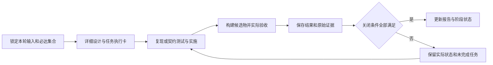
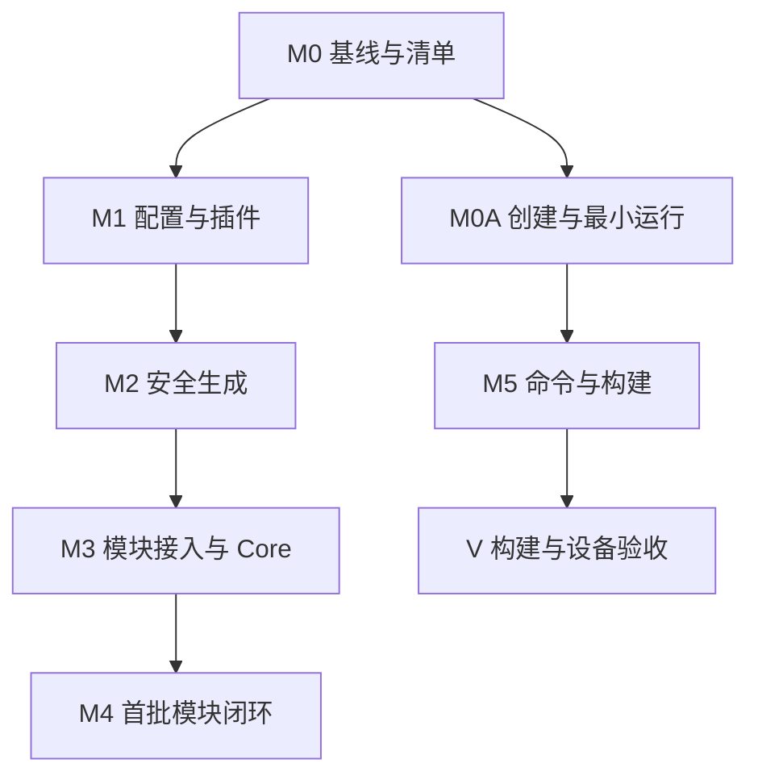
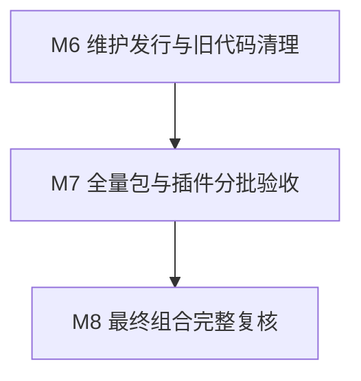

# SDK54 Harmony 新架构阶段开发与验收计划

日期：2026-10-21。
执行与验收约定更新：2026-10-22。
当前状态（2026-10-28）：M0、M0A、M1、M2、M3 已关闭；M2 验收见 [M2 验收](../../releases/2026-10-27-sdk54-m2-generation-acceptance.md)，M3 双包管理器消费、模拟器生命周期与独审结果见 [M3 验收记录](../../releases/2026-10-28-sdk54-m3-author-contract-acceptance.md)；M4～M8 与 V 尚未关闭。进度以 `../../releases/sdk54-stage-progress.json` 及证据 hash 校验为准，下列逐轮记录保留当时结论。

历史状态：2026-10-22 已实施[第一轮来源与包级索引验收](../../releases/2026-10-22-sdk54-m0-source-index-acceptance.md)与[第二轮六插件选项来源验收](../../releases/2026-10-22-sdk54-m0-plugin-surface-acceptance.md)。第二轮实际生成 83 输入、105 路径记录，PLG-01 至 PLG-10 通过，工具回归 262/262；当时仅完成 M0-02/03 子集合，M0-M8 均未关闭。本文各阶段的“预期验收结果”仍不是已经通过的结论。

2026-10-22 [第三轮插件入口与源码关系验收](../../releases/2026-10-22-sdk54-m0-plugin-index-acceptance.md)：141 workspace 扫描记录、41 包入口、308 输入，默认/版本化列表和22个 provider 已索引；IDX-01 至 IDX-09 通过，工具回归274/274。bare/dynamic 引用仍明确未解析，全部选项/API、差异范围与 M0-04/05/06 尚未完成；M0 仍未关闭。

2026-10-22 [第四轮文档/测试入口/误报基线验收](../../releases/2026-10-22-sdk54-m0-validation-baseline-acceptance.md)：M0-06完成，BASE-01至08通过；11组源码复现及CLI集成保留产品失败，15包测试入口索引和16组执行记录齐备，工具278/278。M0仍未关闭，完成33%（2/6，仅M0-01/06）；5组环境失败、2项原生/设备NOT_RUN不计产品通过。M0-02/03全量公开面、M0-04现状/SDK52回归、M0-05调用归属仍未完成。进度见 `../../releases/sdk54-stage-progress.json`，按冻结原任务等权、部分任务计0，阶段退出条件另核。
设计依据：[架构完成设计](../specs/2026-10-21-sdk54-architecture-completion-design.md)、[覆盖核查清单](../specs/2026-10-21-sdk54-platform-coverage-inventory.md)、[AI 端到端验证设计](../specs/2026-10-21-sdk54-ai-e2e-validation-design.md)。
2026-10-22 [第五轮旧代码归属与引用验收](../../releases/2026-10-22-sdk54-m0-ownership-acceptance.md)：M0-05完成，OWN-01至08通过；441文件、1763引用、48命令、8处动态依赖审阅，249共享保留/107待退出/29移交/56工具保留。工具283/283、CLI500/500、打包4/4与类型检查通过。M0仍未关闭，完成50%（3/6，仅M0-01/05/06）；M0-02/03全量公开面和差异范围、M0-04四项目现状及SDK52真实回归未完成。本轮调查未执行实际清理，后续M0A-04/M6-05另验收。

2026-10-22 [第六轮首批运行时API声明索引验收](../../releases/2026-10-22-sdk54-m0-runtime-api-acceptance.md)：8包80输入、38入口、367按入口导出记录、315声明、489语法成员；API-01至07通过，工具294/294、CLI500/500及类型检查通过。144外部/未解析类型与2处外部star明确保留，推断类型及完整语义未验收；仅M0-02/03子集，M0仍未关闭、完成50%（3/6），不增加接受单元。

2026-10-22 [第七轮配置类型与文档schema契约验收](../../releases/2026-10-22-sdk54-m0-config-contract-acceptance.md)：固定7输入、7接口、285类型字段路径、268 schema字段路径；54项差异逐条审阅，CFG-01至06通过。工具305/305、CLI500/500和类型检查通过，11类CLI篡改负例拒绝。文档根required未知，在线消费schema与Harmony执行未验收；仅M0-02/03子集，M0仍未关闭、完成50%（3/6），不增加接受单元。

2026-10-22 [第八轮CLI命令与参数声明索引验收](../../releases/2026-10-22-sdk54-m0-command-surface-acceptance.md)：34固定/35适配输入，18/19命令入口，223/234参数声明；14项差异逐条审阅，CMD-01至06通过。工具316/316、CLI500/500和类型检查通过，12类CLI篡改负例拒绝；prebuild悬空别名原样保留，命令/构建/设备行为未验收。仅M0-02/03子集，M0仍未关闭、完成50%（3/6），不增加接受单元。

2026-10-22 [第九轮当前CLI真实现状回放](../../releases/2026-10-22-sdk54-m0-current-baseline-acceptance.md)：本轮CLI1.6.0构建/TGZ隔离安装通过；四SDK54创建均180秒超时，两SDK52创建/识别/scan通过、prebuild因expo未安装失败。30产品步骤为10 PASS/10 FAIL/10 NOT_RUN，实际创建链5.0.0 wrapper→5.1.5 executor已取证；工具326/326、CLI500/500和类型通过。M0-04未接受，原生/设备未执行；M0仍未关闭、完成50%（3/6）。

2026-10-22 [第十轮SDK52安装与生成补验](../../releases/2026-10-22-sdk54-m0-sdk52-install-acceptance.md)：两源项目各59文件复制至新目录；npm因gesture-handler peer冲突失败，pnpm正常安装/postinstall、关键身份及首次46文件生成通过，重复prebuild按旧覆盖保护拒绝。独立Release JS打包因query-string无法解析失败；两个最小期望测试仍红，设备列表为空。工具333/333、CLI500/500及类型通过；M0-04未接受，M0仍未关闭、完成50%（3/6）。

2026-10-22 [第十一轮全workspace语法清单与基线集合核验](../../releases/2026-10-22-sdk54-m0-workspace-surface-acceptance.md)：141workspace+5模板、16939文件、3934生产模块，11928导出/20066声明/61032语法成员，源重建和重复gzip字节一致。M0-04按原M0-A03的调查对象接受，原产品失败及设备NOT_RUN保持，详见[独立接受报告](../../releases/2026-10-22-sdk54-m0-baseline-audit-acceptance.md)；此前将产品全过混作调查必要条件的判定已纠正，未改原定义。工具349/349、CLI500/500及类型通过。M0仍未关闭、完成66%（4/6）；M0-02/03仍缺全量公开面语义、动态/跨包/外部类型及42外部种子来源/范围复核，9646保守扫描缺口不作为公开API或支持数量。

2026-10-22 [第十二轮跨workspace导出符号图验收](../../releases/2026-10-22-sdk54-m0-export-graph-acceptance.md)：固定4088输入/3934模块，13684边、10010原始符号、13786按模块导出记录；10个workspace-star中8处源码拓扑展开、2处仍部分，7处external-star及1个缺入口保留。三份gzip字节一致，13项新契约、12类真实CLI负例通过；工具362/362、CLI500/500及类型通过。仅源码types投影与符号来源追溯，不证明推断属性、外部类型、发行或Harmony运行；M0-02/03仍未接受，M0仍未关闭、66%（4/6）。

2026-10-22 [第十三轮外部来源与Metro发布类型验收](../../releases/2026-10-22-sdk54-m0-external-sources-acceptance.md)：149固定Git输入，42项种子逐项来源/职责分批记录，23精确锁/5兼容候选/1范围不符/11缺锁/2无上游身份。固定Metro54.2.0归档SRI/SHA1通过，追ConfigT别名及220输入、228可达声明/1662语法成员/1111引用；外部与utility语义未展开。两清单重复一致、17类CLI负例、工具377/377、CLI500/500及类型通过；M0-02/03完整公开面仍未接受，M0仍未关闭、66%（4/6）。

2026-10-22 [第十四轮声明模块导出来源验收](../../releases/2026-10-22-sdk54-m0-ambient-modules-acceptance.md)：4088固定输入/146根，按包隔离99声明模块、20边、408符号/901按模块导出。原7处external-star中5处找到同包ambient声明来源、2处仍未解决；不改运行包身份或旧图结论。12项契约、13类CLI负例、gzip重复、工具389/389、CLI500/500及类型通过；M0-02/03公开面语义等缺口保留，M0仍未关闭、66%（4/6）。

2026-10-22 [M0剩余项合并交付验收](../../releases/2026-10-22-sdk54-m0-consolidated-acceptance.md)：按用户要求减少小轮次，将公开导出类型、推断候选、插件选项映射和总阻塞统一交付。13786导出候选、39162类型/40986属性/13037调用/465构造，原9312推断候选及202插件候选全部映射；40全局ambient文件隔离、18候选另留上下文边界。9份专项和265组来源调查队列统一追踪；单入口重复、1正例/16变异、16历史检查、工具405/CLI500/类型通过。原始完整清单条件不变，M0仍未关闭66%(4/6)，后续按来源上下文、类型插件、入口动态三工作包集中推进。

2026-10-22 [核心来源上下文合批验收](../../releases/2026-10-22-sdk54-m0-source-context-acceptance.md)：7份计划固定归档，React声明/Metro/undici-types共3份双hash核验接入281声明输入，新增1165条来源解析；RN/Node/csstype/virtualized-lists4份因审批服务用量阻断下载且无精确本机归档，CTX-01保持BLOCKED。全源45821类型/76564属性/14948调用/531构造，33推断候选解除类型边界、11暴露传递边界、18隔离保持；202插件候选状态保持。10项新契约、10快照变异和坏归档拒绝、工具415/CLI500/类型、17历史回归通过；默认模式仍重建前批产物。4PASS/1BLOCKED，M0仍未关闭66%(4/6)，原范围与接受记录不变。

2026-10-22 [精确锁来源合批验收](../../releases/2026-10-22-sdk54-m0-source-context-complete-acceptance.md)：审批已可用，原4份缺失归档全部补齐；将原265组队列中的可核验来源合批，233份原始tgz双hash通过、232份声明归档结构可用，39缺锁/7仅SHA1/1重复归档路径保留。7核心图63931类型；整批有限图86005类型/96024属性、13806导出含20条新来源，9312推断/202插件齐全。5396声明实例细节边界及2201泛型应用边界未接受；工具425/CLI500/类型、17历史、1正例/15变异及坏归档拒绝通过。4PASS/2BLOCKED，M0仍未关闭66%(4/6)，M0-02/03原退出条件和分母不变。

当前实际结果：[2026-10-21 基线验收记录](../../releases/2026-10-21-sdk54-architecture-baseline-acceptance.md)及上述逐轮报告。

2026-10-23 [项目来源上下文合批验收](../../releases/2026-10-23-sdk54-m0-project-context-acceptance.md)：原39组缺锁拆至275条消费引用，4391输入逐项来源审阅；132本地源码/13资源/47精确依赖链主分类，含配置阻塞的独立来源共65条精确链。补入65个应用实际引用源码，TS配置/别名/输出根映射接入，Speech按编译器输入追到真实源码。合并图13942导出，原13806零丢失、增136内部/应用候选；9312推断及202插件齐全，有限类型与项目配置边界保留。13专项、工具438/CLI500/类型、13来源及10语义变异拒绝、两旧图兼容通过。3PASS/2BLOCKED，M0仍未关闭66%(4/6)，未缩小原退出条件。

2026-10-23 [固定继承配置与剩余引用合批验收](../../releases/2026-10-23-sdk54-m0-config-inheritance-acceptance.md)：Node18/Node20两份原锁配置归档双hash及结构核验接入；全图项目配置边界2433→89，队列25→1，3份直接继承配置上下文仍有边界。补齐benchmarking目录包入口，14条模块模板引用绑定原始参数与固定文件名，剩余相对目标20→6；49条阻塞及14条模板逐项落表，Router的6条Modal入口缺口保留。13942导出、9312推断、202插件零丢失；工具442/442、12来源和10语义变异拒绝、两旧图兼容、仓库及阶段检查通过。5PASS/2BLOCKED，M0仍未关闭66%(4/6)，完整公开面/类型/插件契约条件保持。

2026-10-23 [插件选项与Router/Splash消费契约合批验收](../../releases/2026-10-23-sdk54-m0-plugin-contracts-acceptance.md)：固定4392输入，202个声明候选全部重建；173个可展开（84显式选项、89无显式参数），1091条选项路径，29个泛型/函数/不透明类型边界保留。Splash43条路径与旧清单一致；Router14条TS/31条schema路径、26项差异逐项绑定来源与用例，35处AST访问保留别名边界；原schema-utils/插件/getter及asyncRoutes消费函数切片共64例通过。工具450/450、源重建正例及16类变异拒绝、旧六插件兼容通过；4392源码/102工具快照/47证据/1历史索引hash封存核验。7PASS/2BLOCKED，原生mod/设备仍NOT_RUN，M0仍未关闭66%(4/6)，M0-02/03及原退出条件保持。

2026-10-23 [插件可调用类型与泛型关系合批验收](../../releases/2026-10-23-sdk54-m0-plugin-type-contracts-acceptance.md)：202候选全映射，447源码/manifest输入及100编译库，933类型/1676属性/118调用签名；条件两分支、索引访问、keyof、声明/基础约束与默认值保留。修复显式模式的别名参数覆盖元组槽位及32实例截断，红绿复现和40种具体实例通过；173候选无可达图内类型边界、29仍有边界，源码诊断另记，不作为Harmony支持或项目通过。工具456/456、原64契约、16类新图变异拒绝及三种旧产物重建兼容通过；新模式尚未迁移完整workspace。7PASS/2BLOCKED，M0仍未关闭66%(4/6)，原分母与M0-02/03退出条件保持。

2026-10-23 [全量workspace结构类型关系合批验收](../../releases/2026-10-23-sdk54-m0-workspace-type-operations-acceptance.md)：结构模式已接入全图构建与CLI显式参数，默认legacy保持兼容；88375类型、197条件/180索引访问/64keyof，13942导出/9312推断/202插件逐ID与来源零丢失、状态不变。工具458/458、源重建正例及16类变异拒绝、旧86024类型完整图重建通过；9671个直接类型边界和2955个模块边界保留。5PASS/1BLOCKED，M0仍未关闭66%(4/6)，未以新增关系或测试数增加原接受单元。

2026-10-23 [声明消费与继承配置来源合批验收](../../releases/2026-10-23-sdk54-m0-source-provenance-acceptance.md)：新增显式来源投影，3份继承配置经唯一固定依赖链接通，原49条来源队列阻塞剩48；653条原缺精确归档引用有声明来源，3个导出补齐原缺位置。全图103605类型，原13942导出/9312推断/202插件零丢失，47推断解除图内边界、2新暴露；1228条声明引用及19685直接类型边界仍在。工具467/467、13语义及5来源变异拒绝、3旧模式兼容、独立封存核验通过。5PASS/1BLOCKED，M0仍未关闭66%(4/6)，来源投影不认定安装或设备通过。

2026-10-23 [显式声明依赖与公开入口口径合批验收](../../releases/2026-10-23-sdk54-m0-declared-types-acceptance.md)：147新增归档双hash/结构核验、361声明根/226锁边、207显式映射；183条旧缺引用补来源、新暴露25，总未解析1228→1070。148975类型以4656校验分片保存，原13942导出/9312推断/202插件逐ID保留；5推断解除图内边界，插件状态保持。工具478/478、全源重建/10图变异拒绝、旧来源图重建及真实旧图字节一致；公开入口下界审计落盘，不能把所有源码候选边界或发布者开发树当作原M0退出条件。5PASS/1BLOCKED，M0仍未关闭66%(4/6)，公开字段覆盖/范围及真实来源缺口仍需裁决。

## 1. 交付边界与执行规则

- SDK54 起始组合为 React 19.1.1、RN 0.82.1、RNOH 0.82.30；固定 Expo 来源 revision，不跟随 latest 自动漂移。
- SDK54 最终从真实适配版 create 工具和模板创建，通过 Expo 标准命令开发；不调用 expo-harmony-cli，不在消费端修补源码/HAR，不以额外后处理补平台能力。
- scope、alias、overrides 可以作为模板及发行物的正式依赖身份；标准 install/升级可维护受管映射。经验证兼容的上游包可以直接复用。
- SDK52 维持现状；旧 SDK54 识别、补丁、诊断、兼容和迁移入口按调用关系清理，SDK52 共享能力必须保留。
- 仅设计中明确的 Expo Go/EAS、expo-updates、expo-dev-client 等范围暂缓；认证模块、普通 Debug 调试、Release 内嵌资源不得随之排除。
- 初始规划轮只编制计划和核查基线；2026-10-22 起按用户指令实施并逐步验收，未获提交或生产 registry 发布指令。
- 每阶段实施前形成对应详细设计和实施计划；新缺陷先添加可复现失败测试，再修复。新增契约先明确断言，再实现。
- M0 关闭后，依据实际全量条目、原生依赖和验证成本估算后续工作量；当前不按 14/15 包或 130 个种子条目承诺总工期。

### 状态与关闭规则

| 维度 | 取值及含义 |
| --- | --- |
| 阶段状态 | 未开始、进行中、待验收、已关闭；当前 M0-M8 均未关闭 |
| 用例结果 | PASS：本候选物实际通过；FAIL：实际执行失败；BLOCKED：必要前提缺失；NOT_RUN：尚未执行 |
| 实现状态 | 未评估、未完成、实现中、已实现待验收、已验收；存在源码不等于已验收 |
| 范围结论 | 本轮必达、明确暂缓；平台不适用另记依据、替代行为和复核结果，不能代替暂缓 |

阶段关闭须满足：必达任务交付、相应测试 PASS、真实发行物关联、适用的设备证据齐备、阶段报告可追溯。必达案例出现 FAIL/BLOCKED/NOT_RUN 均不能关闭。M4 显式转交 M7 的条目仍为未完成；M5 的 default 模块依赖缺口仍保留实际结果，不反向豁免 CLI 自身缺陷。

### 1.1 每轮执行契约

本总计划定义阶段目标；每轮开始前，AI 必须将选定任务展开为详细执行计划。每轮只覆盖明确的任务集合，不能以总计划中的一行任务直接替代实施步骤。详细设计保存为 `docs/superpowers/specs/YYYY-MM-DD-sdk54-<stage>-design.md`，执行计划保存为 `docs/superpowers/plans/YYYY-MM-DD-sdk54-<stage>.md`；M7 每批分别建档。



| 执行前必须锁定 | 要求 |
| --- | --- |
| 任务集合 | 本轮任务 ID、验收 ID、覆盖能力 ID、前置任务与转交依赖；一个任务可对应多个验收，但不能没有验收映射 |
| 输入身份 | Expo/create/模板来源、适配源码状态、覆盖清单 hash、已有报告；未提交修改另记相关文件清单与内容 hash，不能只写 HEAD |
| 修改范围 | 准确文件或模块、输入输出接口、生成/发行产物；待决定项先调查并写明决策，不能留占位值后直接进入对应编码 |
| 必达用例 | 从阶段契约展开准确用例及矩阵，写明操作、预期值、断言方法、超时和证据要求；执行前保存定义及 hash |
| 测试入口 | 按实际包声明准确命令、工作目录、前置环境及预期退出码；单元、消费安装与设备检查分别列出 |

用例定义不能由本次执行结果反向生成。删用例、改必达标记、改范围或放宽断言必须记录原因与差异并重新核查阶段契约；既有失败记录保留，不能靠改定义关闭。M0 的已知缺陷复现等调查任务，验收对象是“复现及记录正确”：可出现复现验收 PASS、产品行为仍 FAIL，必须分别记载并关联后续修复任务。

### 1.2 单任务执行卡模板

以下模板在详细计划中逐任务填写；占位内容必须在执行相应步骤前替换成核实值。复用现有工具时先核对当前职责与版本，不套用历史 SDK54 创建、patch 或图片替换流程。

```markdown
### <任务 ID>：<具体交付>
- 输入：<前置任务、来源/源码状态、清单与候选身份>
- 文件与接口：<新增/修改文件、输入输出、需同步的生成物>
- 验收映射：<验收 ID、能力 ID、用例 ID、矩阵维度>
- 操作与断言：<操作顺序、准确预期值、判定方法、超时>
- 命令：<工作目录、可执行文件及参数、预期退出码>
- 证据：<日志、差异、产物 hash、设备断言及输出路径>
- 退出条件：<本任务的必达集合和交付物>

- [ ] 先写缺陷复现或新增契约测试，记录预期失败及实际原因。
- [ ] 在声明范围内实施，同步源码、类型、构建和发行内容。
- [ ] 运行相关测试与实际消费/设备验收，保存每次尝试。
- [ ] 填写实际结果、遗留问题及是否允许关闭，关联本轮报告。
```

纯枚举、文档或调查任务按自身操作验证，不为勾选模板制造无意义的失败测试。缺少环境时记录实际预检和 BLOCKED；AI 应继续完成不依赖阻塞项的任务，并在报告中标明边界。后续执行遵循已获授权，不把旧文档的历史暂停点自动带入新任务。

## 2. 阶段顺序与交付节点

### 2.1 开发阶段：两条工作分支

左侧补齐配置、生成和模块能力；右侧交付创建入口、标准命令和构建门禁。图中只画各分支的推进顺序，跨分支前置条件见下表。



### 2.2 收敛阶段：维护、全量适配与最终验收

M4、M5 和对应 V 门禁均完成后，进入下面的交付链。



### 2.3 跨分支前置条件

| 阶段/工作 | 必须具备的前置条件 |
| --- | --- |
| M0A | M0 来源与依赖身份固定；最小验证设施可用。创建链路若需要 M1-M3 的具体能力，先交付对应条目 |
| M5 | M0A 最小运行与 M2 安全生成已交付；不能只按右侧分支顺序直接推进 |
| M6 | M4 必达项、M5 必达项及对应 V 门禁全部通过 |
| M7 | M6 完成，M0A 的真实创建入口已交付；按批次关闭全量适用条目 |
| M8 | 所有前置阶段及本轮必达条目关闭；最终候选组合固定 |
| V 验证设施 | 从 M0/M0A 开始分期建设，贯穿 M1-M7；图中的 V 节点专指 M5 构建与设备门禁，不是验证设施的开工点 |

M0A 不等待 M5 才具备最小 prebuild/run/start。M1-M3 可与创建工具工作交错实施；每个交付节点均独立产出候选物和报告。

### 2.4 各节点交付结果

| 节点 | 结束时可见结果 | 不代表已完成 |
| --- | --- | --- |
| M0 | 可核验的全量清单、SDK52 基线、源码和旧代码归属 | 任何新增平台能力 |
| M0A | blank 从真实适配 create 直接创建并连接 Metro 运行 | default 全功能、复杂运行场景 |
| M1-M3 | 动态配置、第三方插件、安全生成及陌生模块接入 | 全部 Expo 模块/API |
| M4 | 首批模块必达能力在设备闭环 | 显式转交 M7 的条目 |
| M5 + V | blank 两种包管理器的标准命令、Debug/Release 和冷启动 | 尚缺模块的 default 全链路 |
| M6 | 新方案支持组合可维护，SDK54 旧入口清理且 SDK52 回归 | 全量模块覆盖 |
| M7 | 固定来源全量评估、本轮适用项分批验收 | 暂缓能力已支持 |
| M8 | 最终发行组合四项目、八构建运行案例完整通过 | Expo Go/EAS/Updates/Dev Client 交付 |

2026-10-23 [公开入口与声明引用账本合批验收](../../releases/2026-10-23-sdk54-m0-public-surface-acceptance.md)：146包/629入口/3959模块全处置；npm-packlist固定树发行规则投影、352552成员/540442类型边/144401声明与70250声明使用关系齐备，原13942导出/9312推断/202插件保留。上游及账本重建、完整重复SHA256一致、13变异和真实CLI漏入口非零拒绝、553工具用例通过。真实build优先、declarationDir、内部别名链、共享对象及声明库集合绕过均有红绿修复。公开面范围、实际公开字段和种子逐项结论仍BLOCKED；M0仍未关闭66%(4/6)，不以账本数量增加接受单元。

## 3. M0：全量清单与固定基线

2026-10-27 [种子范围与入口义务裁决验收](../../releases/2026-10-27-sdk54-m0-scope-decisions-acceptance.md)：13项种子范围裁决完成，13项历史身份仍未验证；6具体BLOCKED逐包绑定固定manifest，区分5隐式probe与1显式main缺口，不升级target。全部16个非inputs表分片保持，原16666输入不变、仅增7条证据；工具654/654，独立10项变异拒绝，默认/重复字节一致、来源check及真实CLI删裁决非零拒绝。上批封存摘要含绝对路径导致仓库门禁FAIL，如实保留；本批新摘要使用相对路径并在写出后重查。M0仍未关闭66%(4/6)，typeRoots隔离、类型预算/错误及来源边界未关闭。

2026-10-27 [通配公开入口完整性验收](../../releases/2026-10-27-sdk54-m0-export-patterns-acceptance.md)：显式fixed-v1补齐10家族/274候选/274既有子入口的双向来源证据；原7表ID零丢失，所有原入口target不变。独立TypeScript emit及Git tree对照、工具回归、17变异、公开重复/来源check和真实CLI删child拒绝通过。8个BLOCKED家族为哨兵，另6个具体入口缺目标；上游语义产物仅复用，不宣称重建或类型缺口减少。M0仍未关闭66%(4/6)。

2026-10-27 [消费者typeRoots隔离验收](../../releases/2026-10-27-sdk54-m0-type-root-isolation-acceptance.md)：显式consumer-v1按有效配置建立独立Program/checker与类型命名空间；历史194及当前212使用全部绑定到授权声明，17表索引和分片、原target及16673输入不变。2上下文/333类型，84诊断及全部使用边界保留；三斜线types/path/lib加载缺失不受skipLibCheck隐藏。36专项/core、工具669/669、独立审查、默认/重复字节一致、来源check及删context真实CLI拒绝通过；逐hash封存结论见本批evidence-verification.json。旧仓库摘要绝对路径FAIL只读保留。M0仍未关闭66%(4/6)，历史身份、共享类型错误/预算和来源边界仍需关闭。

前置：当前仓库及三份关联设计可读取；完整来源缺失时只登记缺口，不能关闭本阶段。

| 任务 ID | 开发工作与交付物 | 主要落点 |
| --- | --- | --- |
| M0-01 | 核对 Expo revision `5b42e3d21e0ac5e086752361ca8a5cb4de53bec1` 的实际 SDK54 workspace；另行固定 create 工具、模板来源及版本 | `scripts/sdk54/catalog.mjs`、来源/provenance 记录 |
| M0-02 | 从 workspace、模板、版本目录、插件导出、类型和公共 API 生成结构化清单；逐项稳定 ID、源码位置、依赖、批次和范围 | `docs/superpowers/specs/2026-10-21-sdk54-platform-coverage-inventory.md`；结构化载体在详细设计确定 |
| M0-03 | 实现双向完整性校验：漏包、漏 API/属性/选项、重复 ID、悬空依赖、缺来源均报错；展开 Splash 嵌套类型、Router 类型/schema 差异 | `scripts/sdk54/` 中的清单生成与验证工具，待新增 |
| M0-04 | 记录两模板 × npm/pnpm 的现有行为和真实发行身份；建立 SDK52 识别、创建、运行及共享能力回归基线 | `apps/cli/src/commands/`、`apps/cli/src/sdk54/`、现有测试与发行记录 |
| M0-05 | 按调用图逐文件分类：SDK54 专属删除、SDK52 共享保留、新方案有效能力移交；列出脚本/CI/内容库/构建引用 | `apps/cli/`、`scripts/sdk54/`、根脚本与 workflow |
| M0-06 | 对齐 Core 旧文档；建立 CLI/Autolinking/Core/Metro/模块测试矩阵；为版本区间误报补最小失败测试 | Core README、各包测试入口、`checkPackages` 相关测试 |

| 验收 ID | 操作 | 预期验收结果 |
| --- | --- | --- |
| M0-A01 | 对固定来源重复枚举，再故意删除一条公开能力记录 | 正常输出稳定；删除后校验非零退出并指出来源位置 |
| M0-A02 | 对种子表与完整来源做双向差异核对 | 每个差异均有新增/废弃/重命名/范围结论；130 项不能直接充当全量总数 |
| M0-A03 | 回放四个现有项目场景及 SDK52 原流程 | 有真实命令、结果、环境和版本记录；已有失败保留为失败，不要求用旧路径冒充新架构通过 |
| M0-A04 | 运行合法 semver、非法组合、alias 和传递依赖复现用例 | 已知误报能够在当前实现稳定复现；保存失败断言，修复另行推进 |
| M0-A05 | 检查旧代码归属和测试覆盖表 | 每个待清理单元有调用方、SDK52 影响、保留/移交位置及回归用例 |

退出产物：完整清单及 hash、来源索引、现状命令矩阵、SDK52 基线、旧代码处置表、分包测试入口表。来源或清单不完整即不关闭 M0。

## 4. M0A：适配创建工具、模板与最小运行

2026-10-27 [创建器与模板验收](../../releases/2026-10-27-sdk54-m0a-creation-acceptance.md)：M0A五单元及原退出产物均完成，已关闭100%（5/5）。真实创建器、完整模板及旧入口移交通过；npm/pnpm blank各自prebuild、普通start/无state重启HTTP200、模拟器真实run与精确前台窗口原始首屏通过，03独审9/9、171输入稳定。四组合完整安装按同18候选跨轮次成功证据验收，05独审10/10、475输入、126依赖身份及15474候选文件通过；历史超时矩阵不改PASS。default两PM原样两轮Router bundle通过；缓存验收不等于冷下载。default原生模块仍关联M7/M8，M0及M0A04原字节证据与历史hash保留；下一阶段M1配置快照与插件。

前置：M0 来源与依赖身份已固定；V 的候选物预检、命令日志和最小设备断言可用。

| 任务 ID | 开发工作与交付物 | 主要落点 |
| --- | --- | --- |
| M0A-01 | 纳入真实 create-expo-app 来源、构建和打包；用源码/帮助信息确定模板和包管理器接口，不预设工具版本或平台参数 | 新纳入的 create 源码，目录由详细设计确定 |
| M0A-02 | default/blank 模板直接声明兼容依赖及发行映射；创建只初始化模板和依赖，原生工程由 Expo 生成 | 模板源码、发行 catalog 与 create 工具 |
| M0A-03 | 平台识别改读真实适配包身份/平台配置；managed-state 仅作状态记录；打通 blank 的 prebuild/run/start | `packages/@expo/cli/src/start/index.ts`、prebuild/run Harmony 路径 |
| M0A-04 | 将有效的创建/版本/发行校验能力移交适配工具链，移除独立 CLI 的 SDK54 创建入口及旧兼容分流 | `apps/cli/src/sdk54/create*.ts`、命令入口、发行脚本 |
| M0A-05 | 构建 create、模板、Expo 的真实 tgz/候选 registry，建立独立消费安装；登记 default 的 M7 模块依赖 | `scripts/sdk54/`、候选物清单与报告 |

| 验收 ID | 操作 | 预期验收结果 |
| --- | --- | --- |
| M0A-A01 | 从仓库外创建 default/blank × npm/pnpm 四个项目 | 四个项目创建和依赖身份检查通过；无源码链接、无后处理补依赖 |
| M0A-A02 | blank 两项目执行 prebuild、start、run，检查设备首屏 | 最小运行真实通过；创建和运行未调用独立 CLI |
| M0A-A03 | 删除 managed-state 后重新启动并请求 Harmony bundle | 无需补写状态文件或人工环境开关即可识别平台并运行 |
| M0A-A04 | 检查创建项目、命令轨迹、依赖内容和 SDK52 回归 | 无创建后源码/HAR 修补；SDK52 创建与所需共享能力保持原行为 |
| M0A-A05 | 原样运行 default 并记录现状 | 已可用步骤实际验证；模块阻塞关联 M7 ID，保持 FAIL/BLOCKED，不能记全链路 PASS |

退出产物：固定创建命令、真实包/模板身份与 hash、四项目创建报告、blank 最小设备记录、default 未完成条目。默认模板完整运行在 M7/M8 关闭。

## 5. M1：统一配置快照与 Harmony 插件

前置：M0 已建立配置包来源及缺口；先验证最小跨包机制，再决定必须扩展哪些上游包。

| 任务 ID | 开发工作与交付物 | 主要落点 |
| --- | --- | --- |
| M1-01 | app.json/js/ts、环境变量求值一次；工程、资源、Constants 消费同一快照；移除媒体独立读取 app.json | `prebuildHarmonyAsync.ts`、`nativeProject.ts`、Constants 配置生成 |
| M1-02 | 定义名称、bundleName、版本、图标/启动图、scheme/querySchemes、权限、方向、主题、扩展字段及优先级 | 配置类型/schema、Harmony 配置模型；字段名由详细设计锁定 |
| M1-03 | 原型验证插件注册、Harmony mods/provider 和编译；有具体接口阻塞才增加最小 fork | config/config-plugins/prebuild-config 评估记录及适配源码 |
| M1-04 | 固定配置求值→插件注册校验→模块发现→变更计划→提交顺序；移除 `skipPlugins: true` 的绕过路径 | Expo prebuild、插件执行与生成接口 |
| M1-05 | 发布独立第三方插件范例，定义缺插件、无平台实现、重复注册及失败诊断 | 第三方测试包、契约测试和作者文档 |

| 验收 ID | 操作 | 预期验收结果 |
| --- | --- | --- |
| M1-A01 | 删除 app.json，仅用 app.config.ts 和环境变量生成 | config 输出、应用身份、资源及 Constants 值一致，无第二配置来源 |
| M1-A02 | 安装第三方 Harmony 插件修改系统配置 | 无中央包名分支；目标字段准确生成，其他平台 mod 不运行 |
| M1-A03 | 输入非法字段、缺插件、无 Harmony 功能实现、重复插件 | 根据契约明确执行或报出来源及原因；不能忽略本次所需功能后成功退出 |
| M1-A04 | 编译有效/无效配置类型及 schema 样例 | TS/schema/运行期校验一致；配置字段和插件扩展均可公开消费 |

退出产物：配置/插件契约、最小真实发行原型、配置快照与生成差异、第三方插件消费证据。单插件通过不关闭全部内置插件。

## 6. M2：安全、幂等和可恢复的工程生成

前置：M1 配置与变更计划接口稳定；本阶段在扩大模块写入范围前完成。

| 任务 ID | 开发工作与交付物 | 主要落点 |
| --- | --- | --- |
| M2-01 | 定义生成目录、受管字段、资源键、用户扩展及归属清单；JSON5 用 parser 更新 | `nativeProject.ts`、Harmony 工程模板和状态清单 |
| M2-02 | staging 生成、验证、受管内容提交与回滚；覆盖 JSON5、资源、HAR/注册和状态；定义并发锁/中断恢复 | 工程生成内部单元，不以新增 npm 包为目标 |
| M2-03 | 稳定排序、相对路径和 hash；增量更新/删除图标、版本、scheme、权限及插件资源 | 配置应用、资源生成和链接产物写入 |
| M2-04 | 普通 prebuild 保留扩展；clean 提示范围、重建声明式扩展；不可声明扩展定义备份/冲突恢复策略 | prebuild `clean` 编排和生成归属策略 |
| M2-05 | 将 RNOH/Screens/Worklets 兼容修复前移到发行；消费端只使用已修复产物，补输入/输出 hash 与退出检查 | `nativeProject.ts` 的兼容转换调用、`scripts/sdk54/` 发行流程 |
| M2-06 | 根据有效依赖图和资源归属删除无主产物，保留传递依赖、用户声明及共享权限 | Autolinking 输出与插件资源归属 |

| 验收 ID | 操作 | 预期验收结果 |
| --- | --- | --- |
| M2-A01 | 同输入连续 prebuild，再更新/删除图标和配置 | 连续生成无实质差异；更新立即生效，旧受管项删除 |
| M2-A02 | 在资源、JSON5、链接和提交各阶段注入失败/中断 | 上次可用工程保留或完整恢复；不存在可见半更新状态 |
| M2-A03 | 两进程并发生成、留下 staging 后重试 | 确定性拒绝/串行化及恢复；不会交叉覆盖或误删其他生成任务 |
| M2-A04 | 放入用户文件、非受管字段后普通生成和 clean | 普通生成保留；clean 按已声明的重建/备份策略验证，目录外源码保留 |
| M2-A05 | 移除直接依赖但保留其传递引用，再彻底移除 | 传递引用存在时继续链接，最终无引用时才清理；共享权限和用户资源保留 |
| M2-A06 | 对 install/prebuild/run 前后依赖源码和 HAR 做完整性比较 | 依赖内容不变；发行端兼容产物可追溯，无消费端修补步骤 |

退出产物：归属规范、事务/故障注入报告、生成差异、兼容发行证明、扩展恢复范例。

## 7. M3：通用 Autolinking 与 Core 作者契约

前置：M2 提交和清理机制可用。

| 任务 ID | 开发工作与交付物 | 主要落点 |
| --- | --- | --- |
| M3-01 | 固定 Expo/RNOH 元数据优先级、逻辑名/实际 npm 身份/OHPM 名/原生符号映射 | `harmony.ts`、`rnohConfig.ts` |
| M3-02 | 校验多 HAR、C++/ETS、生命周期、overlay、同包多版本及传递依赖；冲突写入前阻断 | Autolinking Harmony 解析、冲突诊断及测试 |
| M3-03 | 合法元数据优先；导航适配表严格匹配版本，未知版本不得静默当纯 JS | `rnohConfig.ts` 及兼容输入表 |
| M3-04 | 固定同步/异步、错误、事件、线程/UI 上下文、销毁、SharedObject/Ref、原生 view 的公开契约 | `packages/expo-modules-core/harmony/`、JS 适配和文档 |
| M3-05 | 发布中央清单外的测试模块和插件，提供安装/调用/移除/重装范例及设备断言 | 独立测试模块发行物、Core/Autolinking 契约测试 |

| 验收 ID | 操作 | 预期验收结果 |
| --- | --- | --- |
| M3-A01 | npm/pnpm 安装新模块，调用同步、异步、事件和 view | 无需改 CLI、导航表或 release 固定包名单；行为断言通过 |
| M3-A02 | 构造 Package/CMake/OHPM/生命周期/overlay 冲突 | 写入前非零退出，报告双方来源及冲突字段 |
| M3-A03 | 移除插件配置和依赖后生成，再重装 | 无无主 HAR、注册和生命周期残留；重装恢复正确行为 |
| M3-A04 | 保留已卸载插件配置、未知导航版本、缺原生文件 | 可定位报错，旧工程不损坏，不能静默跳过 |
| M3-A05 | 异步未完成时 reload、销毁 view、退订事件 | 无越界回调、重复事件、跨 runtime 对象泄漏；设备与自动化分别留证 |

退出产物：元数据规范、模块作者文档、真实第三方测试包、冲突测试及设备生命周期报告。

## 8. M4：首批模块纵向闭环

前置：M1-M3 完成。实施前逐公开 API/插件选项划分 M4 必达或显式转入 M7；不能事后将失败必达项移出以关闭阶段。

| 任务/验收 ID | 模块与工作 | 预期验收结果 |
| --- | --- | --- |
| M4-A01 | Font 声明式嵌入、运行时加载、renderToImage、逐格式评估 | 设备字体与图像输出可断言；插件选项、错误和字体删除均测试，TTC 等缺项保持真实状态 |
| M4-A02 | Asset 声明、Metro、rawfile、缓存和移除 | Debug 正常加载；Release 断 Metro 后访问内嵌资源；删除后清理无主资源 |
| M4-A03 | Splash/SystemUI/StatusBar 配置与运行时联动 | 冷启动、前后台、深浅色和 reload 行为一致；平台 no-op 不计功能支持 |
| M4-A04 | Linking/Router 系统声明、冷/热深链、onNewWant、嵌套路由、系统返回 | 生成声明及设备跳转均正确；Native Tabs 等关联 M7.4 的缺项保持未完成 |
| M4-A05 | Browser 打开、取消、重复会话、关闭和销毁 | 返回结果与资源释放可重复验证；生产 OAuth 单独记录能力边界 |
| M4-A06 | Core 错误、异步、事件、资源、view、reload/runtime 隔离 | 原生/JS/类型契约一致，生命周期设备断言通过 |
| M4-A07 | 源码、生成类型、README、测试及候选包同步 | 每项证据可追溯到承载它的发布物，无过期链接/旧 build 冒充当前实现 |

退出产物：逐能力结果、插件选项结果、设备证据、M4→M7 转交表。转交表必须有条目 ID、依赖 ID、所属批次、目标验收条件；转交项阻断 M7/M8。default 的历史 Image 替换只能记过渡限制。

## 9. M5：标准开发、构建与命令完善

前置：M0A 最小链路、M2 工程安全已交付。使用已验证的 macOS 工具链；其他宿主及实体/模拟器分别按实际证据声明。

| 任务 ID | 开发工作 | 主要落点 |
| --- | --- | --- |
| M5-01 | 统一新建/已有项目、加包/重装/组合更新、多平台请求下的平台识别 | Expo start、install、Metro 平台解析 |
| M5-02 | 单 Metro 处理 Harmony/iOS/Android；组合用户 resolver/serializer；覆盖 Fast Refresh、reload 和错误展示 | `packages/@expo/metro-config/`、Expo Metro server |
| M5-03 | 完善工具路径、签名、配置解析、实际 HAP 定位、Debug/Release 切换及设备反馈 | `packages/@expo/cli/src/harmony/{paths,build,device,bundle}.ts`、run Harmony |
| M5-04 | 核查 install/check/fix、config、export 的真实接口与 Harmony 输出；新增缺失支持 | Expo install/config/export；具体参数核对候选物帮助信息 |
| M5-05 | 端口占用、已有 Metro、多设备、无设备、失败安装/启动给出准确结果 | start/run 与 HDC 结果判定 |

| 验收 ID | 操作 | 预期验收结果 |
| --- | --- | --- |
| M5-A01 | blank × npm/pnpm 依次执行 install/check/fix、config、prebuild、export、start、run | 真实包身份、配置、bundle/资源和设备行为均正确，不能仅看退出码 |
| M5-A02 | 两项目分别 Debug/Release 构建运行 | 至少四个构建/运行案例通过，分别记录构建、安装、启动、页面结果 |
| M5-A03 | Release 停止本次 Metro/转发、终止应用，再冷启动 | 实际运行本次 HAP，内嵌 JS/图像/字体可用；Debug 不要求离线启动 |
| M5-A04 | 修改 JS、reload、前后台，混合平台请求及自定义 Metro | 刷新生效，无跨平台解析污染或用户配置失效 |
| M5-A05 | 缺签名、路径含空格、多设备、设备侧失败但 HDC 主机退出码成功 | 诊断准确；不能报告虚假成功、误装设备或错误 HAP |
| M5-A06 | default 四矩阵中两种包管理器的创建/配置及可用步骤 | 实际执行并保存结果；M7 模块阻塞不关闭 default，也不能掩盖 CLI 自身失败 |

退出产物：公开命令接口表、工具链支持表、blank 完整报告、default 实际结果及模块依赖清单。M5 与 V 必达用例共同通过后进入 M6。

## 10. V：AI 端到端门禁分期实现

| 分期 | 建设任务 | 对应预期验收结果 |
| --- | --- | --- |
| V-01，M0/M0A | 新增 `scripts/sdk54/ai-e2e/` 的 manifest、process、report；定义用例注册表与输入/结果 schema，建立独立消费、真实包/hash 预检、日志及最小设备驱动 | 最小创建链路可编排；漏必达用例、重复结果、错误候选 hash、缺环境不能得到 PASS；关闭校验可独立重放 |
| V-02，M1-M4 | 接入配置/插件/生成/第三方模块案例和 UiTest/Hypium 驱动；候选物与测试 HAP 均固定身份 | PLG-T01-T07 及相关模块行为可重复断言；只截图或进程存在不能算功能通过 |
| V-03，M5 | 完整调度标准命令、Metro 就绪、Debug/Release、设备取证、离线冷启动及锁文件重装 | blank × npm/pnpm 完整门禁通过；default 未完成项保留实际状态 |
| V-04，M6/M7 | 组合升级/回退、发行一致性、旧代码清理、SDK52 和其他平台回归；关联覆盖清单 ID | 支持按变更范围重跑；历史结果、候选物和最终组合不串用 |
| V-05，M8 | 最终四项目、八构建运行案例完整执行；核查全量清单与结果集合 | 所有本轮必达项 PASS；未执行或缺证据直接阻断关闭 |

拟定 runner 调用方式沿用 AI 验证设计；当前脚本尚不存在，下列不是现成可执行入口：

```bash
node scripts/sdk54/ai-e2e/run.mjs --manifest /absolute/path/run-manifest.json --stage M5
node scripts/sdk54/ai-e2e/run.mjs --manifest /absolute/path/run-manifest.json --stage M8
```

必须补 runner 自身异常用例：缺设备/签名/驱动记 BLOCKED；产品命令或断言失败记 FAIL；超时保存部分日志；中断保留已落盘结果，其余 NOT_RUN；同设备独占串行；仅清理本次进程/转发，不执行全局 kill。重试保留原失败；改候选物后重新创建受影响项目。

runner 的职责、用例展开、设备效果和关闭算法以 [AI 验证设计第 3.5、4.1、5.1 节](../specs/2026-10-21-sdk54-ai-e2e-validation-design.md)为共同契约。V-01 实现后，报告校验器必须可以读取已落盘的定义、结果和证据重新计算结论；AI 不得手改结果为 PASS。统一 runner 未交付前可保存人工执行的实际证据，但不能据此关闭 V 或宣称自动化门禁完成。

## 11. M6：诊断、升级、发行与 SDK54 旧代码退出

前置：M4、M5 和 V 的对应必达用例通过。

| 任务 ID | 开发工作 | 主要落点 |
| --- | --- | --- |
| M6-01 | 分开源码版本、fork 版本、运行时组合和创建默认组合；显式 promotion；install/check/fix/升级共用规则 | `release-catalog.mjs`、组合元数据、Expo 依赖维护 |
| M6-02 | SDK54 诊断移入适配 Expo；区分未知组合、混装、缺文件、状态损坏；支持预览、更新和允许组合内回退 | Expo 工具链，实际命令接口在详细设计确定，不预设新增 doctor 命令 |
| M6-03 | 依赖、overrides、锁文件和受管状态一致更新；冲突阻断，安装失败恢复 | 事务化依赖维护及 npm/pnpm 集成 |
| M6-04 | 源码→JS/类型→包→真实安装→设备证据绑定同一候选物；补新鲜度与依赖树检查 | `scripts/sdk54/`、根 scripts、CI/candidate workflow |
| M6-05 | 按 M0 调用图删除剩余 SDK54 旧识别/patch/诊断/路由/测试与内容；有效发行工具解除对独立 CLI 内部源码依赖 | `apps/cli/`、SDK54 patch 脚本、打包清单、workflow |

| 验收 ID | 操作 | 预期验收结果 |
| --- | --- | --- |
| M6-A01 | 支持的新方案组合 A→B→A，分别安装、生成、运行 | 依赖与运行一致；不兼容原生结构拒绝自动回退并给出恢复步骤 |
| M6-A02 | 安装中断、用户 overrides 冲突、混装和非法组合 | 写入前阻断或完整恢复受管变更；保留用户数据和诊断 |
| M6-A03 | npm ci / pnpm frozen-lockfile 重装 | 需适配包不回落；核验可复用上游包不被误报；合法 semver 范围不误报 |
| M6-A04 | 检查实际打包内容、命令入口和调用图，再跑 SDK52 | SDK54 旧入口及生产引用退出；SDK52 识别/创建/运行及共享补丁行为通过 |
| M6-A05 | 变更源码而不重建，或替换候选 tgz/hash | 新鲜度或完整性门禁失败；不能拿旧设备日志关闭新候选物 |

退出产物：发行规则、支持组合更新/回退报告、SDK54 清理清单、SDK52 回归报告、同候选物证据。无需写生产 registry 即可用真实 tgz 完成候选验收。

## 12. M7：全量覆盖分批交付

前置：M6 的统一发行与验证机制可用。每批详细设计先锁定准确包/API/插件选项和依赖 ID；下面的包族仅作拆分方向，不代替固定 revision 全量清单。

| 批次 | 具体开发工作 | 对应预期验收结果 |
| --- | --- | --- |
| M7.1 | 收敛 create、CLI、config/types/schema、全部默认/版本化插件、Metro/Router 公共路径；展开 Router schema/TS 差异及嵌套选项 | 平台枚举/类型/实际消费路径一致；全部内置插件选项逐项关闭；纯工具项有真实消费证据 |
| M7.2 | 资源、文件、存储、数据库及依赖；核查持久化、路径/编码、并发、缓存、卸载和重装语义 | 配置、运行时及错误行为通过；需持久化的内容在应用重启后按契约保留，离线资源正常 |
| M7.3 | 权限、设备、系统服务；逐项处理声明、申请/拒绝/撤销、前后台和主题等 | 系统声明与设备行为一致，共享权限可追踪；拒绝/不可用场景不崩溃且结果符合契约 |
| M7.4 | 优先完成 default 所需 expo-image，再完成媒体、相机、音视频、原生 view/Screens 及 Native Tabs 关联项 | default 无 Image 替换即可运行；组件全部属性/事件/错误及媒体资源生命周期逐项验收 |
| M7.5 | 本轮开发相关模块；定位 Go/EAS/Updates/Dev Client 的 API/插件和专属依赖并引用暂缓 ID | 普通 Debug/Metro、本地构建能力关闭；暂缓条目清晰登记且不计完成，共享依赖仍按本轮用途验证 |
| M7.6 | 平台专属/废弃能力、Browser 特定插件等逐语义复核 | 可实现项有实现；真正不适用项有平台依据、替代/拒绝行为及必要测试，不能以缺实现代替不适用 |

每批按以下工作包继续拆分：

1. 来源与公开面：枚举所有公开函数/类/常量、组件属性、事件/错误、权限、插件选项及平台分支，定位固定源码。
2. 底座依赖：标记前置能力 ID；若缺 Core/配置能力，先补底座契约和测试，再落模块。
3. 实现同步：Harmony 原生与 JS、类型、插件、文档、生成输出和发行物同步交付。
4. 验证：运行相关自动化、真实消费和适用的设备用例；插件关联 PLG-T01-T07，禁止只测链接成功。
5. 批次关闭：记录来源 revision、适配 revision、条目集合/hash、准确包清单、候选身份/hash及结果；后续组合变更重跑受影响项。

| 验收 ID | 操作 | 预期验收结果 |
| --- | --- | --- |
| M7-A01 | 校验固定来源全部条目与各批结果双向覆盖 | 无漏评、漏实现、漏测试、漏发布关联；需要设备的条目无设备证据缺口 |
| M7-A02 | 逐项检查 M4 转交清单和 default 阻塞记录 | 转交依赖已实现并补跑；default 保持原始页面和 expo-image，不能靠删除功能关闭 |
| M7-A03 | 复核暂缓及不适用项 | 暂缓仅引用既定范围，不计已完成；不适用有依据、替代行为及复核，无临时改标绕过门禁 |
| M7-A04 | 使用候选最终组合回归前批能力 | 版本/依赖变更未破坏前批结论；每项报告保留原适配 revision，不覆盖历史证据 |

退出产物：六份独立批次报告、全量结构化清单、条目状态汇总及最终候选组合。不得用“全量”描述仍存在本轮未完成适用项的结果。

## 13. M8：最终验收与解耦确认

前置：M0-M6、V 和 M7.1-M7.6 本轮必达范围全部关闭。最终候选组合固定，所有应用从发行物新建。

| 最终项目 | Debug | Release | 断 Metro 冷启动 | 锁文件重装 |
| --- | --- | --- | --- | --- |
| default × npm | 必须 PASS | 必须 PASS | 必须 PASS | 必须 PASS |
| default × pnpm | 必须 PASS | 必须 PASS | 必须 PASS | 必须 PASS |
| blank-typescript × npm | 必须 PASS | 必须 PASS | 必须 PASS | 必须 PASS |
| blank-typescript × pnpm | 必须 PASS | 必须 PASS | 必须 PASS | 必须 PASS |

上表至少包含八个首次 Debug/Release 构建运行案例；配置变更、重装、恢复、升级与回退会额外触发构建，不能用“八个成功”替代全部必达用例。

八个首次案例使用原始模板页面；动态配置、Fast Refresh 和第三方模块使用独立派生案例，避免改动后的项目冒充原样模板。Blank 首屏、default 图片/Tabs/Modal/系统返回、离线冷启动及第三方模块的具体断言见 [E2E 设备效果表](../specs/2026-10-21-sdk54-ai-e2e-validation-design.md#41-最终-e2e-效果与断言)，实施时据固定模板来源锁定选择器和预期值，不能临时跳过无法定位的控件。

| 验收 ID | 最终操作与断言 |
| --- | --- |
| M8-A01 | 四项目独立消费；核验 create/模板/CLI/模块完整性，无 workspace 源码链接、无独立 CLI、无消费端源码/HAR 修补 |
| M8-A02 | install/check/fix、动态 config、prebuild/clean、start、run、export 全部真实执行；配置、类型、插件输出和运行一致 |
| M8-A03 | default 原样图片、导航和关键交互通过；第三方模块/插件同步、异步、事件、view、移除/重装均通过 |
| M8-A04 | 八个构建运行案例逐步验证构建→安装→启动→首屏→功能；Release 断 Metro 后加载本次内嵌资源 |
| M8-A05 | 更新/删除配置、重复生成、普通扩展保护、clean 恢复、故障恢复、组合更新/回退和锁文件重装通过 |
| M8-A06 | 无 managed-state 识别、Fast Refresh/reload、前后台和未完成异步时 reload 通过 |
| M8-A07 | 全量条目与最终发行物一致；本轮适用项无缺口，暂缓/不适用分别列明；候选物变化后补齐受影响回归 |
| M8-A08 | SDK54 旧入口/分流/内容/脚本退出，SDK52 原流程通过；Android/iOS/Web 代表性回归通过，JS 打包与原生运行分别记录 |
| M8-A09 | 最终报告用例集合与门禁定义一致，所有本轮必达项为 PASS，无缺失条目、FAIL/BLOCKED/NOT_RUN |

退出产物：最终发布组合及 hash、四项目锁文件/依赖树、命令日志、构建与设备证据、覆盖结果、SDK52/其他平台回归、支持范围和明确暂缓项。只有这一步通过才可宣布本轮架构完成。

## 14. 报告格式与结果追踪

每轮验收报告路径约定为 `docs/releases/YYYY-MM-DD-sdk54-<stage>-acceptance.md`；执行原始证据：`outputs/sdk54/ai-e2e/<run-id>/`。同阶段多轮报告增加轮次后缀，保留前轮结果，不覆盖历史。报告可提交，体积大的产物按仓库规则保存并提供可访问定位；本文不创建尚不存在的执行报告。

每份报告至少包含：阶段/任务/验收 ID、覆盖能力 ID、来源及适配 revision、create/模板/CLI/模块版本与 hash、候选组合、Node/包管理器/工具链/设备、实际命令、预期与实际结果、原始证据定位、未完成项和下一步。

```json
{
  "caseId": "M5-A03/blank-typescript/npm",
  "stage": "M5",
  "taskIds": ["M5-03"],
  "acceptanceIds": ["M5-A03"],
  "required": true,
  "coverageIds": ["CLI-RUN", "ASSET"],
  "status": "NOT_RUN",
  "sourceRevision": null,
  "adaptationRevision": null,
  "candidateManifestHash": null,
  "expected": "Release 停止 Metro 并终止进程后，冷启动且内嵌资源可访问",
  "actual": "尚未执行",
  "evidence": []
}
```

示例仅说明字段，不是已实现的 runner schema；占位 revision/hash 或缺证据不能进入 PASS。阶段状态与单项结果分开汇总，不能把工具测试 PASS 直接累加为架构完成率。

### 14.1 每轮验收报告模板

```markdown
# SDK54 <阶段>/<轮次> 验收
日期：<实际日期>；run ID：<实际 ID>。
结论：<允许/不允许关闭哪些任务和阶段>。
依据：<设计、执行计划、必达用例定义及 hash>。
输入：<来源 revision、适配源码状态/内容 hash、清单 hash>。
候选：<create/模板/CLI/模块组合、候选 manifest hash>。
环境：<Node/包管理器/工具链/设备，敏感信息脱敏>。

| 任务 ID | 验收/用例 ID及矩阵 | 预期 | 实际 | 状态 | 命令/断言/证据位置 |
| --- | --- | --- | --- | --- | --- |
| <任务> | <准确用例> | <可观察结果> | <实际结果> | <四态之一> | <可复核定位> |

必达集合：<应有、PASS、FAIL、BLOCKED、NOT_RUN、缺失和重复数量>。
失败与重跑：<各 attempt、复现测试、修复差异及新候选物>。
未完成项：<能力/依赖 ID、原因、目标阶段与补验条件>。
关闭校验：<实际命令、退出码、校验报告；未实现或未执行须明确写出>。
证据保存：<本地/归档位置、索引 hash、保留及复取方式>。
下一轮：<必须完成的任务与进入条件>。
```

### 14.2 AI 执行后的更新责任

1. 每完成一个步骤及时保存命令及结果，再勾选执行计划；测试通过、任务关闭和阶段关闭分别记录。
2. 每轮结束输出上表及关闭结论；即使全部失败或被中断，也保存已执行记录及未执行项。任何 FAIL/BLOCKED/NOT_RUN 或缺失必达结果都不得被汇总为阶段完成。
3. 用例结果关联本轮候选物，历史报告仅作历史引用。M8 使用最终候选完整重跑，不采用 README 发布轮次的代码等价策略代替设备重验。
4. 详细计划、报告和用例定义须能随项目交接恢复。当前 `docs/superpowers/`、`outputs/` 被忽略，报告必须注明文档与证据实际保存方式；只有本机文件时明确“仅本机可复核”，不能宣称团队可复跑。本次不改变忽略规则、不暂存、不提交。
5. 后续交付 runner 时落实结果 schema、集合校验和证据校验；具体算法见 E2E 设计第 5.1 节。所有阶段当前仍未关闭，新增模板不构成任何执行或验收证据。

## 15. 首轮可直接排入开发的工作

| 顺序 | 工作包 | 完成后可交付的具体结果 |
| --- | --- | --- |
| 1 | M0-01/02/03：固定完整来源、结构化枚举与完整性验证 | 能回答“到底有哪些包/API/插件选项，每项属于哪一批”，遗漏会被校验发现 |
| 2 | M0-04/05/06：现状与 SDK52 回归、调用归属、测试入口及误报复现 | 可安全拆分 SDK54 旧职责，有可复跑的回归和失败测试 |
| 3 | M0A-01/02 + V-01：真实 create/模板候选与最小 runner | 四个干净项目可直接创建，创建过程可审计；平台能力来自发行物 |
| 4 | M0A-03/04/05：无状态依赖的 blank 最小运行与入口移交 | 两种包管理器在设备跑通，SDK54 无独立 CLI 后处理 |
| 5 | M1-01/02/03：动态配置→图标/身份→Constants→第三方插件纵向闭环 | 一个改配置、生成、设备观察和插件扩展都可重复的最小闭环 |

M0 清单完整后，再为 M7 每批列出准确包名和能力级任务；不能在当前来源不完整时编造“全部模块”的精确工作量。

## 16. 边缘情况与必补测试

| 风险 | 建议测试及必须观察的结果 | 所属阶段 |
| --- | --- | --- |
| 动态配置与媒体来源分裂 | 无 app.json、环境变量切换、非法包名/缺图；config、Constants 和原生一致，失败不半写 | M1/M2 |
| 插件能解析但未生效 | 本地/第三方插件、嵌套选项、缺包/无平台实现/重复注册；同时断言配置差异及适用设备行为 | M1/M4/M7 |
| 生成删除了可用工程 | 多阶段故障注入、中断、并发、遗留 staging、JSON5 注释与用户字段；验证整体恢复 | M2 |
| 卸载错误清理共享内容 | 直接/传递引用、共享权限、用户资源和残留插件；无主才删除，冲突写入前报错 | M2/M3 |
| 元数据/包身份混淆 | npm alias、pnpm、同包多版本、多 HAR、未知导航版本、原生符号冲突 | M3/M6 |
| Core 回调越过 runtime 生命周期 | 重复释放、view tag 复用、事件退订、销毁后回调、未完成异步 reload | M3/M4 |
| 设备命令假成功 | HDC 返回 0 但安装/启动失败、旧 HAP、空白页、缺签名、多设备与错误目标 | M5/V |
| 发行安装与源码验证脱节 | 旧 build/类型、hash 漂移、锁文件回落、用户 overrides 冲突、升级失败恢复 | M6 |
| SDK52 共享能力误删 | 清理前后执行原识别/创建/运行和共享 patch 用例，检查真实发布包内容 | M0/M0A/M6/M8 |
| 全量或最终报告虚假关闭 | 删除清单记录/结果、漏 API/选项、临时改暂缓、换候选 hash、缺设备证据；门禁必须拒绝 | M0/M7/M8/V |
