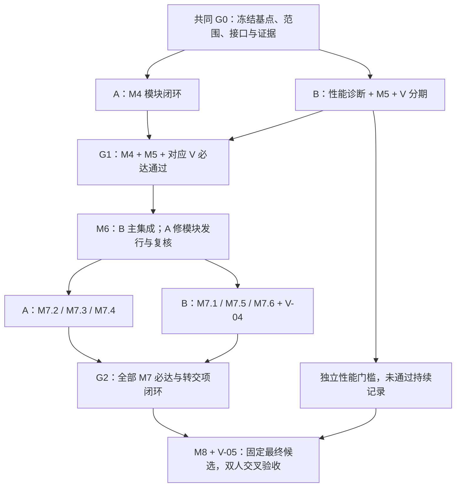

# SDK54 后续开发：A / B 双人 AI 协作与验收规划

> 2026-11-11 人员分工更新：后续开工执行 [A/B/C 任务包](../../releases/sdk54-abc-20261111/README.md)。本文件保留原阶段要求、性能门槛和历史记录；旧“两人职责/开工提示词”由新任务包取代，历史 PASS/BLOCKED 不回写。

日期：2026-10-29。状态：**规划已编写，本文安排的新任务尚未执行。**

目的：两个人各自使用 AI，在尽量不争用代码和设备的前提下，完成模块、工程链路、性能及最终交付验收。本文同时保存已知结果、待执行任务和后续结果登记规则；预期结果不等于实际通过。

“人员 A / 人员 B”指两位负责人，与此前性能优化的“A 批 / B 批”无关。每人对自己的 AI 产生的代码、测试和结果负责。

## 1. 当前基点与真正的下一步

本次规划只读核对到：分支 `feat/V1.7.0`，HEAD 为 `f92b4c5c63f2c8b93715af0531fdf851c6ea603a`；写入本文之前工作区干净。此前报告以 `733e395` 加工作区改动为来源，其报告不是对新提交重新执行的证明。开工时仍需核对提交、候选包和证据身份。

依据：

- [总实施路线](2026-10-21-sdk54-architecture-completion.md)，特别是 M4—M8 与 V 的前置条件。
- [阶段进度](../../releases/sdk54-stage-progress.json)、[M4 范围基线](../../releases/2026-10-28-sdk54-m4-scope-baseline.md)。
- [最近模拟器验收](../../releases/2026-10-29-nova16-emulator-acceptance.md)、[性能优化验收](../../releases/2026-10-29-sdk54-prebuild-performance.md)。
- [性能设计](../specs/2026-10-29-sdk54-prebuild-performance-design.md)、[性能执行计划](2026-10-29-sdk54-prebuild-performance.md)。

**正式下一阶段是 M4 与 M5/V 并行推进，同时补齐性能验收。** M4 仍为 0/7，不能因为 blank 通过就跳过。M7.4 中的 ExpoImage 是已知 default 阻塞，但 M7 正式交付仍依赖 M6；当前可以准备其来源、契约和测试，不提前关闭阶段。此前对“下一步做 ExpoImage”的简化建议，以本文的阶段依赖为准。

### 已有验收结果：开工输入，不是本轮新结果

| 项目 | 已有结果 | 证据与适用边界 | 后续责任人 |
| --- | --- | --- | --- |
| M0 / M0A / M1 / M2 / M3 | 阶段台账历史已关闭 | 部分历史工件缺失；[证据清单](../../releases/sdk54-evidence-availability.json)记录 80 个中 60 个缺失；不改写历史，不把它们算本轮复验 | B 核验可获得证据，A 补模块相关复验 |
| M4 | 未关闭，0/7 | 范围基线仍未完成当前公开面、生成物和候选物闭环 | A |
| M5 / V / M6 / M7 / M8 | 阶段台账均未关闭 | 单项已有能力不等于阶段必达项全部通过 | 按下文分配 |
| blank Debug / 热更新 / 冷启动 | 已有报告 PASS | nova 16 Pro；仅绑定报告记录的候选 | B 复跑，A 交叉核验 |
| blank Release 脱离 Metro | 已有报告 PASS | 新 pnpm 消费工程、模拟器 unsigned HAP；不代表签名真机或全部网络断开 | B |
| default 首页 | 最近运行 FAIL | `ExpoImage/default` 尚未注册，图片、路由及组合交互无法完成验收；性能轮未重跑 default | A 负责能力，B 负责组合复验 |
| 性能 A 批代码与安全专项 | 已有报告 PASS / 部分完成 | 47 项安全专项通过；没有跳过缓存保护 | B |
| 编译后 prebuild | 目标未达 | 带诊断的随后一次观测 184.42 → 129.85 秒，非五次中位数 | B |
| 配置变更 / 后续构建 | 生成与构建成功，性能未闭合 | prebuild 153.85 秒；后续构建 80.94 秒，其中 Ninja 约 62.30 秒 | B |
| 首次 / 无构建产物 prebuild | 已有五次样本未见规定外回退 | 优化后中位数 0.790 / 1.119 秒；不能外推编译后性能 | B |
| Node 外部内存 | 已有诊断明显降低 | 约 3,428 → 301 MiB；不是整台机器内存或物理磁盘指标 | B |
| 仓库 / 发行检查 | 已有报告 PASS | `pnpm check`、`pnpm sdk54:release:check`；工具测试 1,041 通过、20 跳过、0 失败 | B 在最终候选重跑 |

## 2. 两人的长期职责与代码所有权

建议熟悉 ArkTS/C++/React Native 原生桥接的人担任 A，熟悉 Node/TypeScript/构建工具的人担任 B。人员可互换，但同一任务只设一个主负责人。

| 领域 | 人员 A：模块与原生能力线 | 人员 B：工程与验证线 |
| --- | --- | --- |
| 首轮主线 | M4 七项逐项闭环、M4→M7 转交清单 | 性能剩余问题、M5、V-01～V-03 分期 |
| 主要代码 | `packages/expo-modules-core/`；Font、Asset、Splash、SystemUI、StatusBar、Linking、Router、WebBrowser 的包内实现、插件、类型、测试和文档 | `packages/@expo/cli/`、`packages/@expo/metro-config/`、`packages/expo-modules-autolinking/`；创建、打包、benchmark、统一验收工具 |
| 后续主线 | M7.2 / M7.3 / M7.4，优先 ExpoImage；原生公共依赖 | M6 集成维护，M7.1 / M7.5 / M7.6，V-04 / V-05；最终候选管理 |
| 自测 | 宿主/原生契约、错误与生命周期、模块实际设备行为 | 命令、生成事务、安装、性能、候选新鲜度、设备驱动与报告负例 |
| 交叉复核 | 复核 B 是否保留用户数据、生命周期与真实设备行为 | 复核 A 的 API/类型/插件/发行一致性及证据是否足以关闭能力 |
| 汇总职责 | 向 B 交付模块结果与证据，不自行改总台账为 PASS | 维护本文结果表、整合报告及阶段台账，须经 A 复核后记录关闭结论 |

共享文件的明确规则：

1. 根 `package.json`、锁文件、`scripts/sdk54/catalog.mjs`、`release-catalog.mjs`、`creation-catalog.mjs`、打包脚本、CI、阶段进度与验收台账由 **B 单写**。A 提交准确包身份、依赖与所需变更，B 实施。
2. Core 的 JS/ArkTS/C++ 视图、事件、异步、生命周期契约由 **A 单写**；B 负责它在生成器/CLI/验收工具中的集成，不自行修改 Core 接口。
3. 模块包内的插件由 A 修改；CLI 的配置解析、插件执行、生成保护由 B 修改。涉及两边时先固定输入、输出、错误和版本，再分别实现。
4. `scripts/sdk54/` 的公共 runner、schema、打包工具由 B 单写；A 可在自己命名的模块夹具/用例文件中提交测试，但不能与 B 同改一个文件。G0 列出这些新增文件的具体归属。
5. `packages/expo/` 的身份、配置/schema、平台公共类型由 B 主责；若 A 需要新增运行时依赖，先交接口需求。Router 包内源码归 A，CLI/Metro 侧 Router 集成归 B。
6. 当前仓库不存在 `packages/expo-image/`；A 必须先固定上游版本与源码/完整性，再决定引入位置。不能把该路径写成已经存在或把 shim 当作完整适配。
7. 每个改动单元保持可独立审查。变更了对方契约时停止依赖该契约的部分，继续无依赖任务；用任务 ID 记录交接，不同时抢改文件。

## 3. 阶段安排与并行边界

M2 原阶段历史关闭状态不因性能补充任务被擅自改写；性能门槛单列为本交付的发布前条件。未达标时仍可开发其他能力，但不得把本性能计划或最终交付写为全部完成。

### 首轮节奏：以工作日为参考，不承诺五天完成 M4

| 时段 | A 的工作 | B 的工作 | 当日可检查产物 |
| --- | --- | --- | --- |
| D0 | 核对 M4 范围、底座依赖、原生视图契约与实际候选 | 冻结提交/包身份、环境、证据清单、目录和资源排期 | G0 清单、双方文件边界、下一批验收 ID；缺条件逐条记 BLOCKED |
| D1～D2 | A-01、A-02；先写失败用例，再做最小修复；准备 Font/Asset 夹具 | B-01、B-02；先定位 62 秒 Ninja 重编译和各路径成本，完成 V 结果校验最小闭环 | 范围决议、契约夹具、可重放诊断、报告负例 |
| D3～D4 | 按依赖推进 A-03 / A-04，小批交付可装包模块 | B-03 / B-04；接入 A 已冻结的用例，开展第一轮真实候选集成 | 独立 tgz、消费身份、逐项实际结果；不要求本轮所有项通过 |
| D5 | 交叉复核 B 的事务/设备证据，登记模块剩余项 | 交叉复核 A 的类型/发行/行为，汇总本轮结果 | 本文结果表更新、阻塞清单、下一轮工作量与设备排期 |
| 后续每轮 | 继续尚未通过的 A 项，不扩大范围掩盖失败 | 继续 B 项并重跑受影响集成，不以测试数量替代门槛 | 以 G1 / M6 / G2 / M8 条件退出，不按日期强行结项 |

后续 M6/M7 的天数在准确包/API 清单冻结后估算。SDK54 全量适配不能从当前诊断推断为一周或几天可完成。

## 4. A 的任务包

以下均为待执行；每个任务必须产生实现、相应测试、候选物关联和实际结果。

| ID | 主任务与范围 | 前置 / 对 B 的交接 | 交付与验收要求 |
| --- | --- | --- | --- |
| A-01 | 冻结 M4 公开 API、成员、插件选项、当前源码/类型/包差异；逐条关联 M4 或既定 M7 批次 | G0；复用 `m4-scope-inventory.mjs` 的真实校验能力 | 覆盖清单 hash；无未裁定公开项；转交有能力 ID、依赖、批次、验收条件。不得事后把失败必达项转走；完成 M4-A07 的范围部分 |
| A-02 | M4-A06：Core 原生视图、错误、异步、事件、资源、runtime/reload 生命周期 | A-01；向 B 交注册名、属性/事件/错误契约和第三方夹具 | 不依赖中央手写模块名单；挂载/卸载、重复释放、跨 runtime、销毁后回调和失败事件有真实负例及适用设备证据 |
| A-03 | M4-A01/A02：Font 声明式嵌入、运行时加载、renderToImage/格式；Asset Metro/rawfile/缓存/移除 | A-01、必要 Core 能力；向 B 交资源与插件断言 | 配置增加/修改/移除、无主资源清理、错误输入、字体实际呈现、图像结果；Release 断 Metro 仍能访问内嵌字体/资源；TTC 等逐格式记录，不默认 PASS |
| A-04 | M4-A03/A04/A05：Splash/SystemUI/StatusBar、Linking/Router、WebBrowser | A-01/A-02；B 提供命令与设备运行能力 | 冷/热启动、主题、前后台、reload；冷/热深链/onNewWant/嵌套路由/系统返回；浏览器取消、重复会话、关闭/销毁。Native Tabs 保留 M7.4，生产 OAuth 单独记录边界 |
| A-05 | M4-A07 收口：模块源码、JS、类型、插件、README、测试同步 | A-02～A-04；B 的真实候选打包链路 | 特别复验 Core `Platform.select({ harmony: ... })` 候选类型；旧基线曾失败，不推定已修。npm/pnpm 实装类型检查与设备行为均绑定最终模块候选 |
| A-06 | ExpoImage 前期准备，不提前宣称 M7.4 通过 | A-01/A-02；不延误 M4 主线，等待 B 的正式发行机制期间推进 | 固定 `expo-image` 来源（现 default 声明为 3.0.11）、完整性、公开属性/事件/方法、插件、资源与 Core 依赖；保存原始 default 失败复现，交 B 独立可执行的验收断言 |
| A-07 | M6 模块配合、M7.2/M7.3/M7.4 逐批开发 | 正式 M7 实施前 M6 机制可用；按能力依赖排序 | 先打通 ExpoImage 注册和实际渲染，再完成该模块冻结范围；同时分批关闭资源/存储/权限/设备及媒体/原生视图，不因首页可用就关闭全部 M7.4 |
| A-08 | M8 模块与页面复核 | G2、最终组合冻结、B 的 V-05 | 原样 default 图片/Tabs/Modal/系统返回；第三方同步/异步/事件/view/移除重装；复核 B 的窗口/UI/资源证据，确认未用旧 HAP 或替代页面 |

ExpoImage 的最小解阻验收必须包含：原来的 `ExpoImage/default` 注册错误消失、原始 default 无替换页面可进入、实际图片内容显示、资源加载失败可观察、卸载/reload 不产生过期回调。随后逐项补齐冻结的属性、事件、方法、缓存/资源等完整范围。**解阻通过、模块通过、M7.4 批次通过是三个不同结论。**

## 5. B 的任务包

| ID | 主任务与范围 | 前置 / 对 A 的交接 | 交付与验收要求 |
| --- | --- | --- | --- |
| B-01 | 性能定位与修复：大树扫描/哈希/复制、Ninja 失效输入、快照还原与增量构建 | G0；使用固定 blank 基准，避免 A 的模块改动污染对比 | 拆开 prebuild/构建/安装成本；用 Ninja 失效原因、依赖路径、内容和时间精度证据定位重编译，不只猜 mtime。满足第 8 节门槛并保留原安全语义 |
| B-02 | V-01/V-02 最小 runner、结果 schema、证据和用例集合校验；接入 A 的夹具 | G0 即可做空壳与负例；模块功能 PASS 需 A 的真实实现 | 缺用例、重复结果、错误 hash、空截图、缺设备、超时、中断都不能 PASS；在独立进程可从落盘结果重算结论。当前无 `scripts/sdk54/ai-e2e/` runner，须真实实现后再发布命令 |
| B-03 | M5-01/02/04：平台识别、单 Metro/混合平台、自定义 resolver/serializer、install/check/fix/config/export | G0；契约遇 Core/Router 包内缺口交 A | 实际标准命令和资源输出；无 state 项目、重装、Fast Refresh/reload、自定义配置、多平台隔离；参数先查当前 CLI 帮助，不编造接口 |
| B-04 | M5-03/05 与 V-03：工具路径、签名/HAP 定位、Debug/Release、端口和 HDC 失败 | B-02/B-03 可分段接入；设备按预约独占 | blank×npm/pnpm 四个构建运行组合；缺设备/多设备/空格路径/端口占用/已有 Metro/HDC 假成功；default 可用步骤真实执行，模块阻塞单列 |
| B-05 | 集成 M4/M5/性能候选，补新鲜度和 npm/pnpm 消费检查 | A 分批交付后逐次集成，不等待全部 M4 才集成 | 统一候选清单、版本/hash、包内文件和类型核验；A 的 API/插件断言进入 runner；源码链接和消费端 HAR/源码补丁不能替代发行物 |
| B-06 | M6-01～05 与 V-04：组合、升级回退、诊断、锁文件、发行、旧 SDK54 路径退出 | G1；A 修包内新鲜度缺口与模块回归 | 支持组合 A→B→A；安装中断恢复、overrides 冲突、混装、非法组合；npm ci/pnpm frozen-lockfile；SDK52 回归与旧路径真实退出。生产发布不属于自动执行步骤 |
| B-07 | M7.1/M7.5/M7.6 与 V-04：公共工具/配置/插件、开发能力、平台语义评估 | M6；逐能力核对 A 的原生依赖 | 全量工具/API/插件双向关联；Go/EAS/Updates/Dev Client 等沿用既定暂缓 ID，不计完成；不适用须有平台依据和必要拒绝/替代行为测试 |
| B-08 | M8 与 V-05 最终矩阵、结果集合和证据封存 | G2；性能门槛关闭后才能宣告本交付全部通过 | 四项目、八首次 Debug/Release 构建运行，加重装/升级/回退/故障/多平台用例；A 交叉复核；全部必达无 FAIL/BLOCKED/NOT_RUN 才可关闭 |

## 6. 真正可以同时工作的部分

### 工作区与候选物隔离

- 两人从 G0 确认的同一基点建立独立 checkout/worktree，建议分支名 `feat/sdk54-a-modules`、`feat/sdk54-b-toolchain`，集成分支 `integration/sdk54-ab`。这里只约定命名，不自动创建、暂存、提交或合并。
- 两人的 AI 会话绑定各自工作目录；不能都在同一份源码目录写文件。本文若尚未进入共同基点，两人先拿到相同 SHA256 的只读规划副本。
- 消费工程放在源码仓库外，分别使用 `sdk54-ab-a-consumers/<run-id>`、`sdk54-ab-b-consumers/<run-id>`；不共用 `node_modules`、`harmony`、构建缓存或事务目录。
- 证据分别放 `outputs/sdk54/ai-e2e/<run-id>/a/`、`b/`、`integration/`。每轮生成新目录，不覆盖已验收 tgz、HAP、锁文件和失败日志。
- 两人各交自己的结果记录；B 单独更新本文第 10 节，A 核对记录与原始证据，避免同时编辑总规划。

### 设备和性能测试错峰

| 资源 | 是否可并行 | 规则 |
| --- | --- | --- |
| 不同工作区的源码开发、只读调研、文档、轻量测试 | 可以 | 遵守文件边界；性能正式采样时轻量测试也暂停，只保留编辑/阅读 |
| 同一宿主的两个原生构建 | 功能调试可按资源情况安排 | 不计入隔离性能结果；内存或磁盘不足时排队，不删除对方目录 |
| 正式 benchmark | 不可与另一轮 benchmark、Hvigor 或 Metro 编译并行 | B 独占测量时段；A 做源码阅读、接口设计和结果复核；记录其他进程与机器/工具版本 |
| 同一个 nova 16 Pro / HDC target | 不可同时操作 | A 模块设备测试与 B 集成轮流预约；登记操作者、target、bundle、端口、开始/结束和清理结果 |
| 不同机器/不同设备 | 可并行功能验证 | 各自记录环境；性能前后必须在同一受控环境配对，不能跨机器拼改善比例 |
| 集成包、共享版本/目录清单、阶段台账 | B 串行写 | A 提供输入和复核；新的候选 hash 使受影响旧结果失效 |

建议排班：A 上午设备验证、B 下午隔离基准，第二天按需求调换；这只是预约模板，实际以日志为准。各自使用独立 bundle 和端口；只结束自己的进程、转发和测试应用，不全局 kill、不清理他人的缓存。机器空间按本轮快照/旧树/staging/构建峰值预估并检查余量。

### 交接契约与合并顺序

每次交接包含：任务/能力/验收 ID、来源 revision、适配提交或 patch hash、改动文件、依赖、公开契约差异、包身份与 SHA256、命令和结果、证据路径、未完成项。候选未生成时明确写“无候选”，不能进入发行/设备 PASS。

推荐顺序：G0 契约 → B 的验证 schema/负例 → A 的 Core/单模块小批与 B 的通用生成器修复分别审查 → B 整合当前两侧候选 → 受影响消费/设备回归 → A 复核结果 → 更新本轮表。不要把性能重构与 ExpoImage 原生实现塞进同一不可拆分改动。

只合并已经完成该改动单元验收的部分；总阶段仍可未关闭。合并冲突由文件负责人处理，另一人复核语义。性能未达标可保留安全有效的改进，但状态保持未完成。`git add` 仍须用户明确授权具体文件，提交、推送、生产 registry 发布按实际授权执行。

## 7. 验收标准与关闭条件

| 门 | 验收主体 / 复核 | 必须达到的结果 | 当前实际状态 |
| --- | --- | --- | --- |
| G0 开工基线 | B / A | 固定源码和候选身份；核对依赖证据可用性；M4 范围/接口/文件边界/设备排期可执行；历史缺失证据的受影响依赖有补验安排 | NOT_RUN |
| GA：M4 | A / B | M4-A01～A07 全部必达 PASS，插件/类型/设备与发行物对应；M7 转交清单完整且仍标未完成 | NOT_RUN |
| GB：M5 + 对应 V | B / A | M5-A01～A06、相应 V-01～V-03 必达通过；default 模块阻塞如实单列，CLI 缺陷不得借此豁免 | NOT_RUN |
| GP：性能 | B / A | 第 8 节各门槛、安全负例、完整样本与构建合计通过 | NOT_RUN；已有报告显示目标未达 |
| G1：进入 M6 | B 汇总 / A 复核 | GA、GB 通过，候选依赖闭合；受影响历史证据缺口已恢复或有新一轮独立复验 | NOT_RUN |
| G6：发行与维护 | B / A | M6-A01～A05 通过，V 对应能力可用；SDK52 保留，SDK54 旧生产路径退出；新鲜度/完整性可独立校验 | NOT_RUN |
| GI：ExpoImage 解阻 | A / B | 原样 default 消除注册错误、真实图像与最小交互通过；不等于整个模块或 M7.4 全量关闭 | NOT_RUN；最近 default 实测 FAIL |
| G2：全量模块 | 各自批次负责人 / 对方 | M7.1～M7.6 适用必达及 M4 转交全部关闭，M7-A01～A04 通过；合法暂缓单列 | NOT_RUN |
| G8：最终交付 | B 执行编排、A 复核；双方签结论 | M8-A01～A09、V-05、GP 通过；最终候选全矩阵、SDK52 与 Android/iOS/Web 代表回归齐备 | NOT_RUN |

已有的单项 PASS 可以指导排查，但不能直接填入本表的本轮最终候选结果。缺环境/设备/签名记 BLOCKED，真实产品断言失败记 FAIL，未执行记 NOT_RUN；不适用须沿用正式范围决议，不允许临时删用例变 PASS。

### 最终消费矩阵：全部绑定同一候选组合

| 原始模板 / 包管理器 | Debug 构建→安装→启动→首屏/功能 | Release 构建→安装→启动→功能 | Release 脱离 Metro 冷启动 | 锁文件重装 | 当前本轮结果 |
| --- | --- | --- | --- | --- | --- |
| blank-typescript / npm | 必须通过 | 必须通过 | 必须通过 | 必须通过 | 全部 NOT_RUN |
| blank-typescript / pnpm | 必须通过 | 必须通过 | 必须通过 | 必须通过 | 全部 NOT_RUN |
| default / npm | 原样图片、Tabs/Modal/返回必须通过 | 同左 | 本次内嵌资源必须可用 | 必须通过 | 全部 NOT_RUN |
| default / pnpm | 原样图片、Tabs/Modal/返回必须通过 | 同左 | 本次内嵌资源必须可用 | 必须通过 | 全部 NOT_RUN |

首次矩阵保留原始模板；热更新、动态配置、第三方模块等另建派生案例。新旧配置值必须检查 HAP/资源/设备效果；卸载、重装、组合回退、权限与故障恢复另有用例，不能用八个构建成功替代所有验收。需要签名真机的结果单列；模拟器 unsigned PASS 不能覆盖签名真机要求。

## 8. B 的性能专项：门槛不降低

| 项目 | 验收目标 | 测量要求 |
| --- | --- | --- |
| 编译后无变化 prebuild | 中位数 ≤30 秒，较同环境固定旧基线改善 ≥80% | Debug/Release 编译产物分别测；不能直接把旧单次 184 秒当正式基线 |
| 单项合法配置变更 | 中位数 ≤45 秒，改善 ≥70% | 每次还原相同初始快照，校验新值确实生成并进入下一次 HAP |
| 首次生成 / 无构建产物重复生成 | 回退 ≤max(旧基线 20%，2 秒) | 同版本工具与固定输入；保留未预热结果 |
| prebuild + 随后增量构建 | 合计中位数回退 ≤max(旧基线 10%，2 秒) | 记录 Ninja 具体失效原因、重编译范围和真实新内容，不能转移成本 |
| 内存 / 磁盘 / 复制 | 大文件不整体聚合；完整字节/模式/用户修改保护 | 记录 RSS、external、arrayBuffers、阶段 IO、staging 逻辑与物理分配口径；补真实跨文件系统回退 |
| 故障与并发 | 与原安全契约一致 | 相同 size/mtime 的修改、chmod、软链、复制中断/空间不足、进程退出/恢复、旧日志、clean 完整备份均有负例 |

完整场景：首次、无构建产物重复、Debug 编译后重复、Release 编译后重复、配置变化、已支持模块增加/移除、clean，以及对应后续构建。每个场景旧/新版本各预热一次、正式五次，交错测量，报告全部样本、中位数和最大值；安装、网络下载、打包、还原与正式计时分开。

现有 `benchmark-prebuild.mjs` 支持若干场景，但尚不覆盖全部矩阵和指标。B 先补能力与安全测试，不能把规划中的参数当作现成命令。重编译定位还需验证快照恢复是否改变时间精度、依赖路径或构建输入；这些是待证假设，不是已确认根因。

若考虑性能 B 批缓存分离，先完成原设计规定的归属、外部写入协调、日志版本、每步移动中断及恢复冲突表。没有同等人工修改保护时保守回退，不用目录忽略列表或 inode/mtime 快捷判定替代内容校验。未达标的正确结果是保留安全改进并继续记录 FAIL/未完成，不降低门槛或默认为通过。

## 9. 每人如何让 AI 执行

每个 AI 会话一次领取一个可验证任务包，先输出“来源依据、预计修改文件、最小失败用例、通过标准”，再实施。负责人核对范围后持续执行可逆工作，不在例行读代码/测试/修复步骤反复等待。跨职责改动通过已定义契约交接，不让两个 AI 互相覆盖。

### 给人员 A 的开工提示词

> 阅读本规划、总路线、M4 范围基线和最近验收报告。你负责人员 A 的模块线，先执行 G0 中的 A 职责和 A-01，再按依赖处理 A-02～A-05。先核对真实源码、公开面、候选类型和缺失证据，不把历史 blank PASS 当作 M4 完成。只修改 A 所有文件；共享生成器、发行目录、根锁文件的需求以接口交接单交给 B。每个修复给出失败用例、实现、通过日志、候选身份与设备断言。ExpoImage 先做 A-06 准备，正式交付遵守 M6→M7.4 前置。不得删除 default 页面或替换 expo-image 来关闭失败。结果提交到本轮 A 记录，交 B 汇总；不自动 git add/提交/推送/发布。

### 给人员 B 的开工提示词

> 阅读本规划、总路线、性能设计/执行计划及验收报告。你负责人员 B 的工程线，先执行 G0 中的 B 职责，再并行安排 B-01 的根因定位与 B-02 的验收工具，随后 B-03/B-04。先复现约 130 秒 prebuild 与约 62 秒 Ninja 的真实成本，完整基准不得与其他构建并行；保留文件、权限、并发和恢复校验。只修改 B 所有文件，Core/模块契约需求交给 A。接入 A 的固定契约后，用真实 tgz、npm/pnpm 和独立消费工程验证，缺证据不得 PASS。统一 runner 尚不存在，先实现并测试结果校验；只清理自己的进程和转发。维护本文实际结果表，经过 A 复核再记录阶段关闭；不自动 git add/提交/推送/发布。

## 10. 验收结果登记：必须回填到本规划

本文是总览入口，原始证据另存。每轮结束由 B 追加记录，A 核对；不能只在聊天里说“通过”而不更新本文。旧行不覆盖，失败后的修复新增轮次；改候选 hash 后受影响条目重新执行。

### 当前状态（2026-11-10 本机集成复核）

本表区分本机专项、自验和正式阶段关闭。A 本地提交为 `0fcde72`，已包含 B 的 `5526a30`；另外 7 项审查修复仍在工作区。可消费交接见 [本轮交接单](../../releases/2026-11-10-sdk54-integrated-handoff.md)。B 三组最终原始证据未取得，B 的 PASS 保留为自验结论。

| 任务集合 | 主负责人 | 当前开发状态 | 本轮实际验收结果 | 复核人 | 本轮证据 |
| --- | --- | --- | --- | --- | --- |
| G0 | B，A 参与 | B 基线与设备驱动 smoke 已完成；本轮候选已备，等待联合复核与性能资源 | BLOCKED | A | `docs/releases/2026-10-30-sdk54-ab-g0-b-baseline.md`；workspace 候选 manifest `283118c...c5ed2`；target `127.0.0.1:5557` |
| A-01 | A | 202 个插件、1091 条选项路径、7724 条 M4 范围记录已补齐；最终公开闭包未完成 | PARTIAL | B 待复核 | `2026-10-30-sdk54-a-scope-core-acceptance.md`；交接包历史证据 |
| A-02 | A | Core 本地 npm/pnpm × Debug/Release 各 50/50、reload 与离线冷启动专项通过；新候选设备矩阵待跑 | PARTIAL | B 待复核 | `2026-10-30-sdk54-a-core-hap-acceptance.md`；773 条历史归档证据 |
| A-03 | A | Font/Asset 运行时与 TTF/CFF-OTF/PNG 专项通过；声明式嵌入、移除闭环未完成 | PARTIAL | B 待复核 | Font/Asset 与字体格式专项报告 |
| A-04 | A | 多个 npm Release UI/导航/浏览器专项通过；Sheet detents 失败、旋转未验、Drawer 不完整 | PARTIAL | B 待复核 | 各 A-04 专项及失败原件；不得等同全组合通过 |
| A-05 | A | 类型、Router 生成物及 8 包 2824 文件本地一致性通过；已组装 15 个正式命名候选 | LOCAL PASS；正式闭环待验 | B 待复核 | `2026-11-01-sdk54-a05-release-consistency.md`；本轮候选与安装结果见交接单 |
| A-06 | A | ExpoImage 来源、公开契约和失败基线已冻结；无 Harmony 实现 | PREPARATION PASS；IMPLEMENTATION NOT_STARTED | B 待复核 | `2026-11-02-sdk54-a06-expo-image-contract.json` |
| A-07 / A-08 | A | A-07 入口仍有 6 项阻塞；A-08 未开始 | BLOCKED / NOT_STARTED | B | 本轮 `validation/a07-gate.json`；M4/M5/V/M6 未关闭 |
| B-01 | B | Debug/Release、配置、模块增删、clean、首次/no-op、后续构建、跨卷与设备全矩阵完成 | PASS（B） | A | `docs/releases/2026-10-30-sdk54-b01-ninja-diagnostics.md`；专项 61/61；Autolinking `e9ea310c...2698`；summary `8ef5c887...e0bf` |
| B-02 | B | B02 runner、registry 与参数化入口完成；V-01/V-02/V-03 完整场景待 A/C handoff | PARTIAL；正式 run BLOCKED | A/C | `docs/releases/2026-11-11-sdk54-b32-runner.md`；新入口测试 4/4；AI-E2E 61/61 |
| B-03 | B | pnpm/npm Harmony/all export、install/check/fix/config、自定义 resolver/serializer 全矩阵完成 | PASS（B） | A | `docs/releases/2026-11-02-sdk54-b03-export-harmony.md`；validation `bd1d2a73...d9b1a`；CLI `2474adcd...5e9e` |
| B-04 | B | blank×npm/pnpm Debug/Release、离线、Fast Refresh、空格路径、端口/设备/HDC 失败矩阵完成；default 等待 ExpoImage 实现和正式设备复验 | PASS（B）；default BLOCKED（A） | A | `docs/releases/2026-11-10-sdk54-b04-harmony-run.md`；validation `7c650aa6...47d1`；CLI 39/39、SDK54 工具 1090 pass/20 skip |
| B-05 | B | 15 包统一候选与独立 CLI 已重新生成、校验并完成 npm/pnpm blank/default 锁重装；待 C 审查及 clean source 后正式接入 | READY_FOR_INTEGRATION；非阶段 PASS | A/C | `docs/releases/2026-11-11-sdk54-b31-candidate-freeze.md`；B-31 candidate；四组合 install/reinstall 0/0 |
| B-06 / B-07 / B-08 | B | 分别等待 G1、M6/G6、G2 与最终组合候选；当前上游前置未产生 | BLOCKED（阶段前置） | A | 同 B-05 预检；不得越级关闭 |

### 每轮追加记录格式

| 轮次 / 日期 | 任务与原验收 ID / 场景 | 主责 / 复核 | 源码与候选组合 hash | 预期 | 实际结果与状态 | 命令 / 报告 / 原始证据 | 下一步 |
| --- | --- | --- | --- | --- | --- | --- | --- |
| 待首次执行后追加 | 不预填成功项 | — | — | — | NOT_RUN | — | 完成 G0 |
| B-G0 / 2026-10-30 | G0、B-02.1～B-02.6 / V-01/V-02 工具与设备 smoke | B / A 待复核 | source `19a0375cff7e0ef3bc62d54fd5ed57b913bb2000`；workspace candidate manifest `283118c2386bc51e1e50fb2a203d015eefa00d80a1893a263ccf22ba6c2c5ed2` | 冻结 B 输入；缺用例、重复结果、错误 hash、空截图、缺设备、超时、中断均不得关闭；命令无 shell且只清理本次进程；畸形 schema、无效候选/环境和路径穿越必须失败关闭；设备操作绑定明确 target/PID/bundle | G0 `BLOCKED`；B-02 工具与既有 blank 驱动 smoke `PASS`，完整候选/A 夹具验收 `NOT_RUN` | `docs/releases/2026-10-30-sdk54-ab-g0-b-baseline.md`；专项 29/29；target `127.0.0.1:5557`；JPEG/hilog 已核验；SDK54 工具 1073 pass/20 skip/0 fail | A 复核 G0；接入 A 夹具和完整候选后执行 B-02；继续 B-01 正式 blank 诊断 |
| B-01-final / 2026-11-10 | B-01 / 全性能、安全、Debug/Release 与设备矩阵 | B / A 待复核 | Autolinking `e9ea310c2ae3f043cf3c9420df26b43065ae8c6f4b3b3a334e33e031d5212698`；CLI `2474adcd5bc8c9a52819d6763a44f733328b284291207f69eba40b58555b5e9e` | Debug/Release no-op、配置、模块、clean、首次/重复、后续构建、跨卷、设备全部达到第 8 节门槛 | `PASS（B）`；Debug 1.54 s、Release 1.76 s、配置 5.92 s；61/61；Debug/Release 页面通过 | `outputs/sdk54/b01-final-validation-20261110/validation-summary.json`；B-01 报告 | A 交叉复核；B 继续 B-03/B-04 |
| B-03-final / 2026-11-10 | B-03 / M5-01/02/04 | B / A 待复核 | CLI `2474adcd5bc8c9a52819d6763a44f733328b284291207f69eba40b58555b5e9e`；pnpm/npm 锁文件见证据目录 | 两包管理器 Harmony/all export；config、install check/fix；自定义 resolver/serializer 不丢失且三平台隔离 | `PASS（B）`；八项机器断言全 true | `outputs/sdk54/b03-export-final-20261110/validation.json`；B-03 报告 | A 交叉复核；B-05 接入 A 候选后重跑受影响项 |
| B-04-final / 2026-11-10 | B-04 / M5-03/05、V-03 blank/CLI 范围 | B / A 待复核 | CLI `2474adcd...5e9e`；Autolinking `e9ea310c...2698`；四个 HAP hash 见报告 | blank×npm/pnpm Debug/Release；离线、刷新、空格路径、端口、设备和 HDC 假成功失败关闭；只清理本次资源 | `PASS（B）`；十二项机器断言全 true；default `BLOCKED（A）` | `outputs/sdk54/b04-final-20261110/validation.json`；B-04 报告；CLI 39/39；SDK54 工具 1090 pass/20 skip | A 交付 default/M4 夹具与候选；B 接入 B-02/B-05，不以 blank 替代 default |
| B-31/B-32 / 2026-11-11 | 新三方任务包：候选冻结、B02 registry/prepare-run | B / A、C 待交接 | source `3b16a31fc58b1fcbc92978cf93d1bfb3cb64abb7`；candidate `outputs/sdk54-abc/20261111-113600-B-83243/frozen-candidate-final/candidate.json` | 15 runtime + CLI、四组合 install/reinstall、registry 全集、参数化 run、负例 | B-31 `PASS`；B-32 入口/测试 `PASS`，正式 run `BLOCKED`（A/C handoff 缺失、source dirty） | `docs/releases/2026-11-11-sdk54-b31-candidate-freeze.md`；`docs/releases/2026-11-11-sdk54-b32-runner.md`；本轮 `b31-result.json`/`b32-result.json` | A 提供 a-contract、C 提供 c-case-review；协调者提供 clean source 后运行正式 B02 |

| A/B 本机交接 / 2026-11-10 | A01～A06 成果、B02/B05 集成输入与历史证据 | 本机整合 / A、B 待交叉复核 | `0fcde72` + 工作区 7 项修复；完整身份见 `outputs/handoff-20261110/candidate-identity.json` | 提供可消费源码、生成物、断言、候选身份和便携原件；如实更新进度 | 15 包生成/校验、产品 CLI、111/111 主机测试通过；2875 条旧证据核验；安装矩阵见交接报告；阶段未关闭 | `docs/releases/2026-11-10-sdk54-integrated-handoff.md`；独立 HTML 与便携归档 | B 接入新候选；补三组 B 原件与 57 份未恢复历史文件；新候选设备/性能复验 |

每份明细还必须包含：完整用例集合与展开矩阵、来源/适配 revision、包与 HAP SHA256、Node/包管理器/SDK/设备版本、命令/退出码/断言、构建/安装/启动/页面分项结果、截图文件头与窗口/UI 核验、逻辑/物理指标口径、未完成项、清理与回退记录。门禁结果需能从这些证据重新计算。

建议单轮报告命名为 `docs/releases/<日期>-sdk54-ab-<轮次>-acceptance.md`；原始证据使用第 6 节独立目录。历史 60 个缺失工件能恢复原件则核对 hash；不能恢复则以新候选独立复验并保留历史缺失标记，不能补造旧日志。

## 11. 完成定义

- **可以并行开工**：G0 核对完成，双方工作区、文件/接口归属和设备排期清楚。
- **本轮阶段可关闭**：对应 GA/GB/G6/G2 达到原总路线条件，由另一人复核；未进入的阶段继续 NOT_RUN。
- **default 解阻可宣布**：GI 的真实原样运行通过；不能据此宣布全 SDK54 完成。
- **性能优化可宣布完成**：GP 的完整门槛与安全、增量构建、资源证据通过。
- **最终交付可宣布通过**：G8 和 GP 均通过，全部本轮必达项无缺证据或失败；既定暂缓/不适用分列，不计已交付。

本次交付的是双人规划与结果登记框架，没有启动上述实现、合并、发布或新的设备验收。开工后以本文记录的真实结果滚动推进。
