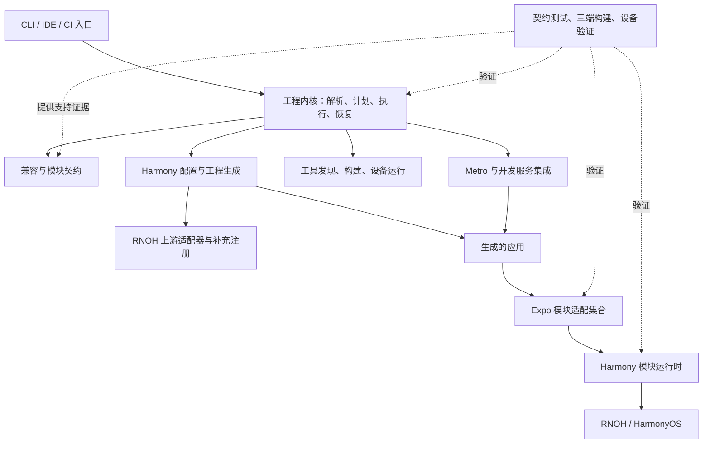

# Expo Harmony 基座：架构评估与分阶段演进建议

日期：2026-09-14  
评估基线：`expo-harmony-cli@1.4.0`，提交 `0e017db`  
状态：架构评审稿；提出建议与验收门槛，不代表改造方案已批准或已实现。

## 1. 目标与结论

用户确认的职责范围：项目创建、构建运行、Expo 模块适配、版本兼容与验证，覆盖完整基础设施。第一阶段交付架构评估与分阶段改造路线。目前没有已确定的官方合作约束、指定版本或验收要求；下文标准均为建议。

**建议保留现有工具链成果，逐步演进为“工程工具链 + 模块运行时 + 兼容契约 + 验证体系”。现有仓库可以成为这一基座的起点，但本次证据不足以认定它已达到完整 Expo 平台支持标准。**

最优先的工作是明确能力与版本契约、验证模块运行时可行性，以及建立可重复的原生验证链路。仅重新组织目录、拆 npm 包，不能补齐这些能力。

评估原则：

- 把“安装成功”“原生注册成功”“API 行为正确”“发布构建通过”作为不同结果记录。
- CLI、IDE、CI 使用同一套工程处理内核；模块扩展通过稳定接口接入。
- 以精确、可追溯的版本组合建立支持承诺；扩展版本范围必须有测试证据。
- SDK、工具链、模块与模板可分别演进，但必须组合验证后发布支持声明。
- 所有跨平台依赖或源码调整，都进入 iOS、Android、HarmonyOS 回归范围。

## 2. 本次证据与验证边界

已阅读命令入口、创建与依赖适配链路、工程生成、官方 autolinking 适配、托管状态、Metro 注入、部分补丁与 shim、模板验证、测试与 CI 配置。

本地验证结果：

| 检查 | 结果 | 能证明什么 |
| --- | --- | --- |
| `pnpm test` | 36 个测试文件、375 项测试通过 | 当前自动化用例覆盖的行为通过 |
| `pnpm type-check` | 通过 | 当前 `tsconfig.json` 范围内的 TypeScript 类型检查通过 |
| 版本识别行为探测 | SDK 51 → 52；55、latest、缺失 expo → 54；53 拒绝 | 版本解析存在宽泛回落，未严格区分未知与已支持版本 |
| 仓库 CI 检查 | Ubuntu / Node 20，执行测试、构建、打包 | 已有基础发布物检查；该工作流没有原生编译、设备运行或三端构建矩阵 |

本次未执行 DevEco/Hvigor 原生编译、设备运行、iOS/Android 构建，也未对全部模块进行 API 一致性验证。测试数量不是平台兼容覆盖率。

已有的 [RNOH 0.82.30 实物 fixture](../../../src/harmony-project/__tests__/fixtures/rnoh-0.82.30/README.md) 是有价值的上游契约证据：它明确说明 metadata 补充条件、产物来源，以及测试回放不等于原生编译通过。建议将这种证据形式推广到全部支持组合。

## 3. 当前架构中应保留的部分

| 已有能力 | 证据 | 演进方式 |
| --- | --- | --- |
| 命令层与若干实现模块已分离 | [命令入口](../../../src/index.ts)、`commands/`、`harmony-project/` | 保留命令兼容，进一步抽出共享服务入口 |
| 官方 autolinking 优先，映射补充，未覆盖报告 | [生成编排](../../../src/harmony-project/standalone.ts)、[官方适配器](../../../src/harmony-project/official-autolinking.ts) | 保留上游优先原则，将输出解析约束封装为版本化适配器 |
| 漂移检测、文件暂存、回滚、中断恢复 | [工程同步](../../../src/harmony-project/standalone.ts)、[托管状态](../../../src/lifecycle/managed-state.ts) | 把这套保护扩展到完整项目变更链路 |
| 内置模板、manifest 与结构校验 | [模板源](../../../src/harmony-project/template-source.ts)、[模板校验](../../../src/harmony-project/template-validator.ts) | 补上版本组合校验、产物哈希和真实构建证据 |
| SDK 分版本数据与适配表 | [版本矩阵](../../../src/version-matrix.ts)、[兼容表](../../../src/scanner/compat-table.ts) | 整合为统一契约，避免消费者各自理解版本和能力 |
| Metro 对 Harmony 请求分流 | [Metro 配置](../../../src/injector/metro-config.ts) | 抽出可组合的配置 API，并验证混合平台请求与用户配置兼容 |

## 4. 优先级最高的架构差距

优先级含义：P0 是建立平台支持承诺前必须解决的约束；P1 是支撑多模块、多版本与多人维护的关键能力；P2 是规模扩大后再完善的组织与交付方式。它们不表示当前所有场景都无法运行。

### P0-A：版本选择与兼容判定需要独立契约

[detectSdkVersion](../../../src/version-matrix.ts#L57) 将 SDK 54 以上归到 54、52 以下归到 52，无法读取时默认 54。[doctor 基线检查](../../../src/env-checks/project-checks.ts#L32) 主要比较声明版本的主版本或次版本，不能证明已安装依赖与完整工具链组合匹配。

建议建立 `CompatibilityProfile`，至少包括：Expo、React、RN、RNOH、RNOH CLI、Metro、Node、Harmony SDK/API、Hvigor、ohpm、模板与适配集合版本，以及已验证的宿主操作系统和目标设备架构。区分声明版本、实际解析版本、锁文件状态与验证记录。

未知组合默认标为 `unverified`；正式支持模式应阻断会依赖该组合的生成或构建。实验使用可显式开启，但不能被标记成正式支持。版本识别失败应提供可定位的原因。

当前仓库定义的 SDK 52/RN 0.77、SDK 54/RN 0.82 组合需要按项目自己的支持矩阵验证；不能仅凭 Expo 主版本推导三端兼容。暂不扩大 SDK 范围，先评估两套现有基线再确定首个主支持组合。

### P0-B：安装策略与 API 支持程度混在一起

[CompatStatus](../../../src/scanner/compat-table.ts#L3) 同时包含 `native`、`patch-only`、`alias-only` 等安装方式，以及 `unsupported` 等支持状态。它不能表达某个模块“部分 API 可用、某些行为降级、只验证过某个设备组合”。

[expo-asset shim](../../../content/shims/expo-asset.ts#L21) 返回空资产列表，`downloadAsync` 直接设置成功标记，体现了启动兼容与真实资产能力之间的差别。已有 `expo-modules-core` 代理 fallback 也不能单独证明 Expo Modules API 已得到完整实现。

建议把兼容记录拆成正交信息：

| 字段 | 用途 |
| --- | --- |
| `support` | verified / partial / unsupported / unverified |
| `actions` | 依赖选择、alias、patch、原生注册、配置变更；允许组合 |
| `capabilities` | 已实现 API、行为差异、明确不可用能力 |
| `constraints` | 适用的版本组合、设备 API、架构与运行模式 |
| `evidence` | 测试标识、实际版本、设备信息、提交与产物哈希 |

必需能力不可用时使用明确、可识别的错误；确有合理替代语义的降级应公开说明。安装成功不能自动把 `support` 提升成 verified。文档、`list`、`doctor`、构建检查应消费同一份数据。

### P0-C：模块运行时需要成为独立的架构工作流

当前可见实现以 JS 适配、patch、RN/Harmony 包替换为主，尚未在本仓库看到足以证明完整 Expo Modules 运行时覆盖的实现与验证体系。

长期需要明确负责：模块发现与注册、同步/异步调用、事件订阅与释放、原生视图及属性更新、对象与资源生命周期、异常转换、应用生命周期与权限语义。依托 RNOH 的实际能力实现这些契约，避免先假定可以直接复用 iOS/Android 的全部原生实现。

先做一个最小模块的技术验证：JS API → 选定 RNOH 桥接路径 → ArkTS/C++ → 返回值/事件/视图。对不支持的 Expo Modules 特性列出边界。是否继续复用 RN 模块适配，或为部分能力实现更深层运行时，由这个验证决定。

### P0-D：发布质量证据需要贯穿真实产物

[CI](../../../.github/workflows/ci.yml) 已执行测试、构建与打包，但没有在该工作流中安装 tarball 后生成真实应用、进行 Harmony 原生编译与设备验收，也没有 iOS/Android 回归矩阵。[tsconfig](../../../tsconfig.json) 不包含 `content/`，因此 CLI 类型检查不能覆盖所有运行时 shim 与生成脚本。

建议让“npm 发布候选包 → 空目录项目 → JS 依赖 → 原生依赖 → Debug/Release 构建 → 设备行为报告”成为正式发布门槛。设备任务可以运行在维护的自托管节点；不能把 Linux 单测通过视为设备结果。

### P1-A：变更流程与文件所有权尚未统一

[install](../../../src/installer/installer.ts#L17)、[scan](../../../src/scanner/scan.ts)、[adaptPackage](../../../src/installer/adapt-package.ts#L27) 分别编排或直接修改依赖、alias、patch、插件与状态。autolinking 的事务只保护其负责的产物，不能覆盖此前包管理器或配置写入的完整操作。

[prebuild --force](../../../src/harmony-project/standalone.ts#L25) 会先删除整个 `harmony/`，与增量同步的保护边界不同。跨平台改动还包括 [完整依赖范围锁定](../../../src/scanner/compat-patch.ts) 和 [postinstall 脚本赋值](../../../src/injector/package-json.ts#L24)，需明确哪些行为只用于全新模板，哪些可用于用户已有项目。

建议共用 `解析 → 计划 → 校验 → 执行 → 验证 → 记录` 流程，并区分：完全生成文件、按字段合并文件、用户所有文件。规划器输出差异、冲突和必要命令，默认保持无副作用；需要调用上游工具才能得到结果时，在独立暂存目录完成。

包管理器和外部构建不能承诺全局原子回滚。应记录检查点、失败阶段与恢复方法，文件变更尽量事务化，依赖变更按锁文件与步骤状态恢复。并发命令需要项目级互斥，防止固定暂存文件相互干扰。

### P1-B：修补、配置与适配扩展点分散

NativeModulesProxy 修补同时存在于 [postinstall 模板](../../../content/templates/postinstall-harmony.js#L19) 和 [启动脚本生成器](../../../src/injector/start-harmony.ts#L74)。兼容表、原生映射表、物料文件、启动期修补各有独立规则；同一个模块升级时需要协调多个位置。

建议先集中 manifest、适配集合与修补执行器，再引入版本化扩展接口。补丁记录精确目标、预期输入特征或哈希、输出校验、适用平台、来源与退出条件；目标不匹配必须报告，必需补丁失败应阻断相关流程。启动期只保留开发服务器管理与状态检查，必要修补移至显式准备阶段。

Expo `getConfig` 的接入已经存在，但 Harmony 的权限、资源、原生配置变更仍需要受支持的配置扩展接口。可以借鉴 Config Plugins 的组合方式；该接口首先是本项目提供的 Harmony 扩展，不能提前宣称 Expo 上游已支持 Harmony mods。

### P1-C：构建运行还缺少统一服务边界

当前有启动、codegen 和 Release JS bundle 脚本；[Release bundle 脚本](../../../src/injector/bundle-harmony-release.ts) 明确把后续 HAP 构建交给 DevEco。完整基础设施需要把工具发现、原生依赖、codegen、bundle、Hvigor 构建、设备选择、安装启动和日志串成可供 CLI/CI 复用的流程。

建议提供结构化结果：执行阶段、错误码、产物路径与哈希、所用兼容组合。签名材料由用户环境或 CI 注入，仅记录配置引用，避免进入模板与发布物。IDE 工作流和命令行工作流应共享配置来源。

## 5. 三种演进选择

| 方案 | 优点 | 代价与适用范围 | 判断 |
| --- | --- | --- | --- |
| A. 单 CLI 持续增强 | 迁移成本较低，容易复用当前实现 | 可改善工程工具链，但运行时与生态扩展仍依附 CLI；不能单独覆盖完整目标 | 适合作为短期过渡 |
| B. 同仓分层，按能力逐步提取包 | 保留已有链路，统一契约，工具链与运行时可独立测试演进 | 需要先定义接口、补契约测试与迁移兼容 | **推荐** |
| C. 一次性深度 fork Expo 工具链和运行时 | 平台接入控制力强 | 持续追踪多个上游，升级、三端回归与维护投入很高；当前没有团队与合作约束支持这一承诺 | 暂不建议 |

推荐 B。先形成逻辑边界、建立依赖约束；出现独立消费者或发布周期需要时，再物理拆包。技术选型不以拆包数量为验收指标。

## 6. 推荐目标架构

工具链与应用运行时的依赖必须分开：应用不应打包 CLI、文件系统管理和模板库；运行时不得依赖 CLI 内部实现。

| 逻辑边界 | 职责与接口 | 当前来源 / 建议去向 |
| --- | --- | --- |
| CLI | 参数、交互、展示与退出码；调用服务接口 | `index.ts`、`commands/`；保持现有命令兼容 |
| 工程内核 | `ProjectContext`、`OperationPlan`、执行与恢复 | creator、installer、scanner、lifecycle 的共同编排；先在 `src/` 内提取 |
| 兼容与适配契约 | 版本组合、模块 manifest、支持能力与物料索引 | version-matrix、compat-table、mapping；先单一数据源，再考虑独立包 |
| 配置与工程生成 | 确定性渲染、配置合并、插件排序与冲突检测 | harmony-project、injector；上游解析细节封装在 RNOH 适配器内 |
| Metro 与构建运行 | 可组合 Metro API、进程与端口、原生构建和设备服务 | injector 生成脚本；稳定后提取供生成项目使用的包 |
| 模块运行时与适配模块 | 桥接、事件、视图、生命周期，以及各 Expo API 实现 | 需要新增独立运行时边界；逐步吸收现有 patch/shim，独立发布 |
| 验证工程 | 最小应用、模块测试应用、原生契约、版本矩阵报告 | 保留现有单测与 fixture，增加 `examples/` 和可重复的集成测试 |

接口设计要求：

- `ProjectContext` 携带解析后的配置、依赖与工具链信息，核心服务不自行散读 `process.cwd()`。
- `OperationPlan` 列出受管文件、字段变更、命令、输入前提、验证项与恢复策略；执行前重新核验输入是否变化。
- 适配 manifest 只描述策略与能力；默认从固定版本的本地依赖读取，不引入隐式下载和执行未知远程脚本。
- 配置扩展先支持声明式权限、资源和注册需求；确需执行代码的插件明确加载来源及信任边界，不将其描述为沙箱。
- 正常路径优先采用 RNOH 公共接口与 metadata；上游不稳定输出集中放在适配器并配 fixture。
- 对生成文件和支持声明采用语义幂等验证；必要时规范化上游 JSON5 的非语义格式变化。

## 7. 分阶段改造路线

阶段按验收结果推进。由于尚未确认维护人数、设备资源与模块清单，不给缺少依据的工期承诺。

| 阶段 | 交付内容 | 进入下一阶段的条件 |
| --- | --- | --- |
| M0：定义支持边界并建立证据基线 | 盘点两套 SDK 的模块能力；明确 verified/partial/unverified；保存真实工具链版本；修订未知版本策略；建立 tarball 安装和最小应用验证入口 | 每项“正式支持”都能指向版本组合与测试证据；未知组合不再静默变成已支持；选出首个主支持组合 |
| M1：收敛工程内核，同时验证运行时 | 工具链线：统一兼容数据、计划与执行入口，迁移 scan/install；运行时线：最小原生模块完成返回值、异常、事件及视图验证 | 现有 CLI 回归通过，代表性适配不需增加核心特殊分支；设备证据验证关键桥接能力，无法实现的特性已明确 |
| M2：形成可配置、可恢复的工程闭环 | 配置扩展接口、受管文件所有权、增量迁移、冲突报告；统一 native build/run；Debug 与离线 Release HAP | 相同输入重复生成无语义差异；失败可诊断与恢复；签名和用户配置受保护；干净环境可重复构建并安装运行 |
| M3：扩充真实模块能力与三端验证 | 用启动/资产、系统能力、原生视图三类模块验证扩展机制，再按优先级增加模块；能力报告由测试结果生成 | 每个承诺 API 有行为用例；升级、卸载和恢复通过；改变共享依赖的发布在三端完成对应回归 |
| M4：建立可持续发布与生态协作 | 明确维护者与模块责任、RFC/ADR、版本支持与弃用政策、变更日志、发布来源与回滚流程；形成第三方接入指南 | 第三方可依文档独立接入示例模块；发布候选包通过指定矩阵；能从报告追溯至代码、依赖和产物 |

M0 就要开始原生验证，M1 尽早暴露运行时可行性风险。后续每一阶段都继续运行已建立的验证矩阵，不把质量建设留到最后。

建议的首批独立工作项：

1. **支持契约与能力清单**：统一版本选择、安装方式、API 支持状态与 `doctor` 结果；把当前降级行为明确列出。
2. **最小验证应用与发布物验证**：从打包产物创建应用，保存 Debug/Release、设备和版本证据。
3. **模块运行时技术验证**：选定 RNOH 基线，验证同步/异步返回、异常、事件释放、原生视图和重载生命周期。
4. **工程变更内核**：以 install/scan 共用计划为首个切入点，逐步纳入配置、原生同步与恢复；保留旧命令入口。

上述每个工作项分别进入设计规范、实现计划和 TDD 流程，避免把完整平台建设合并成一次大改造。

## 8. 迁移策略与发布兼容

- 首轮以现有 375 项用例和代表性生成工程作为回归基线；新增契约行为先补用例，修复已确认问题先写复现测试。
- 保留现有 CLI 包名与命令入口。内部迁移按调用链逐项替换，避免一轮同时更改运行时、模板与全部依赖版本。
- 对旧兼容表提供显式转换层，区分旧安装策略与新的支持状态；无法证明的能力标为 unverified，不自动升级状态。
- 托管状态 schema 的升级可迁移、可识别；较旧 CLI 遇到无法理解的新状态应停止受管修改，避免把它当空状态继续操作。
- 新配置或模板迁移先出差异与冲突报告；完全生成文件可替换，合并文件按受管字段处理，用户所有文件保持其所有权。
- patch 逐项退场：有对应运行时实现、原 API 行为回归和旧项目迁移验证后，才移除旧适配。
- 需要独立发布的运行时、Metro 集成与适配集合采用明确版本和兼容约束；整体支持组合以集成测试报告为准。

## 9. 边缘情况与建议验收用例

| 边缘情况 | 必须验证的结果 |
| --- | --- |
| 未知 SDK、版本别名、预发布版本、缺失或损坏 package.json | 明确拒绝或标记未验证；正式模式不能误选受支持基线 |
| 声明版本与实际安装版本不一致、锁文件过期、传递依赖多版本 | 识别真实解析结果，给出冲突原因；不能仅比较声明主版本 |
| npm/pnpm/yarn/bun、workspace/符号链接、路径含空格或中文 | 声明支持的组合能解析依赖和执行工具；未支持布局明确报错 |
| 两个插件修改同一权限、资源或原生字段 | 按明确规则合并或报告冲突，结果与执行次数无关 |
| 官方 autolinking 缺失、metadata 不完整、产物格式变化 | 分清官方覆盖、补充覆盖和未覆盖；必需能力缺失时正式构建失败 |
| 用户修改受管文件、签名、资源、PackageProvider | 漂移冲突在破坏性写入前被发现；用户内容可保留或恢复 |
| install 中断、依赖下载失败、磁盘满、状态写入失败 | 文件事务与外部命令边界明确，重试可恢复，不假报整体成功 |
| 两个 CLI 同时操作、旧状态被新 CLI 升级后再降级 | 互斥或拒绝冲突；旧 CLI 不误清理新状态管理的资产 |
| 补丁重复应用、上游源码改变、install scripts 被禁用 | 幂等；输入不匹配可诊断；缺少必需准备步骤时阻断运行 |
| 模块同步调用、Promise 拒绝、事件多次订阅与取消 | 返回值和错误符合承诺；重载、销毁后无遗留订阅与资源 |
| 权限拒绝、用户取消选择、后台切前台、无网络 | 保持对应 Expo API 的结果语义，不能将不可用伪装成成功 |
| Native View 更新属性、卸载重建、不同屏幕/设备 API | 视图与生命周期行为符合支持声明，设备限制出现在报告中 |
| Release 无 Metro、资源离线、冷启动与安装升级 | 真正安装并运行 Release HAP，资产可加载，启动与关键功能有断言 |
| 同一项目构建 iOS、Android、HarmonyOS | 平台 alias、补丁和共享版本调整不破坏其他平台承诺的 API |
| 发布 tarball 缺模板、物料版本错配、旧 CLI 配新运行时 | 消费端验证失败并定位原因，不能依赖源码仓库里的未发布文件 |

## 10. 后续决策与评审结论

建议先接受“渐进分层 + 兼容契约 + 运行时早期验证 + 真实产物验收”的总体方向，再逐项细化工作项。当前可以开始定义支持契约和验证应用；首个主支持 SDK、首批模块、宿主系统与设备范围，由 M0 的实测结果和可投入资源决定。

“官方支持基座”是项目目标，不能由当前单测数量、注册成功或一个示例启动来认定。应把它落成公开、可复现的版本与 API 支持承诺，并用构建、设备行为、升级和恢复证据持续兑现。
