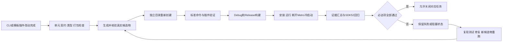
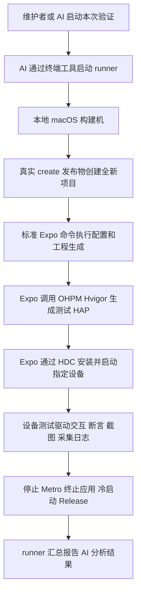

# SDK54 Harmony AI 端到端构建验证设计

日期：2026-10-21。
执行与验收约定更新：2026-10-22。
状态：验证流程设计，尚未实现统一 runner，本文不代表已执行或已通过。
关联：[新架构完成路线](2026-10-21-sdk54-architecture-completion-design.md)、[平台与插件清单](2026-10-21-sdk54-platform-coverage-inventory.md)。

## 1. 目标与边界

CLI 开发完成后，已有单元、契约、类型和打包检查仍需通过；再由 AI 使用真实受控发行物，从干净目录实际创建项目，执行标准 Expo 命令、本地 Debug/Release 构建和设备验证。只有代码或单元测试通过不能判定开发完成。

- SDK54 只验证新方案，不执行 expo-harmony-cli，不套用旧 SDK54 patch、shim、迁移或旧工程修复流程。每个模板/包管理器组合重新创建。
- expo-harmony-cli 仅服务 SDK52；删除 SDK54 旧代码时，单独验证 SDK52 原有识别、创建和运行，保留其共享能力，不改造 SDK52。
- Expo Go、EAS Build、EAS 托管服务、expo-updates 和 expo-dev-client 不在本轮验证范围，包括本地更新与失败恢复、自定义开发客户端及相关 API、插件。分别关联覆盖清单中的暂缓范围 ID；普通 Debug 应用连接 Metro、本地 Hvigor 构建、签名接入、设备运行和 Release 内嵌资源仍必达。
- AI 执行和分析实际工具输出；截图、日志、产物、API 行为断言共同构成证据，不能由 AI 描述或人工推测替代。
- 本次只定义方案，不运行长时间原生构建，也不删除旧代码或旧测试目录。后续按总设计的对应里程碑实施。

## 2. 触发时机与门禁



| 触发点 | 要求 |
| --- | --- |
| M0A | 最小创建/识别/prebuild/run/start 场景；确认无需独立 CLI 和 managed-state；default 尚未具备的模块如实登记未完成 |
| M5 CLI 开发完成 | blank-typescript × npm/pnpm 完整标准命令及 Debug/Release 设备门禁；default 创建/配置等已具备能力同时验证，依赖 M7 的模块缺项保留失败/阻塞及转交记录，不用替换模板通过 |
| M1-M7 中后续相关变更 | 按覆盖清单 ID 重跑受影响的配置、插件、模块或命令用例；声明影响范围，保留未运行项，不借小范围通过宣称全矩阵通过 |
| SDK54 旧代码清理 | SDK54 新工程链路与 SDK52 原有流程回归；检查过渡 CLI 包中不再包含 SDK54 分流和旧内容 |
| M8 | 使用最终受控发行组合完整重跑；default 原样运行，不删除功能或替换 expo-image；只允许本轮明确暂缓项排除 |

阶段尚不要求的用例记 NOT_RUN 并关联后续阶段，不计成功；已实际失败/阻塞的 default 模块依赖保留原状态，记录对应 M7 条目，不反向阻断 M5 已明确的 CLI 必达项，也不允许宣称 default 已通过。CLI 自身缺陷不得转交豁免。到了对应必达阶段，FAIL/BLOCKED/NOT_RUN 任一存在即不能关闭。

## 3. 输入、环境与隔离

执行前生成本次 run 清单：

| 输入 | 必须记录 |
| --- | --- |
| 来源与候选物 | 固定 SDK54 来源 revision、适配 revision、create/模板/CLI/模块真实包名版本、registry 或 tgz、完整性 hash、发布组合 ID |
| 包管理器 | Node、npm、pnpm 版本，registry 配置、锁文件和实际解析依赖树；需要适配的包不得回落到不兼容官方版本 |
| 原生环境 | macOS/DevEco/SDK/Hvigor/OHPM/Java/其他必需工具的路径与版本；首批仅承诺已验证宿主范围 |
| 设备 | 明确选定目标、设备或模拟器类型、系统/API/架构；不自动选择未知设备 |
| 签名 | 已配置的本地开发/测试签名可用性；不把证书私钥、密码或 token 写入报告 |
| 用例 | 本阶段必达场景、覆盖清单 ID、预期结果和判定方法；暂缓项明确引用范围 ID |

消费目录位于仓库、workspace 和源码目录之外，不共享 node_modules，不使用 workspace/link 源码依赖。pnpm 自身 store 链接允许存在，但目标必须是包管理器按已核验发行物安装的内容，不能指向本仓库源码。

可使用 registry 或可复现 tgz。create 及模板的整个依赖图都必须通过真实发行身份解析；不能创建后手改 package.json 来补齐适配依赖。只读本地候选 registry 可以服务真实 tgz，但须确认其元数据、完整性和模板解析与最终发行方式一致，不以源码路径替代包。

### 3.1 在哪台机器运行，AI 如何操作

首批使用维护者已配置的本地 macOS 构建机，安装 DevEco Studio、Harmony SDK、Node、npm/pnpm、OHPM 和 Hvigor，并连接一台明确指定的测试设备或已启动的模拟器。当前会话可作为执行入口，AI 通过终端工具在这台机器上启动命令、读取输出和查看拉取到本地的截图。AI 不靠自然语言直接控制设备，也不要求点击 DevEco 界面完成常规构建。

首次接入由维护者准备工具链、设备调试连接和可用测试签名，设备弹出的授权或受保护凭据仍需人工处理。验证脚本检查这些前提，缺失则记录 BLOCKED；不自动申请证书、修改全局配置或换用其他设备。后续如使用专用构建机，由同一执行入口在该机上运行 runner；远程连接和设备分配另行配置，不假设当前已有远程执行服务。

AI 负责启动验证、查看失败、补充复现测试并修复；runner 是运行在构建机上的 Node.js 调度脚本，负责按固定用例执行命令、管理进程、调用设备驱动、校验结果和生成报告。通过与否由可重复断言和证据决定，不能仅由 AI 看日志后给出主观结论。



### 3.2 runner 与设备驱动如何实现

计划新增 `scripts/sdk54/ai-e2e/`，以下是待实现的文件职责，不代表仓库已有这些脚本：

- `run.mjs`：读取本次 manifest，预检环境，建立全新消费目录，调度矩阵和阶段，汇总结果；同一设备的案例串行运行。
- `process.mjs`：以 Node.js `spawn` 的参数数组启动真实命令，记录工作目录、PID、输出和退出码，处理就绪探测、超时及本次进程清理；不拼接未经处理的 shell 文本。
- `device.mjs`：封装指定 HDC 目标的能力探测、日志采集、截图拉取、进程核验、强制停止与重新启动；不导入产品 CLI 的内部 helper 代替公开命令验证。
- `cases/` 与 `device-tests/`：前者定义发布物、配置和产物断言，后者使用设备支持的 Harmony UiTest/Hypium 测试驱动进行页面交互和断言；测试代码及测试 HAP 的来源 revision、hash 同样记录。
- `report.mjs`：将步骤、断言、设备证据及候选物 hash 写入统一报告；按第 5.1 节校验必达集合，支持基于已保存证据独立重算关闭结论；失败返回非零退出码。
- `schemas/` 与用例注册表：校验 manifest、用例定义、结果及证据索引；按阶段契约展开矩阵。文件布局由 V-01 详细设计固定，不能由调用方任意删减必达集合。

runner 从 manifest 获取 create/模板的真实发行身份、候选 registry 或 tgz 清单、工具链绝对路径、目标设备 ID、测试应用标识、阶段、用例以及超时配置；签名只引用本机已配置的安全位置，不把密钥写入 manifest。报告目录在仓库内，消费项目位于仓库外，两者分别记录，不能把源码 workspace 当消费项目。

拟定调用接口如下，**仅为后续实现约定，目前不可直接运行**；manifest 中必须填入实际发布物和设备，不能用占位值通过预检：

```bash
node scripts/sdk54/ai-e2e/run.mjs --manifest /absolute/path/to/run-manifest.json --stage M5
node scripts/sdk54/ai-e2e/run.mjs --manifest /absolute/path/to/run-manifest.json --stage M8
```

开发时可由 AI 直接执行相同的公开命令逐步排查，但统一 runner 与设备断言实现并验收前，不宣称自动化端到端门禁已落地。runner 只编排测试，不提供 Harmony 平台功能，也不成为 SDK54 用户必装的独立 CLI。

### 3.3 从构建到页面，怎样证明端到端

以一个 blank-typescript/npm 案例为例，runner 创建新目录，调用真实 create 工具，再从该消费项目解析本地安装的 Expo 可执行文件运行 install/config/prebuild/export。它核验本地 CLI 身份后启动 Metro 独立进程，等待服务就绪，再运行 Debug 的 `expo run:harmony`，明确传入设备、端口及禁止重复启动 bundler 的参数；参数以候选物 `--help` 为准。持续进程的服务就绪与构建进程的退出分别判定，避免等待 Metro 退出才进入构建。

安装和首次启动必须经过被测 `expo run:harmony`，不能由测试脚本手工调用 Hvigor/HDC 绕过失败。其内部应真实执行 OHPM/Hvigor、选取可安装的签名产物并通过 HDC 安装、启动；runner 保存本次构建目录、HAP hash、安装记录和设备中的应用版本。安装成功之外，还须检查前台 Ability、首屏、交互和设备日志，防止把旧应用或空白页面当作成功。

HDC 是主机与设备之间的通道，设备测试驱动才负责点击、输入、导航和断言。先探测目标系统可用的 UiTest/Hypium、截图及日志接口，再使用已核实的接口；不在总设计中虚构通用的截图或点击命令。驱动优先通过控件标识/文本定位，必要时配合截图与明确的屏幕尺寸；坐标点击和截图本身不能证明功能正确。

default 模板必须保持原样，通过外部设备测试检查其已有页面、图片、导航和关键交互，不能为测试插入桥接代码或替换组件。第三方模块用例使用另行发布的测试模块和测试项目，验证同步返回值、异步结果、事件次数及 view 行为，并将断言结果关联到具体操作。若 RN 页面无法被设备驱动定位，必须补齐可重复的交互与结果断言；只看到进程或截图、没有所需功能证据时保持 BLOCKED，不能判 PASS。

随后 runner 执行真实 Release 构建与安装，核验包内 bundle/资源及实际安装产物。它仅停止本次 Metro 和端口转发，并检查应用配置没有指向另一可用 Metro；然后强制停止测试应用，确认进程退出，再通过 HDC 重新启动，验证相同首屏、图片/字体及关键交互。此处验证的是随 HAP 内嵌的 JS/资源离线运行，不涉及已暂缓的 expo-updates 或 expo-dev-client。Debug 的 Metro 调试与 Release 的断开 Metro 冷启动分别记录，不要求依赖 Metro 的 Debug 包离线启动。

### 3.4 超时、隔离与失败处理

设备必须显式绑定目标 ID 并在 run 内独占，同设备矩阵串行；安装仅作用于专用测试应用，候选模板若共用包名必须顺序验证并记录每次版本/hash。未配置专用设备或应用标识有冲突时阻塞，不覆盖业务应用。SDK52 和其他平台回归使用独立项目与独立证据。

各步骤配置安装、构建、Metro 就绪和页面等待超时；超时先保存部分日志和设备状态，再结束本次子进程。无设备、签名不可用或测试驱动缺失记 BLOCKED；产品命令、构建或行为断言失败记 FAIL。诊断后可以重试，但不得覆盖原失败记录或用重试成功隐去不稳定行为。

结束和异常退出都清理本次 Metro、端口转发、设备测试进程及临时文件，不执行全局 kill、不重置设备、不删除其他项目。每个阶段完成即落盘证据，AI 会话被中断后保留已记录结果，未完成步骤不得补记 PASS；改动候选物后重新创建受影响项目运行。

### 3.5 AI、runner 与验收校验器的责任

| 角色 | 必须负责 | 输出 |
| --- | --- | --- |
| AI | 将阶段任务展开成执行卡，核实接口，运行工具，分析失败，先补复现再修复，填写限制与下一步 | 详细计划、复现测试、本轮报告及关闭建议 |
| runner | 根据已锁定的定义实际执行公开命令和设备交互，采集原始日志、断言值、产物身份及各次尝试 | manifest、case-set、results、证据索引和原始文件 |
| 验收校验器 | 从阶段契约核对必达集合，验证结果、证据及候选一致性，独立计算是否允许关闭 | 结构化关闭结论、原因及进程退出码 |

设备结果必须来自驱动实际观察并写入的断言，不能以 AI 填写 `tabs: true`、截图描述或命令退出码直接获得 PASS。截图是辅助证据；所需 UI 无法定位或观测时，按实际情况记录 BLOCKED，产品行为断言不符合预期记 FAIL。用例定义缺必需断言属于验证设施未完成，也不能通过。

借鉴旧 `verify-cli-acceptance.mjs` 的字段完整性、子报告关联和 hash 校验机制，以及 `test-release-install.mjs` 的真实安装/重装与依赖树检查。新流程不能继承旧校验器中固定 pnpm、精确旧版本、图片替换、旧 CLI TGZ 等专属条件；设备字段完整性校验也不能代替执行设备测试。README 发布中的历史设备证据沿用策略不适用于 M8。

## 4. AI 执行步骤

### V0：检查与候选物准备

1. 读取当前任务设计、受影响包和测试命令；根 test/type-check 只覆盖产品 CLI，不能据此跳过适配包检查。
2. 执行相关单元、契约、类型及包内容检查，保存原始日志。失败先建立能复现的用例再修复。
3. 从同一适配 revision 构建候选物、核对必需文件、类型/JS 新鲜度、版本和 hash；记录 create 与模板的真实发布方式。
4. 检查设备、签名、工具链和网络依赖。缺失时标 BLOCKED，列明阻塞阶段；不伪造运行证据，不将设备步骤降级为文本检查后判通过。

### V1：四个全新消费项目

矩阵为 default/npm、default/pnpm、blank-typescript/npm、blank-typescript/pnpm。每次 run 使用新的目录；同一案例内的配置修改、重复 prebuild、移除/重装属于要验证的生命周期，可以在该案例内进行。

AI 先核对实际 create --help 和模板身份，再调用真实适配 create 工具。`@expo-oh/create-expo-app` 目前只是总设计中的发行示例，不能假定已发布；无真实工具发布物即阻塞该项。包管理器选项必须来自真实接口，不预设 `--harmony` 或其他不存在参数。

创建后验证：

- 页面与依赖来自固定模板；保留 default 中 expo-image、Router 等原始功能，不应用替换脚本。
- 未调用 expo-harmony-cli，未注入 patch/shim、补写 alias/overrides 或替换依赖源码/HAR。
- 模板原有发行映射允许存在；标准 install/check/fix/升级可按受控元数据维护映射，但不能成为创建后补救步骤。
- `.expo-harmony/managed-state.json` 缺失或删除后，平台识别、生成和启动仍有效。
- 安装后记录真实解析树与锁文件，确认无指向仓库源码的解析。

### V2：标准命令、配置和插件

AI 在每个消费目录执行真实 CLI 接口。以下是验证序列，具体 export/config 子参数以该候选物 --help 为准，发现未支持即记 FAIL，不改用独立 CLI：

```bash
npx expo install expo-font
npx expo install --check
npx expo config --type public --json
npx expo prebuild --platform harmony
npx expo export --platform harmony
npx expo start --port "$E2E_METRO_PORT"
# start 由 runner 作为独立持续进程运行；就绪后在另一进程执行 run。
# 以下参数须先核对候选物 --help，设备和端口由本次 manifest 提供。
npx expo run:harmony --device "$E2E_DEVICE_ID" --port "$E2E_METRO_PORT" --no-bundler
npx expo run:harmony --device "$E2E_DEVICE_ID" --configuration Release --no-build-cache
```

逐项断言：install 的包身份/版本及 --check/--fix 行为；config 的动态配置和平台输出；export 的 bundle、资源及输出布局；prebuild 的模块注册、权限、URI 和资源。禁止只看退出码。

`start` 是持续进程，AI 需保存进程 ID、端口和日志，等待 Metro 就绪并发出真实 Harmony bundle 请求；在需要的阶段保持运行，结束时只停止本次创建的进程。已存在 Metro 的复用与端口占用作为独立用例验证。

配置/插件用例关联清单 PLG-T01-T07：

- 同一案例改用 app.config.ts，变更名称/版本/图标、scheme、主题和插件参数，检查 config 与实际生成文件一致。
- 重复 prebuild 无实质差异；修改/删除字段、资源、插件后，旧受管内容正确清理。
- 安装真实发行的第三方 Harmony 测试模块及插件，调用同步/异步/事件/view；经 npm/pnpm 移除、重装后检查注册与资源生命周期。不改中央名单。
- 缺插件、非法选项、资源缺失或生成中途失败，检查可定位报错与失败恢复；不能用自动跳过插件掩盖失败。
- 普通 prebuild 保留用户扩展；clean 按 M2 重建声明式扩展或执行已定义备份恢复，不要求保留所有生成目录手改。

### V3：Debug、Release 与设备运行

M5 对 blank-typescript 的两个包管理器项目执行 Debug 和 Release，共四个构建/运行案例；default 完整运行在其 M7 依赖完成后补跑。M8 完整门禁四个消费项目均执行 Debug 和 Release，共八个构建/运行案例。记录构建配置、依赖身份、bundle、HAP 路径/hash、安装和运行目标。

1. Debug 实际构建、安装与启动，检查首屏、模板关键交互、字体/资源、路由、插件对应效果；执行 Fast Refresh 和 reload，收集设备日志/截图或可重复行为断言。
2. Release 使用 `--no-build-cache` 执行真实构建、安装与启动，验证资源随包存在；签名或产物选择失败记 FAIL/BLOCKED，不改用旧 HAP 继续。
3. 停止本次 Metro、移除本次端口转发并确认无其他 Metro 为该应用提供 bundle；终止应用进程后重新启动，验证首屏及离线资源。需要在线业务的案例与离线启动断言分开。
4. 检查 JS/原生崩溃、模块未注册、资源缺失和无限白屏；HDC 主机退出码成功不代表设备成功，须核对设备侧动作和实际运行证据。

构建成功、设备安装成功、进程启动成功、页面及目标功能正常分别记录；后一步证据缺失不得推断通过。不得以 expo export 成功推断其输出已经能被原生 Release 消费；Release 实际加载的 bundle/资源路径另行核验。

### V4：依赖重装、失败恢复与版本隔离

- 删除本案例 node_modules 后按锁文件重装，使用 npm ci 或 pnpm install --frozen-lockfile，再生成/构建，确认未回落到不兼容版本。
- SDK54 升级/回退只在新方案支持组合内测试；失败恢复覆盖配置、锁文件和受管原生变更，不回退旧 patch/legacy。
- 旧 SDK54 分支清理时，先记录 SDK52 实际共享调用图；验证 SDK52 识别、创建、扫描/注入（若其原流程需要）、生成和运行与原行为一致。不要求 SDK52 使用本方案的标准 Expo 新链路。
- 检查 SDK54 旧分类、patch manifest 管理、专属 doctor、命令分流与迁移入口不再被产品 CLI 引用或打包；SDK52 使用的 patch 不能因同名误删。
- 在总设计承诺的 Android/iOS/Web 场景执行代表性回归，记录具体案例和环境，不能只写“无影响”。

### 4.1 最终 E2E 效果与断言

下表定义最低效果，不代替全量能力清单。V-01 锁定通用用例身份；V-02/V-03 及各阶段详细计划补准确选择器、输入值、预期值、等待条件和超时。模板文本/路由由固定模板源码确认，旧模板文字和旧截图不能直接成为新模板基准。设备测试代码及基准数据随用例定义记录 revision/hash。

| 用例族 | 操作与必须观察的效果 | 必需证据 | 阶段及验收映射 |
| --- | --- | --- | --- |
| E2E-CREATE | 四个仓库外干净目录用真实 create 创建；文件来自对应模板、依赖身份正确，无独立 CLI 或创建后补丁；原样模板应用文件与来源一致 | create 命令、模板树比对、锁文件/依赖树、包完整性 | M0A-A01/A04；M8-A01 |
| E2E-COMMAND | 实际执行 install/check/fix、config、prebuild/clean、export、start/run；分别核验包身份、配置快照、生成差异及 bundle/资源，不能只验退出码 | 每条命令日志、配置/生成差异、解析树与资源索引 | M1/M2 相关用例；M5-A01；M8-A02 |
| E2E-BLANK | 原样 blank Debug/Release 均显示固定模板规定的首屏文本和组件，无白屏/错误覆盖层；前台应用身份与本次安装匹配 | 设备身份/前台 Ability、首屏定位断言、截图和运行期日志 | M0A-A02 最小 Debug；M5-A02；M8-A04 |
| E2E-DEFAULT | 原样 default Debug/Release 显示 Home/Explore、模板图片和字体/图标；切换 Tabs 后对应内容出现；打开 Modal、按系统返回后回到原页面，无崩溃或错误覆盖层 | 每步动作/目标/观察值、图片与字体渲染断言、截图和运行期日志 | M7-A02；M8-A03/A04 |
| E2E-OFFLINE | Release 核验包内 bundle/资源；停本次 Metro/转发并确认无其他 bundle 服务，确认应用进程已退出后冷启动；重复首屏、图片/字体及关键导航断言 | 构建/内嵌 bundle hash、HAP/安装关联、停服务与停进程记录、冷启动设备断言 | M5-A03 blank；M8-A04 四项目 |
| E2E-REFRESH | 派生 Debug 案例变更确定文本，Fast Refresh 后出现新值；reload 仍正常；前后台切换恢复页面；删除 managed-state 后标准启动及 Harmony bundle 请求仍成功 | 修改差异、刷新前后断言、Metro 请求、进程及设备日志 | M0A-A03；M5-A04；M8-A06 |
| E2E-CONFIG | 派生项目仅用动态配置与环境变量，变更/删除名称、图标、scheme、权限及插件资源；config、原生与 Constants 一致；重复生成无实质差异 | 配置快照 hash、受管文件差异、Constants 返回值、适用的图标/深链/权限设备断言 | M1/M2、PLG-T01-T07；M8-A02/A05 |
| E2E-EXTENSION | 独立测试项目安装中央清单外的真实模块/插件，同步/异步返回已定值，事件次数和 payload 正确，view 属性/交互生效；移除与重装后注册和资源正确 | 测试包身份、动作与返回值/事件/view 断言、生成差异、设备日志 | M3-A01/A03/A05；M8-A03/A06 |
| E2E-RECOVERY | 注入生成/安装失败和并发，受管文件恢复且用户扩展保留；支持组合 A→B→A 后运行符合契约；锁文件重装后身份与设备行为不回落 | 故障点、前后快照、锁文件/依赖树、重建及设备断言 | M2/M6 相关用例；M8-A05 |
| E2E-COVERAGE | 固定来源的必达 API/属性/插件选项逐项对应实现、测试和发行物；SDK54 旧路径退出，SDK52 与其他平台代表案例实际回归 | 清单/结果双向差异、打包/调用检查、分平台报告 | M7-A01/A04；M8-A07/A08/A09 |

四项目的八个首次 Debug/Release 案例必须分别执行 E2E-BLANK 或 E2E-DEFAULT，四个 Release 案例另执行 E2E-OFFLINE。其余用例按阶段契约展开独立案例；不能只运行以上十个用例族各一次就宣称全矩阵通过。涉及所有包管理器的安装、移除/重装和依赖维护必须覆盖 npm/pnpm。

原样模板案例与派生配置/刷新案例分开建目录和记录，不在原样 default 中加入测试桥接、替换 expo-image 或删除页面。第三方模块、字体格式和其他全量 API 使用专门测试项目验证，模板自带页面不能充当其全部覆盖证据。

图像/字体不能仅断言节点存在：设备详细计划须选定可重复判定方法，例如固定环境下的区域图像基准比较（记录容差）配合资源加载状态。基准来自已核验素材与预期布局，不能从同次待验截图直接生成。白屏、占位图、错误字体必须有能使该断言失败的反例。网络浏览器、权限或媒体用例单独展开，不将需联网业务混入离线启动要求。

## 5. 报告与完成判定

建议证据存储为 `outputs/sdk54/ai-e2e/<run-id>/`，这是后续 runner 的输出约定，不表示当前已有该工具。

| 证据 | 内容 |
| --- | --- |
| run-manifest.json | revision、候选物与 hash、环境、设备、用例范围、清单 ID |
| results.json / summary.md | 每个 case 的 PASS/FAIL/BLOCKED/NOT_RUN、原因、实际结果、证据路径及下一步 |
| commands / logs | 命令参数、工作目录、起止时间、退出码、构建/Metro/设备日志；敏感信息脱敏 |
| artifacts / diffs | 锁文件、解析树、生成配置差异、bundle/HAP hash 与实际安装对应关系 |
| device | 截图或录屏、目标交互、设备侧断言与冷启动证据 |

完成规则：本阶段必达案例全部 PASS，四个矩阵不混用证据；环境阻塞不等于通过；暂缓项单独登记，不混入支持统计。修复后生成新候选物，重新创建受影响案例并保留前次失败证据；变更影响共享底座或最终组合时扩大回归，M8 必须重跑完整矩阵。

AI 最终结论须说明“验证了哪个发布物、哪些案例通过、哪些未执行、是否允许关闭任务”。没有保存可追溯证据就不能据口头结论毕业。

### 5.1 必达集合、结果与关闭算法

以下是 V-01 起待实现的契约，不代表已有 schema 或自动门禁。每轮报告使用 [总计划第 14 节模板](../plans/2026-10-21-sdk54-architecture-completion.md#141-每轮验收报告模板)。

| 载体 | 必须保存的关联 |
| --- | --- |
| 用例注册表与 `case-set.json` | 注册表版本/hash、阶段与任务/验收/能力 ID、适用条件、展开后唯一 case ID、模板/包管理器/构建配置、required、步骤/断言及所需证据类型 |
| `run-manifest.json` | run ID、阶段、case-set hash、候选 manifest hash、各来源与适配源码状态、工具链/设备、消费目录、测试驱动身份及超时；选择局部用例只能用于诊断 |
| `results.json` | case ID、run ID、attempt ID、关联的定义/候选 hash、四态结果、起止时间、步骤命令引用、每个断言的预期/实际值及证据引用；失败原因和后继重跑 ID |
| 证据索引 | run/case/attempt、文件或归档定位、内容 hash、类型、采集时间；构建配置、HAP/hash、安装目标与设备执行记录建立关联，不能仅比较应用版本号 |
| 关闭报告 | 应有/实际/缺失/重复集合、证据及候选校验结果、未完成任务、`canClose` 与原因；由校验器生成，人类可读报告引用该结论 |

关闭算法按下列顺序执行：

1. 从版本化阶段契约和覆盖清单推导必达集合，再展开矩阵；与 run 的 case-set 比较。不能仅对调用方提供的结果逐条计数，也不能允许 manifest 将必达项设为可选。局部运行只能给出其覆盖范围内的结论。
2. 校验 schema、唯一身份与引用完整性；意外用例、未知 ID、缺失必达项或同一 attempt 中重复结果都导致关闭校验失败。缺失结果保留为缺失并在摘要标示 NOT_RUN，不能生成 PASS。
3. 核对候选、适配源码状态、用例定义和测试驱动身份；实际读取/取得证据并校验 hash，验证必需类型及断言值。证据缺失或无法复取时拒绝关闭；仅记录 hash 字符串不够。
4. 构建成功、安装成功、启动成功、首屏和功能断言分别判定。设备安装/启动异常不能被 HDC 主机退出码覆盖；没有行为断言不能从截图推断 PASS。
5. 重试创建独立 attempt，保留首次失败。故障修复需补复现测试并绑定新候选；若属环境/驱动故障，保存诊断与修复证据再重跑。产品失败原因未解决而偶发重试成功不能关闭。
6. 在本阶段必达集合全部 PASS、任务交付和前置报告齐备且证据可复核时，才输出 `canClose: true`。否则非零退出并列明具体缺项；产品 FAIL、实际前提缺失 BLOCKED 与中断后的 NOT_RUN 保持原语义。M8 始终对最终组合完整重跑。

结果 schema 中的空 revision/hash、空证据数组只允许用于明确的未执行记录，不能进入 PASS。V-01 先建立 schema、集合校验与可独立重放的报告校验入口，后续 V-02 至 V-05 增加设备断言及用例覆盖；不能等到 M8 才检查报告完整性。

### 5.2 门禁自身的反例验收

| 注入情况 | 必须观察到的结论 |
| --- | --- |
| 删除一个必达用例或将 required 改为 false | 契约/集合校验失败，指出准确 case ID，拒绝关闭 |
| 同一 attempt 重复结果，或混入别轮/别候选的 PASS | 身份或重复校验失败，不累计为通过数量 |
| 证据丢失、hash 不匹配，或仅填设备布尔值 | 证据/断言校验失败，不能获得 PASS |
| 安装失败但 HDC 返回 0，或设备仍运行旧 HAP | 安装与产物身份检查失败，保留实际步骤日志 |
| UI 显示白屏、占位图或错误字体 | 对应页面/图像/字体断言 FAIL，截图不能掩盖失败 |
| Release 实际连接另一 Metro | 离线断言 FAIL，不能以已停止本次 Metro 判通过 |
| 驱动/设备/签名缺失，或 AI 会话中断 | 实际缺前提的案例 BLOCKED；已执行结果保留，未执行项 NOT_RUN；拒绝关闭 |
| 未修复的产品失败，随后偶发重试成功 | 保留失败及全部尝试，拒绝以最后一次成功直接关闭 |

## 6. 已有资产、实施拆分与限制

当前可复用的输入：

- `scripts/sdk54/prepare-npm-release.mjs`、`verify-npm-release.mjs` 的候选物与完整性检查。
- `scripts/sdk54/test-release-install.mjs` 的真实包安装/依赖树检查思路；它目前读取 apps/cli/dist 内 SDK54 helper，不是新创建工具的完整验收，需解除该依赖。
- `stage-e2e-packages.mjs` 的 tgz staging 思路；固定包数和外部包列表不是全量清单，也不证明新 create/模板可用。
- `verify-cli-acceptance.mjs` 的子报告、缺字段、模板文件保护和候选 hash 校验思路；现有设备布尔字段只证明记录满足旧契约，不证明新设备驱动已执行。
- `blackbox-packed-cli.mjs` 等旧产品 CLI 验证脚本不能作为 SDK54 新方案入口；仅保留可独立复用的安全执行/证据能力，SDK54 旧路径随清理删除。

实施分为三项可验收交付：

1. 独立候选消费与命令记录：接受真实 create/模板/包组合，四个干净目录及依赖身份检查；不用旧产品 CLI 内部源码。
2. 本地构建与设备验证：组合 Debug/Release、Metro 生命周期、安装、冷启动与插件测试；资源和进程清理仅作用于本次 run。
3. 报告与门禁：结构化用例状态、artifact hash 关联、失败后重跑、SDK52 与其他平台回归记录；缺必达证据不能通过。

第 3.2 节约定了待实现的 runner 文件职责和调用入口；实施时需用真实 create、Expo、HDC 和设备测试接口验证这些约定，不能把设计示例写成已有可用工具。当前 `packages/@expo/cli/src/run/harmony/runHarmonyAsync.ts` 及 `src/harmony/` 已有构建、设备和启动原语，但不等于统一端到端验证已完成；签名产物选择、设备交互断言和自动报告仍须按本方案验收。本轮文档检查不代替任何构建或设备执行。

runner 自身验收至少覆盖：多设备误选、设备中断、签名缺失、Metro 端口冲突和迟迟不就绪、构建超时、旧 HAP 残留、安装失败、启动后崩溃、白屏、UI 驱动不可用、Release 偷连 Metro，以及中断后的清理与报告保留。它必须能将这些情况分别报告为 FAIL/BLOCKED，不能仅凭主机命令退出码判通过。
