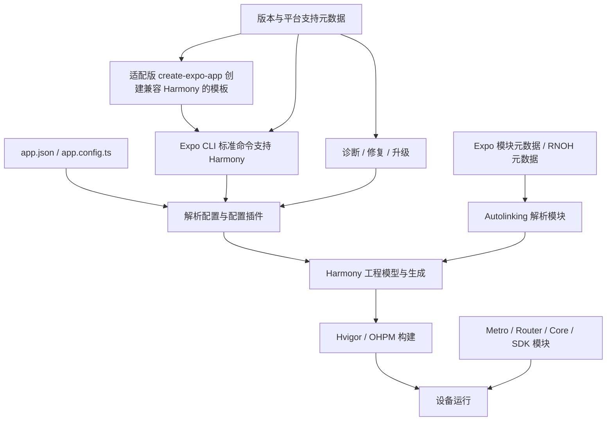
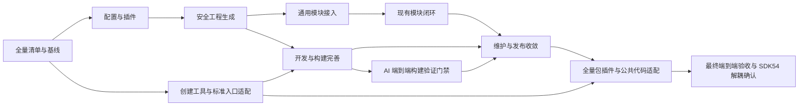

# SDK54 Harmony 新架构完成路线与验收设计

日期：2026-10-20。
修订日期：2026-10-21。修订原因：明确受控发行与全量适配边界；本轮暂缓 Expo Go/EAS、expo-updates 和 expo-dev-client，SDK54 仅保留新方案、SDK52 维持现状，并增加 AI 端到端验证门禁和插件明细。
状态：待用户审阅的总设计；不是已完成报告，也不是逐函数实施计划。
范围：SDK54 Harmony 平台集成、SDK54 全量 Expo 包与内置插件的分批覆盖，以及完整开发与维护闭环。SDK52 保留独立 legacy 边界。
方法：Superpowers 6.2.0 brainstorming；各里程碑再分别形成设计、实施计划和 TDD 变更。

## 1. 最终目标

Harmony 平台能力进入 Expo 自身的创建工具、核心平台层、配置与插件体系、自动链接、模块和标准命令。业务项目通过配置与依赖表达需求，通过 Expo 命令生成、构建、运行和维护原生工程。

最终 SDK54 用户入口为适配版 `create-expo-app` 与 `expo`。创建工具与模板天然兼容 Harmony；`@expo/cli` 原生支持 install、prebuild、run、start、export、config；`@expo/config`、`@expo/config-types`、`@expo/config-plugins`、`@expo/prebuild-config`、Autolinking、Core、Metro、Router 等公共底座均支持 Harmony。固定 SDK54 revision 下的全部 Expo 包、内置 Config Plugin 和公开 API 均纳入评估；本轮范围内的能力完成实现与验收，明确暂缓项单列，不能宣称已完成。

SDK54 只支持新方案，不保留旧 SDK54 patch/legacy 兼容路径，也不依赖 `expo-harmony-cli` 承载平台功能。`@expo-oh`、scoped 包、自建 registry、alias 和 overrides 可以作为适配版本的发行方式长期存在，但不得依赖创建后的注入、源码替换、patch、shim 或独立 CLI 才能启用 Harmony。

这里禁止的“创建后注入”指通过额外工具或后处理补上平台能力。适配版 Expo 标准 install、check/fix 和升级流程可以按受控发行元数据维护依赖、alias、overrides 和锁文件；这些操作不得修改已安装包源码，也不得成为首次启用 Harmony 的补救步骤。

架构完成必须同时满足三个条件：

1. 应用开发闭环：创建、配置、加包、移除包、生成、调试、Release、升级和恢复都有明确行为。
2. 模块开发闭环：开发者按公开契约新增一个模块后，无需修改独立 CLI 或 Autolinking 的包名单即可接入应用。
3. 维护发布闭环：源码、类型、原生实现、发布包、兼容组合和验收证据保持一致，可持续升级。

“模板能跑”“15 包已发布”“构建成功”分别是局部证据，不能替代上述三项。

此外，SDK54 全量 Expo 包与内置配置插件必须全部纳入清单并逐项评估。现有模块是首批交付；不以冻结包数量宣布新架构完成。本轮关闭规则见第 2 节：仅显式暂缓的低优先级能力不阻断本轮验收，不能将缺实现临时改标为暂缓以通过门禁。



这是本项目维护的 Expo 适配源码与受控发行的目标架构，不代表 Expo 官方发行版已经具备相同能力。本项目通过真实发布的适配包、模板和工具链完成验收。向 Expo 上游贡献属于可选维护策略，上游是否合入或发布不影响本项目完成判定。`@expo-oh`、alias 和 overrides 可以作为发行身份存在，但不能承担创建后的架构修补，也不能要求 `expo-harmony-cli` 才能启用 Harmony。

全文术语：

| 术语 | 定义 |
| --- | --- |
| Expo 上游源码 | 用于同步和差异跟踪的 Expo 原始源码 |
| Expo 适配源码 | 本项目加入 Harmony 支持后的 Expo 源码分支 |
| 受控发行 | 本项目发布的 scoped 包、自建 registry 包或可复现 tgz |
| 标准 Expo 命令 | create、install、prebuild、run、start、export、config 的标准行为和参数体系；create 由创建工具承载 |
| 官方发行 | Expo 官方仓库和官方 npm 包，不属于本项目完成条件 |
| 过渡 CLI | expo-harmony-cli，仅服务 SDK52 legacy，不承载 SDK54 创建、运行、诊断或迁移 |
| 暂缓 | 经本轮范围明确排除、仍未交付的低优先级能力；不等于已完成或平台不适用 |

## 2. 已确认范围与完成边界

- 保持 SDK54、React 19.1.1、RN 0.82.1、RNOH 0.82.30 为起始验证组合；升级必须单独形成兼容证据。
- 支持 fresh default、blank-typescript 及其后续日常开发，npm/pnpm 为首批保证范围。
- 现有 14 个 Expo 包和 Screens 衍生包为第一批交付，SDK54 全量 Expo 包及其内置配置插件均进入总路线，按 M4/M7 分批关闭覆盖项，M8 执行最终验收。
- 提供 Harmony 配置扩展点、第三方配置插件契约，以及新增模块的可复制范例。
- SDK54 只支持新方案下的受控发行组合及其更新。删除旧 SDK54 patch 方案的项目识别、补丁管理、专属诊断及命令兼容代码，不提供迁移工具或迁移支持；测试项目统一从真实新方案发行物重新创建。
- SDK52 保留现有项目识别、创建和运行流程，不统一重构、不切换 SDK54 生成器。清理 SDK54 旧代码前检查调用关系，保留 SDK52 仍在使用的扫描、注入、补丁及其他共享能力。
- 应用侧允许正常业务配置、业务 Metro 自定义和用户原生扩展；不要求应用复制 SDK 内部修复。
- 底层兼容构建可保留，必须有明确归属、输入版本、产物身份、回归与退出条件。
- 每个包、插件和全部公开 API 必须有可追溯的评估与范围结论；本轮适用项须有实现和验收证据。“不适用”仅用于 Harmony 确实不存在相应语义的能力，必须提供依据与替代行为；可以实现但尚未实现的能力标为“未完成”，仅本节明确排除项可另记“暂缓”。有限支持不得用于关闭仍可实现的缺项。

**本轮优先完成 SDK54 的标准开发流程。** 包括创建项目、安装模块、配置与生成工程、Metro 调试、本地 Debug/Release 构建、签名接入和设备运行。认证模块仍按对应模块批次逐项评估和适配。

**Expo Go、EAS 云服务、expo-updates 和 expo-dev-client 均暂缓。** 本轮不做应用 JS/资源的在线更新与失败恢复，也不做自定义开发客户端；普通 Debug 应用连接 Metro 的开发调试仍要完成。云构建、云端更新/提交、商店发布自动化同样不做。上述模块及相关 API、插件标为“暂缓”，不阻断本轮验收，不算已完成或平台不适用；以后纳入时另行确定范围。生产证书代管、SDK55+、Swift/Kotlin DSL 语法等价和全部设备覆盖也不在本轮范围。

**SDK52 保持现有方案，SDK54 只支持新方案。** 不提供旧 SDK54 项目的兼容或迁移支持，测试项目统一重新创建；清理旧代码时保留 SDK52 仍在使用的共享能力。

适配以固定的 SDK54 源码版本和功能清单为准，记录 revision 与清单 hash。更新源码版本时重新核对功能差异，不自动跟随 latest。

## 3. 当前完成度：按源码和证据区分

以下为静态核查结论；本轮没有重跑设备验收或完整测试，因此不提供主观完成百分比。

| 层次 | 已有基础 | 剩余缺口或待验证项 | 依据 |
| --- | --- | --- | --- |
| 创建与分发 | 官方模板创建、alias、overrides、运行探针、scoped 状态 | CLI 默认组合与运行时最新组合分开；组合推进和已建项目维护需统一策略 | `apps/cli/src/sdk54/create-release.ts`、`docs/releases/2026-10-10-sdk54-expo-oh-readme-release.md` |
| Expo 命令 | Harmony prebuild、run、start 和安装映射已接入 | 配置插件被跳过；运行模式、故障恢复及已有项目操作矩阵需补验收 | `packages/@expo/cli/src/prebuild/harmony/prebuildHarmonyAsync.ts`、`src/run/harmony/runHarmonyAsync.ts` |
| 配置系统 | Expo 配置读取、Constants 配置输出、名称和包名生成 | prebuild 使用 `skipPlugins: true`；媒体单独读取 app.json；缺少完整 Harmony 配置模型与插件执行约定 | `prebuildHarmonyAsync.ts:59`、`nativeProject.ts:105` |
| 原生工程生成 | 包内模板、HAR 组装、C++/ETS/CMake、生命周期和 overlay 生成 | 增量同步先清空生成区；图标仅首次复制；资源与用户文件归属和失败恢复待完善 | `nativeProject.ts:139` |
| 自动链接 | Expo module config、RNOH autolinking 元数据、多类原生描述、生命周期 | 导航包仍依赖精确版本适配表；通用第三方边界、冲突诊断和增删包闭环需验证 | `harmony.ts`、`rnohConfig.ts` |
| Core | runtime-local 模块、事件、异步、SharedObject/Ref、原生 view 基础接口 | 模块作者契约不完整；文档混有旧验收边界；类型/原生/设备契约需统一 | `ExpoModulesCoreRuntime.h`、`NativeViewManagerAdapter.harmony.tsx`、Core Harmony README |
| 既有业务模块 | 资源、字体、Constants、Linking、Splash、SystemUI、Browser、Router 等 | 静态字体插件未闭环；scheme 系统声明需配置接入；部分 API 尚未支持或未经设备验证 | 各包 README、plugin 源码 |
| 开发运行 | Metro 平台分流、release bundle、设备选择和 HDC 转发 | start 自动识别依赖 managed-state；工具路径/HAP 路径有固定假设；设备命令成功判定需审计 | `start/index.ts`、`harmony/paths.ts`、`build.ts`、`device.ts` |
| 维护与质量 | release catalog、包审计、确定性打包、真实安装、候选与发布 workflow | 根检查不等于全部适配包测试/类型覆盖；跨组合 doctor、升级和当前产物设备证据需收拢 | 根 package.json、`.github/workflows/`、`sdk54/release-runtime.ts` |

特别说明：Core Harmony README 仍写有未实现 Autolinking/CLI 等历史描述，但仓库已有对应实现；必须更新文档，不能照抄旧限制作为现状。仓库已有部分跨包行为测试，不能把根检查未覆盖全部包误写成完全没有测试。

当前仓库没有 `create-expo-app` 源码包，也没有完整同步 `@expo/config`、`@expo/config-types`、`@expo/config-plugins`、`@expo/prebuild-config`。当前根 build/type-check 主要指向产品 CLI。上述事实说明平台终态尚未完成，但不代表所有这些上游包都必须 fork；每项必须检查平台枚举、类型、schema、运行路径及测试后决定适配或原样复用。

## 4. 路线选择

| 方案 | 收益 | 代价与风险 |
| --- | --- | --- |
| A：沿现有新架构补齐契约，分阶段交付（推荐） | 复用已验证 Core/CLI/Autolinking；每阶段有可运行产物；风险可定位 | 必须先明确配置、生成与模块边界，防止继续堆包名特例 |
| B：先堆业务模块，再统一平台契约 | 可较快增加对外模块数量 | 配置和工程生成缺口被各模块重复处理，后期返工大 |
| C：一次重写平台层并追求上游全面等价 | 可统一更多抽象 | 容易同时扩大包 fork、Core DSL、模块和工具链范围，难以验证回归 |

采用 A，将标准创建入口和全量覆盖纳入同一路线分阶段收敛。保留正确的 SDK 内部平台差异；用契约和证据决定哪些特例保留、上移或移除。

## 5. 最终职责边界

| 单元 | 应承担职责 | 不能继续扩散的职责 |
| --- | --- | --- |
| create-expo-app 与模板 | 模板、依赖和项目初始化；标准模板天然兼容 Harmony | 预设新增平台参数；创建后再由独立工具重写源码、注入 Harmony 平台开关 |
| Expo CLI（适配版） | 标准命令编排、配置解析、依赖策略、工具链和设备调度；prebuild/run 生成原生工程 | 业务模块实现、不断增长的模块包名分支 |
| expo-harmony-cli（SDK52 legacy） | 保留 SDK52 自己的项目识别、创建、运行和必要共享能力 | SDK54 创建/运行入口、旧 SDK54 识别和补丁管理、专属诊断、兼容命令或迁移支持 |
| Harmony 配置与插件层 | 声明配置、执行平台 mods、形成可检查工程变更 | 隐式修改用户未授权范围、忽略声明但报成功 |
| Expo Modules Autolinking | 模块发现、元数据校验、原生注册图与链接结果 | 充当所有应用配置和资源转换的总入口 |
| Harmony 工程生成层 | 基础模板、配置应用、生成区写入、归属与恢复 | 覆盖用户文件、从多个配置来源各自推导状态 |
| Modules Core | JS/原生交互、线程、事件、资源、view 与 runtime 生命周期 | 应用身份、业务包版本名单 |
| 适配业务模块 | 自身 Harmony 实现、元数据、插件、类型和支持声明 | 应用 EntryAbility 内复制业务实现 |
| 发布工具 | 上游来源、fork 版本、兼容组合、构建产物与验收关联 | 消费方在安装时临时修补发布包 |

工程生成层可以先作为现有包内的独立内部单元，不以新建 npm 包为目标。

### 5.1 SDK54 与独立 CLI 解耦及旧代码清理验收

解耦验收使用本项目真实发布的 create 工具、Expo 适配包和模板验证；不允许使用 workspace 软链接或直接引用仓库源码代替发布物。发布物可以是 scoped npm 包、自建 registry 包或可复现 tgz。SDK54 不再设置旧项目兼容窗口。

1. 适配版 `create-expo-app` 与模板可直接创建兼容 Harmony 的项目，且两模板、npm/pnpm 通过独立消费项目验收。
2. prebuild/run/start/install/export/config 与必要诊断可从 Expo 工具链执行；不要求独立 CLI 提供运行时开关或状态。
3. 标准模板不需要额外工具在创建后注入 alias/overrides、patch、源码替换或应用侧 shim；正常依赖维护按第 1 节规则执行。默认模板使用的 `expo-image` 等能力进入正式模块实现。
4. 旧 SDK54 项目识别、补丁管理、专属诊断、兼容路由和迁移入口均已删除，测试不再复用旧 SDK54 工程；共享能力按 SDK52 实际调用保留，SDK52 现有流程回归通过。
5. M7 本轮范围清单关闭，M8 从受控发行物完成最终验收并确认解耦；不依赖 Expo 官方发布。

SDK54 的唯一支持路径是新方案，Harmony 能力完全位于 Expo 适配源码、模块和模板中。`expo-harmony-cli` 仅保留 SDK52 legacy，不提供 SDK54 旧项目识别、维护或迁移支持。旧代码清理在 M0/M0A 和 M6 分阶段实施，M8 复核，不等待最终验收才决定是否支持旧方案。

## 6. 里程碑与依赖



### M0：全量清单与固定源码基线

交付：
- 将“模块可链接”“插件可执行”“运行时 API 可用”“设备已验收”分成四项能力，不互相替代。
- 记录现有 release、依赖树、模板输出、生成文件及已验收设备/工具链。
- 建立后续改动实际会触及的 CLI、Autolinking、Core、Metro 和模块测试入口，明确根 CI 覆盖情况。
- 收拢 Core 历史文档与当前代码的差异；历史证据保留原时间和原产物身份。
- 从固定 Expo revision 的 workspace、模板、CLI 命令及插件源码生成完整覆盖清单；不是只读取当前 14 包或 bundledNativeModules。初始核查表见 [覆盖清单](2026-10-21-sdk54-platform-coverage-inventory.md)。
- 显式覆盖 create-expo-app、@expo/cli、@expo/config、@expo/config-types、@expo/config-plugins、@expo/prebuild-config、Autolinking、Core、Metro、Router、Asset、Updates 及全量 SDK54 包/内置插件。
- 建立 SDK54 新方案和 SDK52 现有方案的命令矩阵；unknown、证据冲突和不支持 SDK 在写入前阻断，不保留旧 SDK54 子类型识别与兼容诊断。
- 列出旧 SDK54 代码、内容库、构建/测试脚本及调用关系，按“删除 SDK54 专属 / 保留 SDK52 共享 / 归入适配源码的有效能力”分类，禁止按文件名含 patch 就整目录删除。SDK52 用现有行为建立回归基线，不自动迁移、不共享 SDK54 生成器。

验收：两模板、两包管理器的现有行为有可复跑入口；已知版本检查误报有最小失败测试；全量清单有来源 revision、枚举规则、唯一条目 ID 和缺失项检查。M0 结束后再估算各阶段工作量，不依据文件数量承诺工期。

### M0A：create-expo-app 与模板适配

核心工作：
- 将与 SDK54 模板对应的 create-expo-app 源码版本、来源 revision、构建和发布配置纳入同步与核查；不能因为名称含 Expo 就假定其与 SDK54 有相同版本号。
- 适配版 create-expo-app 创建的标准 Expo 模板天然兼容 Harmony。create 阶段负责模板、依赖和项目初始化；Harmony 原生工程由 `expo prebuild --platform harmony` 或 `expo run:harmony` 生成。
- 核查模板下载、依赖初始化、包管理器参数、安装、完成提示和后续命令。不预设新增 Harmony 平台选择参数；如确有需要，由本阶段详细设计和真实源码接口决定。
- 让适配模板的源文件与依赖声明承载平台能力，创建后无需调用独立工具再次改写。先验证固定 SDK54 default/blank-typescript；default 中的 expo-image 按 M7 真实适配，M8 原样验收。
- 构建受控发行的 create 工具、Expo CLI 和模板，并打通独立安装测试；记录来源仓库、revision、发布身份、hash 和验收证据。
- 确定实际发行方式及创建命令；向上游提交为可选维护策略，不作为阶段交付门槛。
- 建立新的 SDK54 创建入口后，移除 expo-harmony-cli 的 SDK54 创建入口及旧 SDK54 兼容分流；新方案所需的发行元数据和检查能力归属适配版 Expo，不能因为原来位于 apps/cli/src/sdk54 就全部丢弃。保留 SDK52 的创建参数和实际调用能力。
- 初始创建、新装依赖和启动从真实包身份/平台配置识别 Harmony；删除 `.expo-harmony/managed-state.json` 不应使标准路径丢失平台能力。

本阶段包含 CLI 基础平台识别及 blank-typescript 的最小 prebuild/run/start 链路，复用已有适配实现并补齐必要缺口；不以后续 M5 为验收前置。M5 在此基础上完善复杂运行场景。M1-M3 可以并行推进；如创建阶段需使用尚未交付的配置或链接能力，必须先完成对应前置条目，不以临时注入替代。

验收：以真实受控发行物直接创建 blank-typescript 并运行，没有独立 CLI 后处理；default 创建流程纳入本阶段，其完整原样运行依赖 M7 全量适配，并在 M8 验收，不以临时替换关闭该项。不依赖官方合入或发布。

### M1：配置、类型与 Config Plugin 底座

核心工作：
- app.json、app.config.js、app.config.ts 和环境变量解析为单一配置快照，工程与 Constants 消费一致结果。
- 定义 Harmony 字段和优先级，至少覆盖 bundleName、名称、版本、图标、启动资源、scheme、查询 scheme、权限、方向、主题和原生扩展。
- 通用 Expo 配置沿用原语义；Harmony 特有字段经受控扩展及类型声明表达，不把自定义字段假装成上游已支持字段。
- 优先验证复用现有 config-plugins 的 mods/编译接口承载 Harmony；先做最小跨包原型，再决定是否必须扩展 `@expo/config-plugins` 或 `@expo/prebuild-config` 发布集合。
- 上游公共接口足够时，将 Harmony mod provider 放在现有适配包；不足时记录具体接口阻塞，再最小扩展 fork 集合。
- 上述最小原型只验证机制；全量核查必须检查 config-types/schema、平台枚举、config 求值、mod provider、prebuild 内置插件及每个 SDK54 包的内置插件，M7 逐项关闭。
- 固定执行顺序：配置求值、插件注册与校验、模块发现、原生变更计划、提交生成结果。
- 无 Harmony 实现的插件不执行其他平台原生操作；区分平台专属插件与会影响本次 Harmony 功能的缺失插件，给出可定位诊断。

验收：动态配置可替代 app.json；同一配置同时生成正确身份、资源、系统声明和 Constants；独立第三方测试插件能改 Harmony 系统配置，不修改 CLI。该项只证明插件扩展机制，不代表所有内置插件完成。

### M2：安全、可重复的 Harmony 工程生成

核心工作：
- 明确全托管生成区、受管配置字段、用户扩展区。普通 prebuild 保留用户扩展；clean 重建明确声明的生成目录，不保证保留其中的手工修改。持久扩展通过配置/插件或生成目录外源码重建；不可声明的扩展必须按明确的备份、恢复和覆盖冲突策略处理，clean 前提示影响范围。
- 原生生成先在 staging 中完成并校验，再替换受管产物；失败恢复到上次可用状态。
- 事务范围包含受管 JSON5 配置、资源、链接产物、状态清单，避免仅 HAR 目录原子替换但其他文件已经半更新。
- 重复运行使用稳定排序和相对路径；不应产生无意义文本差异或持续变化的内容哈希。
- 图标、启动资源、包名、版本、scheme 和权限在增量 prebuild 后生效，移除配置能移除对应旧受管项。
- 以 JSON5 parser 处理用户可编辑 JSON5；字符串资源只更新明确受管键。
- RNOH/Screens/Worklets 的 SDK 缺陷修复和兼容转换最终在受控发行前完成，记录输入 hash、工具版本和输出身份，保留严格匹配与确定性机制。消费项目只使用已修复发布物，执行正常工程生成、链接和编译；不得在 install/prebuild/run 时再次补丁化已安装源码或 HAR。现有消费端兼容转换须迁入发行流程，在 M8 前退出。
- 卸载沿用 npm/pnpm remove，不新增 expo uninstall；用户移除模块插件配置后，按当前有效依赖图清理无归属受管项。仍被传递依赖引用的模块继续链接，用户资源和共享权限不得按包名粗暴删除。

验收：重复生成无实质差异；改资源可更新；中途故障、并发生成和遗留 staging 有确定处理。普通 prebuild 保留用户原生文件与非受管字段；clean 验证声明式扩展重建、目录外源码保留及已定义的备份恢复行为，不承诺无条件保留生成目录内手改文件。

### M3：通用自动链接与 Modules Core

核心工作：
- 固定 Expo 模块元数据与 RNOH 元数据的优先级、安装逻辑名、实际 npm 身份、OHPM 名和原生符号的对应关系。
- 验证 package/HAR、多 HAR、C++/ETS、生命周期、overlay、重复依赖与传递依赖的处理。
- 对 Package 类、CMake target、OHPM 名、生命周期 key 和 overlay 冲突，在写入前报告来源包和冲突字段。
- 导航兼容表作为有版本边界的适配输入；已有合法元数据优先，未知版本明确诊断，不能误认为纯 JS 后静默跳过。
- 输出模块作者最小契约：同步/异步方法、错误、事件、UI 上下文、销毁及原生 view 接入。
- 复用现有 Core 和 RNOH 桥；为作者提供统一范例与薄辅助 API，避免每包复制桥接代码。不要求复制 Swift/Kotlin 语法，但全部适用的公开契约必须逐项评估和实现，不能以不提供同语法 DSL 为由豁免能力。
- 新增一个发布清单外的测试模块，完成本地安装、自动链接、公开 JS API 调用、卸载和重装。
- 已卸载插件仍留在配置中时，写入前报告插件名及配置来源，并要求修正；不自动执行缺失插件、不静默跳过。

验收：测试模块不进入独立 CLI、导航适配表或 release 包硬编码名单仍可工作；npm/pnpm 都通过；移除后无 HAR、注册代码或生命周期残留。

### M4：首批现有模块闭环

阶段关闭范围：M4 详细设计必须先列出必达能力及测试，至少覆盖下列核心工作；首批包的其余全部公开 API、插件和选项也必须完成核查。依赖后续模块的能力可按条目 ID 显式转入 M7，记录依赖、所属批次和验收条件，状态仍为“未完成”。例如 Router Native Tabs 关联 Screens 原生导航能力及 M7.4；不得将其计入 M4 已支持能力。未明确转出的必达项未完成时，M4 不得关闭。

核心工作：
- Font：补齐声明式字体嵌入与 renderToImage，逐格式评估 TTC 等字体支持；可以实现的缺项不得直接归为不适用。
- Asset：资源声明、Metro 打包、rawfile 路径、缓存及资源移除统一验证；Release 离线访问内嵌资源。
- Splash/SystemUI/StatusBar：声明配置、运行时 API、前后台、主题和生命周期联动；不把平台 no-op 视为功能支持。
- Linking/Router：scheme/querySchemes 进入系统配置；验证冷启动、热启动和 onNewWant、嵌套路由与系统返回。
- Browser：验证会话取消、重复打开、关闭和 runtime 销毁；生产 OAuth 单独声明支持范围。
- Core：将错误、异步完成、事件退订、资源释放、view 卸载、reload 和 runtime 隔离统一为设备契约。
- 每个包更新源码、生成类型、包内文档、测试与发布产物，纠正仍指向临时仓库或不存在证据的链接。

验收：M4 必达项全部完成，有实现、测试及适用设备证据；转入 M7 的条目有完整记录并保持未完成，不阻断 M4 阶段关闭，但阻断全量清单及 M8 关闭。default 两处 Image 替换仅允许作为阶段过渡限制；expo-image 后端在 M7 完成，M8 原样验收，不能据过渡模板宣布全架构完成。

### M5：开发、构建与标准 Expo 命令完善

核心工作：
- 复用 M0A 已交付的基础平台识别，验证已有项目、加包/重装、组合更新和多平台请求下识别一致；managed-state 仅记录来源和操作状态，缺失时不影响 Harmony 能力识别。
- 保持单一 Metro 按请求平台解析 Harmony/iOS/Android，验证用户 Metro resolver 和 serializer 扩展的组合。
- 验证 Fast Refresh、完整 reload、错误展示、Debug/Release 切换、资源清理、已占用端口、已有 Metro 和多设备选择。
- 把宿主系统、DevEco/SDK 路径、构建脚本依赖、设备系统支持范围形成明确工具链契约；发行端兼容修复所用 Python/patch 工具不得成为消费项目启用 Harmony 的必需依赖。
- 构建产物由实际构建配置解析，不仅假定一个 unsigned HAP 路径；支持已有签名配置，缺签名给出可操作诊断。
- 审计 HDC 安装、启动和端口转发结果；不能仅凭主机进程退出码判断设备动作成功。
- 本地自动构建/安装保持现有 run 命令；额外的 Harmony 专用构建命令不作为毕业前提。
- 必须核查标准 `expo export --platform harmony` 的目标路径以及 `expo config` 的 Harmony 配置/类型/插件输出，不以新增 Harmony 专用命令替代。具体参数以对应适配源码实际 CLI 接口为准，验证失败即列为待实现。

验收：首批以已验证 macOS 工具链为基线。Windows/Linux 只有对应实际测试通过后才进入保证范围；不因有路径参数就宣称跨平台完成。实体设备与模拟器分别记录证据。

### V：AI 端到端构建验证门禁

CLI 功能开发完成后，除已有单元、契约和类型测试外，必须由 AI 在独立消费目录实际执行创建、安装、配置、导出、Prebuild、Debug/Release 构建、设备运行和断开 Metro 冷启动验证，并保存日志、产物身份及设备证据。M0A 先跑可用的最小链路；M5 使用 blank-typescript × npm/pnpm 完成标准命令及构建/设备门禁，并验证 default 的创建/配置等已具备能力。default 尚缺 expo-image 等 M7 依赖时保留实际失败/阻塞记录，不计通过、不要求临时替换；这些已关联 M7 的模块阻塞不用于关闭 default，也不反向阻塞 M5 的明确 CLI 必达项。依赖完成后必须补跑，M8 对两模板 × 两包管理器使用最终组合完整复核。CLI 自身缺陷不能借模块转交豁免；后续影响 CLI/模板/插件/发行物的变更重跑受影响场景。

详细方案：[AI 端到端构建验证设计](2026-10-21-sdk54-ai-e2e-validation-design.md)。没有设备、签名或必要环境时记录“阻塞/未验证”，不得仅凭单元测试或构建成功宣布完成；暂缓的 Expo Go/EAS、expo-updates 和 expo-dev-client 不进入该门禁。

执行方式：AI 通过终端在已配置的 macOS 构建机启动 Node.js 验证 runner，由它编排真实创建工具与标准 Expo 命令；构建安装经过被测 CLI，设备交互和取证通过 HDC 及 UiTest/Hypium 驱动完成。具体机器前提、待实现脚本、Debug/Release 链路和失败判定见验证设计第 3.1-3.4 节；统一 runner 和设备断言尚未实现，不能将方案描述当作已通过的证据。

### M6：诊断、升级与受控发行维护

核心工作：
- 源码上游版本、fork 发布版本、release 组合分开表达，运行时清单和创建入口清单通过明确 promotion 操作衔接。
- install、check、fix、自动补装和升级读取同一组合规则；处理包身份、版本区间、peer 和传递依赖。
- SDK54 的诊断归属适配版 Expo 工具链，按新方案受控组合检查；未知组合、混装、缺文件和损坏状态分别报告，不强制所有项目跟随创建工具内置版本。不恢复旧 SDK54 项目分类、专属诊断或迁移建议；SDK52 继续走自己现有诊断流程。
- 提供 scoped 项目显式组合更新流程：先预览计划，再统一更新依赖、overrides、锁文件和状态；安装失败保留诊断并恢复受管变更。
- 保留用户依赖与 overrides；与受管项冲突时报告差异，不一概覆盖。
- 回退仅选择 SDK54 新方案内明确支持的先前发行组合；配置/原生结构不兼容时拒绝自动回退并提供恢复步骤。不回退到 SDK54 patch/legacy 方案。
- 所有变更过的发布内容从当前源码生成，类型与运行入口同步；源码快照中保留 build 的包也必须有新鲜度验证。
- 将平台相关包行为测试、类型检查、打包真实安装和设备验收关联到同一候选物。
- SDK52 legacy CLI 与 SDK54 适配工具链独立维护；平台功能归属 Expo 适配源码，scope、alias 和 overrides 可作为长期发行身份。删除残余旧 SDK54 补丁管理、诊断、命令分流及对应兼容测试/脚本；先按调用关系确认 SDK52 共享能力，再清理。SDK54 新方案的发行和验证工具应解除对过渡 CLI 内部源码的依赖。

验收：SDK54 新方案的支持组合更新后安装/生成/运行一致，旧 patch/legacy 分支与迁移入口不再存在；SDK52 项目识别、创建、运行和所需共享能力回归通过。npm/pnpm 锁文件重装不会将需要适配的包意外解析回不兼容的官方版本。经过核验、无需修改的 Expo 上游包可按兼容清单原样复用，不强制全部改成 scoped 包。生产 registry 写入按独立发布授权执行。

### M7：SDK54 全量 Expo 包、插件与公共代码覆盖

从固定 Expo SDK54 revision 生成完整覆盖清单，并按依赖关系分批完成适配。所有验收使用本项目真实发布的 scoped 包、自建 registry 包或可复现 tgz。Expo 上游源码作为同步与差异跟踪基线，是否向上游提交不属于本阶段完成条件。

| 批次 | 可独立验收的范围 |
| --- | --- |
| M7.1 | create、CLI、配置、类型、Config Plugin 与公共工具 |
| M7.2 | 资源、文件、存储和数据库 |
| M7.3 | 权限、设备和系统服务 |
| M7.4 | 媒体、图像、相机、音视频和原生视图 |
| M7.5 | 本轮开发相关模块；登记暂缓的 Expo Go/EAS、expo-updates 和 expo-dev-client，不要求实现 |
| M7.6 | 平台专属模块及不适用能力评估 |

每批必须独立记录来源及适配源码 revision、准确包清单、实现、测试、设备证据和发布物身份/hash。纯工具条目说明无需设备的依据，仍需真实消费测试。各批基于同一固定 SDK54 来源基线，适配提交可不同；后续批次不得默默覆盖前批证据，最终组合变更须回归。跨批依赖按条目 ID 关联，不能把所有模块塞进一个不可审阅的最终改动。

核心工作：
- 优先闭合默认模板实际依赖，包括 expo-image；模板按其正式源码创建，禁止创建后替换 Image 或删除功能来通过最终验收。
- 每个 Expo 包都列出其内置插件、全部公开 API、平台声明、类型、原生实现/复用方式、依赖和测试。无插件包也需明确记录“无内置插件”的源码依据。
- 全量清单覆盖所有公开函数、类和常量，所有 React 组件及公开属性，所有事件、回调和错误行为，所有权限声明，所有 Config Plugin 及其全部选项，所有平台文件和 JS/TS 平台判断，所有类型声明，所有原生接口、生命周期和资源，以及包的安装、移除、Autolinking 和 Prebuild 行为。允许按功能组归类，但每个公开能力必须追溯到固定源码位置，不得只选关键 API 后宣称全量完成。
- expo-updates 的更新、失败恢复及 expo-dev-client 的本地开发客户端能力均暂缓，其相关 API、插件和专属依赖任务不要求本轮实现或验收；与 Expo Go/EAS 一样登记范围，不计为完成。标准 CLI、Metro、普通 Debug 应用、本地构建和 Release 内嵌资源仍为必达，不能随这两个模块一起排除。
- 能实现但尚未实现的条目保持未完成；Harmony 确实不存在相应语义时才允许不适用，并提供依据、替代行为和复核结论。有限支持不得隐藏可实现的缺项。
- 受控发行可以保留 @expo-oh、alias 和 overrides，由发布物和模板表达依赖身份；禁止以创建后的注入、源码替换、patch 或 shim 修补架构。无需等待上游合入、官方发布或消除 scoped 包名。

验收：M7.1-M7.6 的本轮范围分别关闭；所有条目均有来源、评估和范围归属，本轮适用项不存在缺实现、缺相应测试、缺适用设备证据或缺发布物关联的情况。暂缓项必须引用第 2 节明确范围并保持未交付，不计入已完成数；新增暂缓项必须另行确认。纯工具/类型条目使用消费、构建或类型测试，不强求设备证据；类型、插件选项和公共代码可关联所属包发布物，无需单独发包。不适用项有平台依据、替代行为及复核记录；若对外暴露拒绝、降级或替代行为，还须验证相应行为并关联承载它的发布物，不要求虚构不存在的平台原生实现。上游贡献和官方发行状态只作信息记录，不参与完成判定。

### M8：最终端到端验收与 SDK54 解耦确认

前置条件：M0-M6、V 门禁和 M7.1-M7.6 的本轮范围全部完成，覆盖清单本轮项目关闭，明确暂缓项仍单列。default 模板、expo-image 或其他本轮必达项尚未完成时，不得使用“毕业验收”名称或提前关闭 M8；本轮毕业不表示 Expo Go/EAS、expo-updates 或 expo-dev-client 已支持。

验收逐项包括：

1. 从干净目录安装真实受控发行物。
2. 不使用 workspace 软链接或直接引用仓库源码替代发布物。
3. 创建 SDK54 default 和 blank-typescript 项目。
4. 创建后不运行 expo-harmony-cli。
5. 不进行创建后的源码替换、patch、shim 或额外工具的 alias/overrides 注入；模板和发布物中预先声明的发行身份，以及标准 install/升级按受控元数据维护的依赖映射可以保留。不得在消费项目中修补依赖源码或 HAR。
6. `npx expo install`、`prebuild`、`run:harmony`、`start`、`export`、`config` 全部可用，参数以实际源码接口为准；包括 install --check/--fix、动态配置和第三方 Harmony 插件输出。
7. default 模板原样运行，不替换 expo-image，也不删除模板功能。
8. 安装、调用、通过 npm/pnpm 移除和重装第三方 Harmony 模块，覆盖事件、异步和 view；无需修改中央注册名单。
9. npm/pnpm 均通过，锁文件重装仍使用受控组合。
10. Debug、Release、断开 Metro 后冷启动及内嵌资源访问均通过。
11. 配置修改、重复 Prebuild、clean 重建和失败恢复通过；普通 prebuild 保留用户扩展，clean 按 M2 约定验证扩展重建或备份恢复；升级、回退和锁文件恢复可重复验证。
12. SDK54 完整覆盖清单按 M7 分类规则完成全量评估及本轮范围关闭：本轮适用项无缺实现、缺相应测试或缺发布物关联；需要设备的项目有设备证据，工具/类型项目有对应验证，不适用项有依据和替代行为的复核及必要验证；仅明确暂缓项可未交付，不能漏评或假报完成。
13. Harmony 能力不依赖 `.expo-harmony/managed-state.json` 才能识别；Fast Refresh、reload、后台切换、未完成原生异步任务时 reload 均验证。
14. Android、iOS、Web 的代表性回归通过，原生构建和运行与 JS 打包证据分别记录。
15. 确认 expo-harmony-cli 仅保留 SDK52 legacy，SDK54 创建/运行入口、旧方案识别/补丁管理/专属诊断/兼容分流和迁移入口均已移除；SDK52 共享能力及原有流程回归通过。
16. AI 端到端验证报告关联最终发布物，完整记录 PASS/FAIL/BLOCKED/NOT_RUN；必达用例不得有失败、阻塞或未执行项，不能用旧项目、旧日志或单元测试替代。

验收产物包括代码 revision、create/模板/CLI/模块发布身份、完整性 hash、锁文件、命令、环境、设备、日志、实际结果和明确限制。最终组合与各批证据一致；必要回归针对最终发布物执行。是否上游合入、官方 registry 发布或采用官方包名均不是验收条件。

## 7. 最终用户体验

### 7.1 最终主路径：标准 Expo 入口

以下是本项目适配版 Expo 真实发布物完成后的目标体验，不代表 Expo 官方发行版。下列 scoped 创建工具身份为发行示例，尚不代表已发布；M0A 必须确认真实包名、版本、模板及 registry，并在验收中固定版本，不以未来 latest 自动选中 SDK54 为前提。

```bash
npx @expo-oh/create-expo-app my-app --template default@sdk-54
cd my-app
npx expo install expo-font
npx expo prebuild --platform harmony
npx expo run:harmony
npx expo start
npx expo run:harmony --configuration Release --no-build-cache
npx expo install --check
```

轻量模板和包管理器的具体参数以 M0A 验收后的创建工具接口为准，不预设新增 Harmony 平台选择参数。如果采用自建 registry 或其他包名，使用实际发行身份替换示例；除非 registry 明确保证解析到适配版本，不直接使用默认获取官方包的 `npx create-expo-app`。

### 7.2 SDK52 legacy 与 SDK54 的使用边界

SDK54 仅使用第 7.1 节新方案创建项目，测试工程每轮从真实发行物重新创建，不提供旧 SDK54 项目识别、兼容或迁移支持。`expo-harmony-cli` 仅服务 SDK52 legacy，保留 SDK52 自己的参数、创建、识别及运行行为；不把 SDK52 切换到 SDK54 新方案。代码清理完成前尚存的 SDK54 入口属于待删除实现，不是另一条支持路径。

SDK54 新方案完成后还应支持：
- 配置放在 app.config.ts 中，修改图标、版本、scheme 或插件参数后重新生成即可生效。
- 安装带合法 Harmony 元数据的第三方模块后，按该模块声明完成原生注册和插件处理。
- 删除模块后重新生成，移除对应受管产物，同时保留用户扩展。
- 项目只跟随明确支持的版本组合更新；诊断给出包身份、配置、工具链或设备层面的具体问题。
- JS 业务代码和公开模块 import 保持常规 Expo 使用方式；平台差异在 SDK 包和显式平台文件中实现。

模块作者的目标路径是：按公开范例实现模块与元数据，声明必要配置插件，将包安装进消费项目，再使用相同 prebuild/run 命令完成验证。接入一个模块无需修改创建工具。

SDK 维护者的目标路径是：持续同步 Expo 上游源码、跟踪差异，修改 Expo 适配源码，运行单元和契约测试，生成包含创建工具和模板的候选物，由 AI 真实安装并执行端到端构建/设备验证，运行平台及 SDK52 回归，发布可追溯的同一候选物。向上游贡献为可选维护策略；Expo Go/EAS、expo-updates 和 expo-dev-client 暂缓，SDK54 不恢复过渡 CLI 支持。

## 8. 边缘情况与建议测试

| 分类 | 必须覆盖的边缘情况 |
| --- | --- |
| 配置 | 无 app.json、动态配置覆盖、环境变量差异、空/非法包名、JSON5 注释、资源缺失、重复插件、插件无 Harmony 实现 |
| 生成 | 同输入重跑、图标更新、配置项删除、用户手改、非受管字段、写入失败、中断恢复、并发生成、clean 后扩展恢复策略 |
| 链接 | npm/pnpm、alias 实际包名不同、传递依赖、同名多版本、多 HAR、缺元数据、未知导航版本、符号与生命周期冲突 |
| Core | 同步与异步错误、事件清理、跨 runtime 对象、重复释放、view tag 复用、模块销毁后的原生回调、reload 时未完成工作 |
| 运行 | 端口占用、复用 Metro、无设备、多设备、安装/启动失败、网络断开、Debug/Release 来回切换、签名缺失、工具链路径含空格 |
| 维护 | 合法 semver 范围、误用不兼容官方版本、合法原样复用上游包、新方案内支持组合更新/回退、未知组合、标准升级维护 alias/overrides、部分安装、用户 overrides 冲突、升级失败及锁文件恢复 |
| SDK 隔离与清理 | SDK54 旧代码无入口/导入/构建内容残留、不提供迁移、SDK54 测试重新创建；SDK52 原有识别/创建/运行及共享补丁能力未被误删 |
| AI 端到端 | 真实发布物、新目录、两模板/两包管理器、构建与设备结果分别判定、无设备标阻塞、失败修复后新建项目重跑、证据关联最终 hash |
| 发布 | 缺文件、旧 build/类型、源码与 tgz 不一致、包间版本不同步、仅 workspace 可运行、候选与发布 hash 不一致 |
| 标准入口 | 创建后零源码改写、没有独立 CLI、无需额外工具注入 alias/overrides、消费端不修补源码/HAR、无 managed-state 平台开关、默认 Image 原样可用、config/export 平台识别 |
| 全量覆盖 | 固定 revision 清单遗漏、公开 API/组件属性/插件选项漏扫、版本表含废弃项、平台不适用误分类、有限支持隐藏可实现缺项、分批产物与最终组合不一致 |

修复已确认缺陷时先写失败测试。新行为按里程碑契约先测后实现；设备行为必须在真实构建中验证，不能用文本包含断言替代。

## 9. 实施组织与完成判定

- M0-M8（含 M0A）是总路线，不将全项目塞进一次不可审阅的改动。每个里程碑独立设计、计划、实施和验收。
- 首个项目为 M0 全量清单与 M0A 创建工具来源/入口核查；随后推进 M1 的动态配置、身份/图标、独立插件与 Constants 纵向闭环。单插件/14 包验收仅作为阶段证据。
- M2 应在扩大插件和模块前完成，避免扩大现有生成故障的影响面。
- 版本误报可以作为有复现测试的独立修复穿插，但不替代架构主线。
- 规划中的配置字段名、插件 API 和升级命令在对应详细设计中锁定；本总设计不把尚未实现的命令写成现有能力。
- 本轮只新增规划文档，不提交、不发布、不修改现有业务实现。

最终毕业条件：M0-M8 和 V 门禁均有当前发布物的验收证据；固定 SDK54 revision 的完整包、插件、公共代码和公开 API 清单全部完成范围评估，本轮必达项全部关闭，Expo Go/EAS、expo-updates 和 expo-dev-client 等明确暂缓项单列且不计作完成；适配版 create-expo-app 与 Expo 标准命令能够从真实受控发行物运行；SDK54 只支持新方案，不依赖 expo-harmony-cli、创建后源码注入或应用侧补丁，不保留旧 SDK54 识别、补丁、诊断、命令兼容或迁移支持；SDK52 保留原有方案及所需共享能力；AI 已完成真实端到端构建与设备验证；模块作者无需修改中央注册名单即可接入，维护者可持续同步上游并交付可追溯的适配发行。官方合入/发布及上述暂缓能力不属于本轮完成条件。

## 10. 历史依据

- `docs/designs/2026-09-24-sdk54-mvp-migration-design.md`
- `docs/plans/2026-09-24-sdk54-mvp-migration.md`
- `docs/designs/2026-09-28-sdk54-cli-patch-productization-design.md`
- `docs/plans/2026-09-28-sdk54-cli-patch-productization.md`
- `docs/plans/2026-10-09-sdk54-expo-oh-npm-release.md`
- `docs/releases/2026-10-10-sdk54-expo-oh-readme-release.md`

历史阶段排除项在本轮纳入时已逐项明确，例如配置插件、持续增量生成和 scoped 组合升级；仍未纳入的能力保持独立边界。

## 11. 本轮评审问题处理

| 截图编号 | 核查结论 | 修订与理由 |
| --- | --- | --- |
| 1 独立 CLI 仍是最终入口 | 成立：原文把过渡入口写在最终主路径 | 第 1/7 节改为适配版标准创建入口；M8 使用真实受控发行物验收，不依赖官方发行 |
| 2 排除全部 Expo 模块 | 成立：原文最终边界过窄 | SDK54 全量包和内置插件纳入 M0/M7，M8 最终验收；现有 14 包仅是首批；云服务与平台模块分别评估 |
| 3 独立 CLI 长期固化 | 成立：原文没有明确版本边界 | 第 5.1 节明确 SDK54 只支持新方案，旧方案代码清理且不迁移；expo-harmony-cli 仅保留 SDK52 legacy 及其所需共享能力 |
| 4 缺少创建工具源码适配 | 成立：仓库当前只有调用，没有对应源码路线 | M0A 纳入来源、模板、构建和受控发行，不预设新增平台参数；真实创建工具发布物验收 |
| 5 发布策略固化 fork/alias | 部分成立：fork、scope、alias 和 overrides 可以作为长期发行身份，但不能成为应用侧补丁机制，也不能要求独立 CLI 才能启用 Harmony | 将官方发布从完成门槛中移除；以真实受控发行物验收；保留 @expo-oh 等发行方式，同时禁止创建后的注入和架构修补 |
| 6 全量核心/插件没有清单 | 成立：单个测试插件和现有包不能证明全量覆盖 | 新增覆盖清单，定义枚举来源、逐项状态、证据和关闭规则；未获取完整上游源码前不宣称枚举完整 |

本轮反思：此前将本项目架构完成与官方发行绑定，超出了项目可控范围。后续评审先分别核对能力归属、发行身份、全量范围和验收证据，明确外部上游贡献不参与完成判定；阶段交付不能代替最终目标，合法发行身份也不能被误判为必须消除的架构缺陷。

自查修订记录：基础平台识别归 M0A，M5 复用并完善；M4 必达项与转入 M7 的未完成项分开；关闭证据按适用性及条目类别判断；标准依赖维护与额外注入分开；兼容修复前移至受控发行；允许核验后的上游包原样复用；普通 prebuild 与 clean 分别定义扩展保护行为。后续修订同时核对依赖图、阶段关闭条件、全量关闭条件及其引用清单，避免只改局部措辞留下冲突。

本次范围调整：SDK54 旧项目兼容和迁移支持全部取消，过渡 CLI 仅保留 SDK52；此前关于支持窗口的约定由本次版本边界替代。Expo Go/EAS、expo-updates 和 expo-dev-client 均暂缓，不再与本轮毕业条件绑定；CLI 增加 AI 实际构建/设备验证。后续更新同步检查范围清单、阶段门禁和最终验收，避免旧承诺残留或将暂缓项误报为完成。
