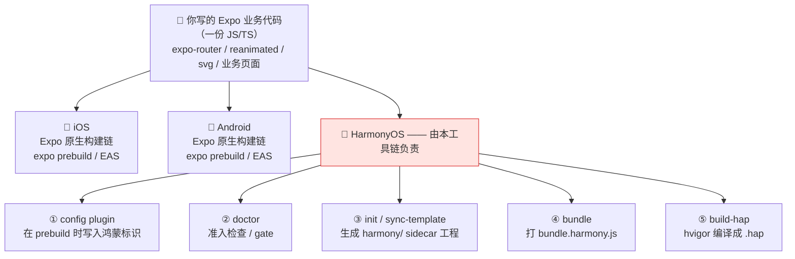

# Expo-Harmony-Toolkit：Expo「一码三端」构建鸿蒙的实现剖析

> 面向团队的技术介绍：这个工具如何让一份 Expo 业务代码，在鸿蒙 HarmonyOS 上跑起来并编出可安装的 App。
>
> 仓库：https://github.com/BlackishGreen33/Expo-Harmony-Toolkit （当前版本 v1.11.x，基线 React Native 0.82.1 / RNOH 0.82.29 / Expo SDK 55）

---

## TL;DR

- 它**不是一个新的跨端框架**，而是一条围绕 **RNOH（React Native OpenHarmony）**、把 Expo 项目接到鸿蒙上的**受管迁移 + 构建工具链**。
- 它本身**不负责三端**，只负责**第三端——鸿蒙**。iOS / Android 继续走 Expo 原生构建链，鸿蒙端由它补齐。
- 核心做法：复用同一份 JS 业务代码，用 **Metro 三重平台分流**打出 `bundle.harmony.js`，由 **RNOH runtime** 在鸿蒙的 ArkUI 里加载渲染，最后用 **hvigor** 编译成 HAP 安装包。
- 构建链是一条严格流水线：`doctor → init → bundle → build-hap`。

---

## 1. 它解决什么问题

Expo / React Native 原生只面向 iOS 和 Android。鸿蒙不是官方目标平台，要把一份 RN 代码跑在鸿蒙上，需要：

1. 一个能在鸿蒙上执行 RN JS、并用鸿蒙 UI（ArkUI）渲染的 **runtime** —— 这就是 **RNOH（`@rnoh/react-native-openharmony`）**。
2. 一套把 Expo 项目的 JS 代码**打包成鸿蒙可加载格式**、把 RN 生态的**原生模块链接进鸿蒙工程**、最后**编译成 HAP** 的工具链。

Expo-Harmony-Toolkit（以下简称 **EHT**）做的就是第 2 件事——它在 RNOH 之上，提供了一条针对 Expo Managed / CNG 项目的、受管（managed）的迁移与构建链路。

> 名词约定：
> - **RNOH** = React Native OpenHarmony，鸿蒙上的 RN 运行时。
> - **HAP** = Harmony Ability Package，鸿蒙的安装包（类比 Android 的 APK）。
> - **hvigor** = 鸿蒙官方构建工具（类比 Android 的 Gradle）。
> - **DevEco Studio** = 鸿蒙官方 IDE（类比 Android Studio）。

---

## 2. 一图看懂整体架构



**关键认知**：iOS / Android 这条线 EHT 完全不碰，由 Expo 自己负责。EHT 的全部价值都在最右边那条鸿蒙线。

---

## 3. 构建链路总览

鸿蒙端的构建是一条流水线，每一步都有明确的职责：

| 步骤 | 命令 | 职责 |
|---|---|---|
| 准入 | `expo-harmony doctor [--strict]` | 扫描 Expo 配置与依赖，对照支持矩阵判断项目能否迁移，作为正式 gate |
| 初始化 | `expo-harmony init` | 生成 `harmony/` sidecar 工程 + autolinking 产物 + metadata + npm scripts |
| 同步 | `expo-harmony sync-template` | 重新应用受管模板，检测漂移（drift） |
| 环境 | `expo-harmony env` | 检查 DevEco / hvigor / hdc / 签名 是否就绪 |
| 打包 | `expo-harmony bundle` | 用 Metro 打出 `bundle.harmony.js` |
| 出包 | `expo-harmony build-hap --mode debug\|release` | 调 hvigor 编译 HAP |


---

## 4. 核心：一份 JS 怎么变成鸿蒙能跑的 bundle

这是「一码」复用的关键。鸿蒙端要复用同一份 Expo 源码，难点在于：很多库没有鸿蒙原生实现，但 JS 侧又必然 `import` 它们。EHT 用 **Metro 解析器的三重分流机制**解决（见 `src/core/template/metro.ts`，运行时会生成项目根的 `metro.harmony.config.js`）。

### 4.1 平台扩展名分流

Metro resolver 注册了一组新的源码扩展名：

```
harmony.ts / harmony.tsx / harmony.js / harmony.jsx
```

它的作用和 RN 原生的 `.ios.tsx` / `.android.tsx` 完全一样——你可以为某个组件写 `Button.harmony.tsx`，鸿蒙构建时会优先选中它。**一份入口、多份平台实现，在源码层面分流。**

### 4.2 Shim 别名注入

对于鸿蒙没有原生实现、但 JS 必然引用的包（如 `expo-modules-core`、`react-native-safe-area-context`，以及 preview 阶段的 `expo-camera` / `expo-location` / `expo-image-picker` / `expo-file-system`），EHT 在 `.expo-harmony/shims/` 下放了鸿蒙特制实现，并通过 Metro 的 `extraNodeModules` + 别名，把这些 `import` **重定向**到 shim：

```js
const expoHarmonyShims = {
  'expo-modules-core': path.resolve(__dirname, '.expo-harmony/shims/expo-modules-core'),
  'react-native-safe-area-context': path.resolve(__dirname, '.expo-harmony/shims/...'),
  // ...preview 能力的 shim
};
```

### 4.3 RN 兼容回退（最巧妙的一处）

当某段代码来自 `@react-native-oh` 或 `react-native` 自身、且用相对路径引用别的模块时，resolver 会按下面的顺序找第一个存在的平台实现文件：

```
harmony → native → android → ios
```

含义是：**鸿蒙没有实现的，自动回退到 Android / iOS 的现有实现文件**，最大化复用已有平台代码，而不必为鸿蒙从零写一份。

### 4.4 打包命令

底层 Metro 配置由 RNOH 官方提供：

```js
const { createHarmonyMetroConfig } = require('@react-native-oh/react-native-harmony/metro.config');
```

打包时调用的不是标准的 `react-native bundle`，而是 **RNOH 提供的 `bundle-harmony` 子命令**（见 `src/core/build.ts`）：

```
node react-native/cli.js bundle-harmony \
  --reset-cache --dev false \
  --entry-file <入口> \
  --bundle-output bundle.harmony.js \
  --assets-dest <资源目录> \
  --config metro.harmony.config.js
```

产物固定输出到：

```
harmony/entry/src/main/resources/rawfile/bundle.harmony.js
```

即作为**鸿蒙资源**被打进 HAP，运行时由鸿蒙侧从资源里读取。

---

## 5. 鸿蒙侧：谁在跑这份 JS（RNOH）

打包好的 `bundle.harmony.js` 需要一个 runtime 来执行。鸿蒙不是 RN 官方平台，这个 runtime 就是 **RNOH**。EHT 生成的鸿蒙工程模板（见 `templates/harmony/`）只是把 RNOH 正确装配起来：

**入口 Ability**（`EntryAbility.ets`）继承 RNOH 的 `RNAbility`：

```ts
import { RNAbility } from '@rnoh/react-native-openharmony';

export default class EntryAbility extends RNAbility {
  override getPagePath() { return 'pages/Index'; }
  override getRNOHWorkerScriptUrl() { return 'entry/ets/workers/RNOHWorker.ets'; }
}
```

**渲染页面**（`pages/Index.ets`）用鸿蒙的 ArkUI 组件 `RNApp` 挂载 RN 视图，并指定 JS bundle 的来源：

```ts
RNApp({
  rnInstanceConfig: {
    name: '<app-slug>',
    createRNPackages: getRNOHPackages,
    enableDebugger: ...,
  },
  appKey: '<app-slug>',
  jsBundleProvider: this.rnohCoreContext?.isDebugModeEnabled
    ? new AnyJSBundleProvider([
        new MetroJSBundleProvider(),                              // debug：连 Metro dev server 热更新
        new ResourceJSBundleProvider(resMgr, 'bundle.harmony.js') // debug：兜底用打包产物
      ])
    : new ResourceJSBundleProvider(resMgr, 'bundle.harmony.js')   // release：只用打包产物
})
```

**一句话**：在鸿蒙的 ArkUI 树里嵌入一个 RN 视图，由那份 JS bundle 驱动它渲染。这就是「一份 RN 代码跑在鸿蒙」的物理实现。debug 模式还支持连 Metro dev server 做热更新。

---

## 6. 原生模块怎么链接（autolinking）

RN 生态里 `react-native-svg`、`react-native-reanimated` 这类库都带原生代码，鸿蒙侧需要把它们对应的**鸿蒙原生实现**（HAR 包，命名形如 `@react-native-oh-tpl/*`）链接进工程。EHT 的 autolinking（见 `src/core/autolinking.ts`）流程是：

1. 调用 RNOH 官方 CLI 的 `link-harmony` 命令，在临时目录生成 **4 个受管文件**：

   | 产物 | 作用 |
   |---|---|
   | `RNOHPackagesFactory.ets` | ArkTS 侧的 RN 包注册工厂 |
   | `RNOHPackagesFactory.h` | C++ 侧的包注册 |
   | `autolinking.cmake` | CMake 链接配置 |
   | `oh-package.json5` | 鸿蒙依赖清单 |

2. EHT 再对生成产物做**正则后处理（normalize）**，修补 RNOH codegen 的已知不兼容问题（如 gesture-handler、screens 的类名差异），并注入额外的受管条目。

3. 把这 4 个文件写回项目的 `harmony/` 工程。

这套机制等价于 RN 里的 autolinking，只是产物换成了鸿蒙的 ArkTS / C++ / CMake，而非 Java / ObjC。

---

## 7. 怎么接进 Expo（config plugin）

EHT 提供一个 Expo config plugin（入口 `app.plugin.js` → `src/plugin.ts` 的 `withExpoHarmony`）。它的设计很克制——**不生成任何原生鸿蒙代码**，只在 `expo prebuild` 时做两件事：

1. 把鸿蒙标识（`bundleName`、`entryModuleName`、schemes、plugins 清单）写入 `.expo-harmony/prebuild-metadata.json`；
2. 把这些标识挂到 `config.extra.expoHarmony`。

目的是让后续 CLI 命令读到的鸿蒙标识和 Expo 配置保持一致，**不破坏 Expo 自己对 iOS/Android 的处理**。在 `app.json` 里这样启用：

```json
{
  "expo": {
    "android": { "package": "com.example.app" },
    "plugins": [
      "expo-router",
      ["expo-harmony-toolkit", { "entryModuleName": "entry" }]
    ]
  }
}
```

---

## 8. 怎么编出 HAP（hvigor）

最后一步（`src/core/build.ts` 的 `buildHapProject`）调用鸿蒙官方构建工具 hvigor：

```
hvigor assembleHap --no-daemon \
  -p product=default \
  -p buildMode=debug   # 或 release
```

- `buildMode` 决定 debug / release；
- **release 构建额外要求签名**：需要 `.expo-harmony/signing.local.json` 里配置好签名信息，构建前会把它合并进 `build-profile.json5`；
- 构建前还会对本地 HAR 依赖做规范化、对 RNOH codegen 产物打补丁，绕开已知的鸿蒙侧构建坑；
- 产物是 `.hap` 文件，可用 hdc 安装到鸿蒙设备 / 模拟器。

---

## 9. 支持边界：三层支持矩阵

EHT 对外不承诺「什么都能跑」，而是用三层模型明确边界（见 `doctor` 报告与 `docs/support-matrix.md`）：

| 层级 | 含义 | 当前范围 |
|---|---|---|
| **verified** | 完整验收、正式承诺 | 唯一矩阵 `expo55-rnoh082-ui-stack`：expo-router / expo-linking / expo-constants / reanimated / svg |
| **preview** | 已接入但仅部分子 API 可信 | expo-file-system / expo-image-picker / expo-location / expo-camera |
| **experimental** | 仍在试验 | expo-notifications / react-native-gesture-handler |

配套有 capability 遥测字段：`runtimeMode`（是否已进 verified runtime path）、`evidence` / `evidenceSource`（证据及其来源，区分自动验收 vs 人工）、`coverageProfile`、`nextActions`。这让 `doctor` 不仅能说「行/不行」，还能说清「差在哪、下一步该补什么」。

---

## 10. 总结

### 一句话本质

> Expo/RN 的「一码」不动；iOS、Android 继续走 Expo 原生链路；鸿蒙端用「**Metro 平台分流**（harmony 扩展名 + shim + RN 兼容回退）」把同一份 JS 打成 `bundle.harmony.js`，再由 **RNOH runtime** 在 ArkUI 里加载渲染，最后 **hvigor** 编成 HAP。

### 技术分层回顾

| 层 | 解决的问题 | 关键技术 |
|---|---|---|
| JS 复用层 | 一份代码三端用 | Metro 三重分流 + `bundle-harmony` |
| 原生桥接层 | RN 原生模块进鸿蒙 | autolinking → ArkTS / C++ / CMake 产物 |
| 构建链层 | 出可安装的鸿蒙包 | doctor 准入 → init → bundle → hvigor build-hap |
| Expo 接入层 | 不破坏 Expo 原生流程 | 克制的 config plugin（只写元数据） |

### 两个必须知道的边界

1. **重度依赖 RNOH**。鸿蒙端的运行时能力上限 = RNOH 的实现进度。EHT 的三层支持矩阵，本质就是在追踪 RNOH 对各 RN 库的支持程度。脱离 RNOH，这条链路无法独立工作。
2. **输入范围受限**。目前只面向 Managed / CNG 类型的 Expo 项目，bare workflow 不在承诺范围；多矩阵并行支持也尚未提供。

---

## 附：关键源码索引（供深入阅读）

| 关注点 | 源码位置 |
|---|---|
| config plugin | `app.plugin.js` → `src/plugin.ts`（`withExpoHarmony`） |
| Metro 三重分流 | `src/core/template/metro.ts`（`renderMetroConfig`） |
| 打包 / 编 HAP 主流程 | `src/core/build.ts`（`bundleProject` / `buildHapProject`） |
| autolinking | `src/core/autolinking.ts`（`generateAutolinkingArtifacts`） |
| 鸿蒙工程模板 | `templates/harmony/`（EntryAbility.ets / Index.ets 等） |
| 支持矩阵 | `src/data/validatedMatrices.ts`、`src/data/capabilities.ts` |
| 准入检查 | `src/commands/doctor.ts` |
